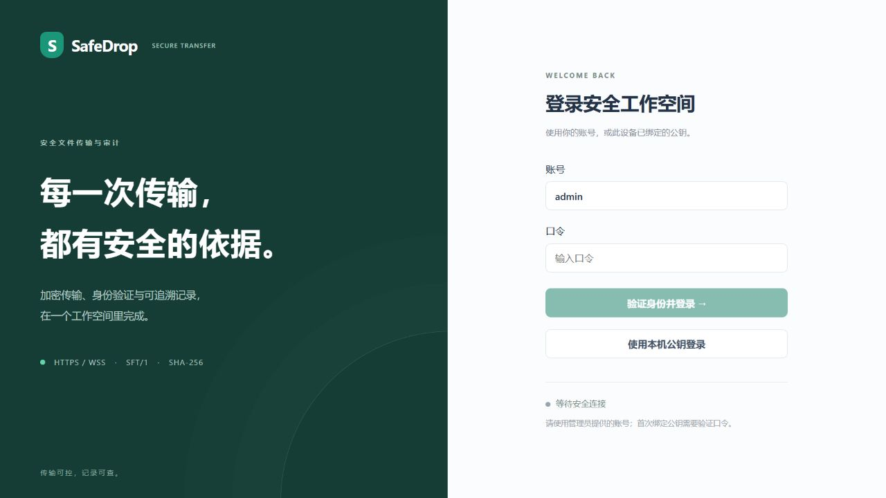

# SafeDrop

安全文件传输与审计平台。

SafeDrop 将加密传输、身份验证、断点续传和可校验操作记录放在同一个工作空间。采用 Vue 3、TypeScript、Node.js 和 SQLite，支持本地运行及 Docker Compose 部署。



## 功能

- **安全通道**：HTTPS/WSS，严格校验证书，持续连接与心跳检测。
- **可恢复传输**：二进制分块、完整文件 SHA-256 校验、上传与下载续传。
- **受控交付**：发送给已注册账号、只读接收与续传、撤销授权、源文件及账号失效联动、双方可见交付审计。
- **文件管理**：所有者重命名及永久删除，服务端统计已用、预留与可用配额，清理失败保留占用并允许重试。
- **多任务处理**：同时上传和下载多个文件，独立进度与暂停控制。
- **账号策略**：默认邀请注册、限时单次邀请、关闭自助注册、修改口令和管理员停用。
- **身份与权限**：口令及 P-256 公钥认证、用户文件隔离、会话查看与撤销。
- **管理员双因素**：口令加 TOTP、持久化重放与尝试保护、一次性恢复码及受限重新绑定。
- **资源控制**：按账号汇总的带宽限制、消息大小与并发上限、文件存储配额。
- **存储维护**：全局上传预算与磁盘余量保护、过期任务安全清理、一致备份、审计链段归档及隔离恢复。
- **可验证记录**：安全事件时间线、审计哈希链、独立检查点及离线校验工具。
- **安全验证**：独立运行 TLS/WSS 集成测试，生成 HTML 与 JSON 报告。

## 本地运行

需要 Node.js 24.14+（24.x）、npm 和 OpenSSL。

```sh
npm ci
npm run setup
npm run build
npm start
```

入口为 `https://localhost:8443`。初始化生成的账号资料位于 `.local/accounts.json`，本地 CA 公共证书位于 `.local/tls/ca.crt`。请核对并信任本地 CA 后连接；不要关闭证书验证。

账号资料、私钥和运行数据均不纳入源码仓库。

## 文档

- [运行与部署](docs/运行与验收.md)：启动、账号初始化、文件传输、Docker Compose 与公网 HTTPS 配置。
- [协议与安全设计](docs/协议与安全设计.md)：报文格式、认证、续传、限速、审计和信任边界。
- [验证记录](docs/验证记录.md)：已完成的容器检查、原始报告摘要及验证范围。
- [安全验证矩阵](docs/安全验证矩阵.md)：威胁、机制、测试和证据对应关系，以及尚未验证的边界。
- [存储维护与恢复](docs/存储维护与恢复.md)：资源阈值、过期清理、敏感备份、独立检查点及隔离恢复命令。
- [管理员双因素认证](docs/管理员双因素认证.md)：启用、登录、受限恢复、独立密钥备份和维护命令。
- [安全自动化](docs/安全自动化.md)：构建与回归、依赖/镜像漏洞及凭据检查、限时风险例外和证据边界。
- [浏览器验收清单](docs/浏览器验收清单.md)：公钥登录、多任务传输和原生文件恢复的操作步骤。
- [开发路线图](docs/开发路线图.md)：20 项任务的当前状态、执行顺序，以及指定用户发送和公网展示的范围。

## 验证

```sh
npm test
npm run security:report
```

报告输出到 `reports/latest.html` 和 `reports/latest.json`。测试使用独立的临时账号与数据，生产界面只读取报告，不提供远程触发测试的接口。

管理员导出的审计日志可以对照独立保存的检查点校验：

```sh
npm run audit:verify -- audit.json checkpoint.json
```

## 部署

本地部署使用 `compose.yaml`，公网部署使用 `compose.public.yaml`。公网入口由 Caddy 管理 Let's Encrypt 证书，应用服务仅位于容器内部网络。完整前提和验证状态见运行文档。

Windows 下可在已启动 Docker Desktop 的普通 PowerShell 中运行独立容器验收：

```powershell
.\scripts\verify-container.ps1
```

工具使用单独的 `safedrop-check` 项目、数据卷及 `18443` 本机端口，检查容器权限、升级前后原数据保留、账号注册与撤销、文件管理与配额、账号间受控交付、HTTPS/WSS 传输、重启后的文件与续传位置，并输出 `reports/container-latest.json`。工具不会修改系统证书信任；凭据只存放在忽略提交的 `.local/container-check/` 中。

当前版本为 0.1.0，邀请、改密、停用、文件管理、配额及账号间受控交付最小流程已完成。15 项自动检查与 82 个安全场景通过；版本 5 独立 Linux 容器验收保留 295 条原有记录，验证 HTTPS/WSS、权限与网络隔离、交付及重启恢复，含单条 HSTS 策略；对应模块的 Edge B01～B25 验收按各轮记录通过，详情见验证记录。公开部署前还需完善账号恢复、必要的全局存储与维护保障，以及真实公网证书和访问验证。安全验证结果仅覆盖列出的场景，不等同于全面安全审计。
