# SFT/1 协议与安全设计

版本：存储与维护最小版，2026-11-17。工程位置：`shared/protocol.ts`、`server/app.ts`、`server/store.ts`、`server/storage.ts`、`server/backup.ts`、`web/client.ts`。

## 1. 目标、信任与边界

保护文件内容、账号身份、访问权限、可用性与操作记录。客户端与网络对端可以恶意；任意客户端字段都不作为授权依据。信任部署宿主机、标准密码库、初始化账号流程、用户核对安装的本地 CA 或公网证书链，以及用户独立保存的审计检查点。

实际实现的控制包括：TLS 服务器认证、P-256 一次性挑战认证、带盐 scrypt 口令散列、SQLite 参数化查询、逐消息授权、随机物理文件标识、任务所有权、全文件 SHA-256、持久化确认偏移、协议大小检查、有界请求队列、按用户聚合限速、会话撤销、哈希链审计。

上传内容不自动执行、解压或渲染；文件内容通过二进制 WSS 数据返回，前端文件名由 Vue 文本转义。当前没有病毒扫描、端到端加密或静态数据加密功能，不应在报告中写成已实现。

## 2. 分层与报文头

浏览器 ↔ TLS ↔ WebSocket ↔ SFT/1。TLS 保护通道，WebSocket 提供双向长连接和消息边界，SFT/1 规定业务语义。容器模式的 TLS 终止位置见运行说明。

一个 WebSocket 二进制消息只携带一个 SFT/1 报文。所有多字节整数为大端：

```text
 0                  8                 16                 24                32 bits
 +-----------------------------------------------------------------------+
 |                         Magic = 0x53465431                             |
 +-----------------+-----------------+-----------------------------------+
 | Version = 1     | Type = 1/2      | Flags = 0                         |
 +-----------------+-----------------+-----------------------------------+
 |                         Request ID                                    |
 +-----------------------------------------------------------------------+
 |                         Stream ID                                     |
 +-----------------------------------------------------------------------+
 |                         Metadata Length                               |
 +-----------------------------------------------------------------------+
 |                         Payload Length                                |
 +-----------------------------------------------------------------------+
 | UTF-8 JSON Metadata ... | Binary Payload ...                           |
 +-----------------------------------------------------------------------+
```

固定头 24 字节。type=1 为请求，type=2 为响应。requestId 关联请求和响应；streamId 为保留的连接内流标识，首版客户端使用 0，并通过 JSON 中的持久化 transferId/fileId 区分传输任务。并发实现为多个异步任务交错发送有界文件块，不声称已有独立优先级流调度。

JSON 元数据上限 16 KiB，载荷上限 256 KiB。总长度必须严格等于 24 + metadataLength + payloadLength。非法魔数、版本、标志、类型、JSON、长度会导致连接关闭。文件列表分页，避免控制消息超过上限。二进制文件不经 Base64 编码；签名这种短控制字段使用 Base64。

请求示例：`{"op":"upload.chunk","transferId":"服务器生成的 UUID","offset":262144}`，载荷为本块字节。成功响应包含 `ok:true`；业务失败响应为 `{"ok":false,"code":"错误码"}`。文件内容不依赖 TCP 断连确定边界。

## 3. 建连、保活与状态

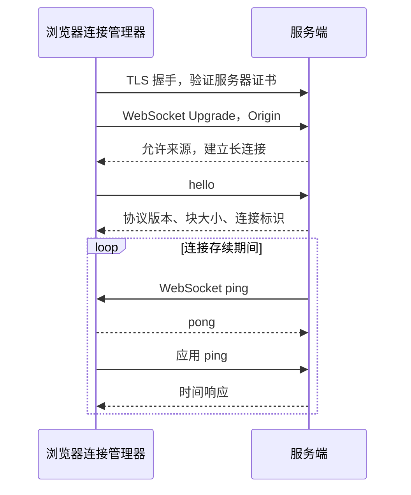

服务端显式调用 socket.setKeepAlive，20 秒 WebSocket 心跳。30 秒内未认证的连接关闭；客户端应用心跳为 15 秒。文件完成后连接仍保留。异常断线可退避重连；身份需要重新建立，已撤销会话不会自动恢复。会话默认一小时，最多每用户 8 个有效会话。服务器启动时将旧会话失效，避免把上次进程的连接身份延续到新连接。

## 4. 口令认证与公钥绑定

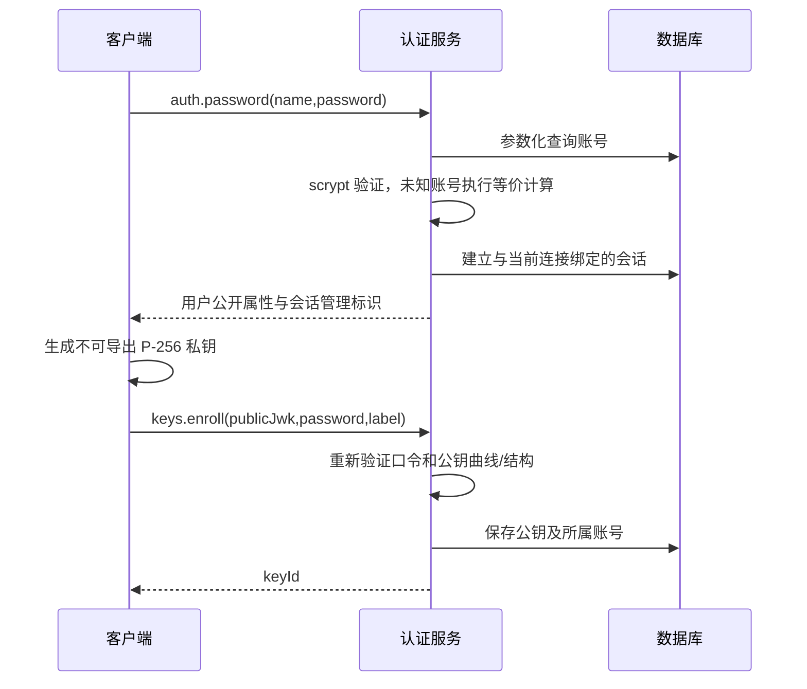

口令散列使用每账号随机盐、scrypt N=32768、r=8、p=1、32 字节结果；比较使用 timingSafeEqual。输入长度、每 IP 登录频率及全局并发散列次数均受限制。服务端不接收私钥。公钥登录不等于 mTLS，也不证明存在防钓鱼硬件认证器。

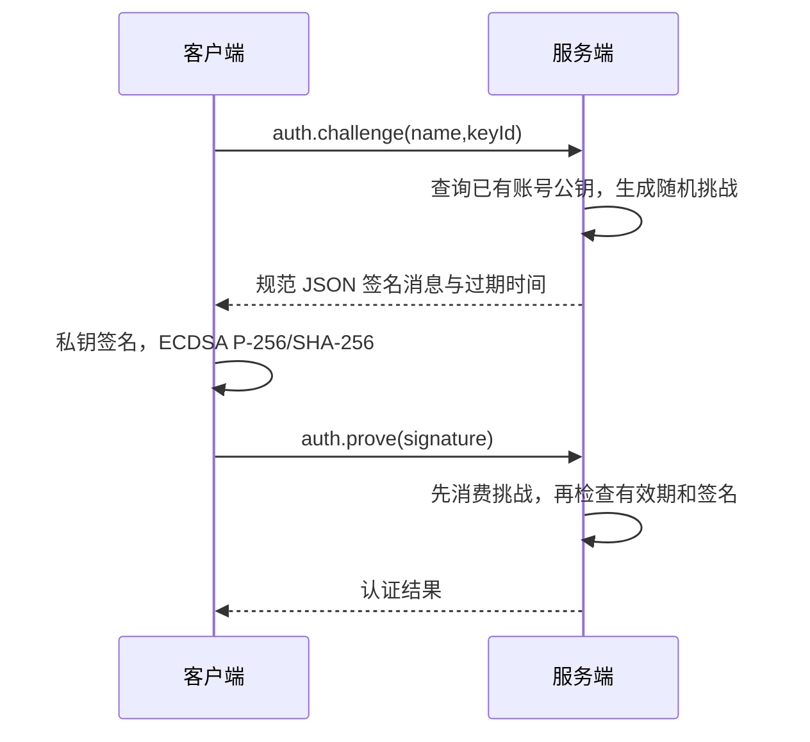

签名消息为固定顺序 JSON 数组，含协议用途、连接标识、账号、公钥标识、32 字节随机值、到期时间。有效期 30 秒，签名采用 IEEE-P1363 格式，防止客户端和服务端编码不一致。挑战绑定连接且只允许一次证明尝试；撤销的公钥不能完成尚未使用的挑战。

### 4.1 邀请注册与封闭部署

默认策略为 `invitation`；管理员可切换为 `closed`，不提供开放注册模式。策略保存在 SQLite，重启不改变。`hello` 返回当前注册策略，只作为界面提示；领取邀请时服务端再次检查。关闭后拒绝新邀请生成及所有自助注册，不影响已有可用账号登录；重新开启时，尚未到期、未撤销、未使用的邀请仍然有效。

邀请由管理员生成，使用 `randomBytes(32)` 的 256 位随机值，编码为带 `sd1_` 前缀的 Base64url 令牌。有效期为 1～168 个整数小时，界面默认 24 小时；最多同时保留 100 个有效待领取邀请，每个管理员每分钟最多生成 10 个。数据库只保存令牌的 SHA-256 摘要及邀请标识、创建者、期限、撤销与领取状态。高熵随机令牌不采用用户口令的低熵输入模型；没有保存可恢复的令牌正文。完整令牌仅在生成响应中返回一次，不放入 URL、浏览器持久化存储、邀请列表或审计日志。管理员应通过可信渠道交给受邀者，忘记后撤销并重建。

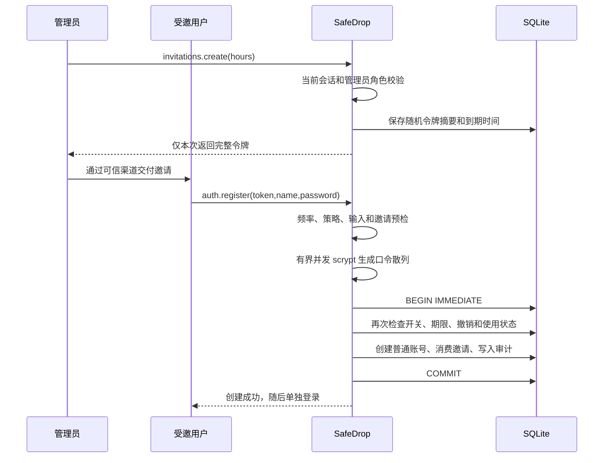

账号为 3～32 位 ASCII 字母、数字、下划线或短横线，沿用现有大小写区分规则；口令为 12～256 个字符。注册请求不能设置管理员角色或 VIP 档位。两个连接并发领取同一邀请，只有一个事务能成功；到期、撤销、重放均返回 `INVITATION_INVALID`。重名返回 `ACCOUNT_UNAVAILABLE` 并回滚整笔事务，不消费邀请。异步计算后才到期、撤销或关闭注册也必须拒绝。

每 IP 每分钟最多 6 次注册尝试，全进程每分钟最多 30 次；注册、口令登录、修改口令和公钥重新认证共用最多 4 个并发 scrypt 工作。无效输入与失败尝试也消耗注册额度，换连接不能绕过。频率计数位于当前进程内存，重启会重置；代理部署按当前网关地址合并限制，不能宣称已经有真实客户端 IP 分布式限流。

新增操作：

| 操作 | 调用身份 | 关键字段与语义 |
| --- | --- | --- |
| `auth.register` | 未认证 | `token,name,password`；不自动建立会话 |
| `registration.set` | 管理员 | `mode` 仅允许 `invitation` / `closed` |
| `invitations.create` | 管理员 | `hours`；仅生成响应返回 `token` |
| `invitations.list` | 管理员 | `offset`；每页 12 条，不返回令牌或摘要 |
| `invitations.revoke` | 管理员 | `invitationId`；立即阻止领取 |
| `account.password` | 当前用户 | `password,newPassword`；只修改自己 |
| `users.list` | 管理员 | `offset`；每页 12 条，仅公开账号状态与角色 |
| `users.disable` | 管理员 | `userId`；停用身份，保留业务数据 |

每条管理操作在服务端重新读取当前账号和会话，不以界面是否显示按钮作为授权。管理员能管理账号及审计，但文件列表、元数据、上传任务和下载仍受原所有权检查约束。

### 4.2 修改口令与账号停用

修改口令必须验证当前口令，拒绝原样重复及不符合长度要求的新口令。成功事务更新口令散列和 `authVersion`，撤销该账号的全部会话（包括当前会话），删除全部服务端公钥绑定，并记录脱敏审计。旧设备私钥无法远程擦除，但已不再具备登录能力；当前浏览器清理本账号保存的公钥引用，其他设备如需公钥登录须重新绑定。文件、上传任务和确认偏移不删除，重新登录后可以按原规则续传。

管理员停用账号时，在同一事务中设置 `disabled=1`、递增 `authVersion`、撤销全部会话并删除公钥绑定。事务内检查至少保留一个 `disabled=0` 的管理员；两名管理员交错停用不能使可用数量归零。有其他可用管理员时允许停用自己；最后一名可用管理员收到 `LAST_ADMIN`。本版不提供重新启用、管理员重置用户口令或角色提升入口，也不向管理员提供用户的口令散列。

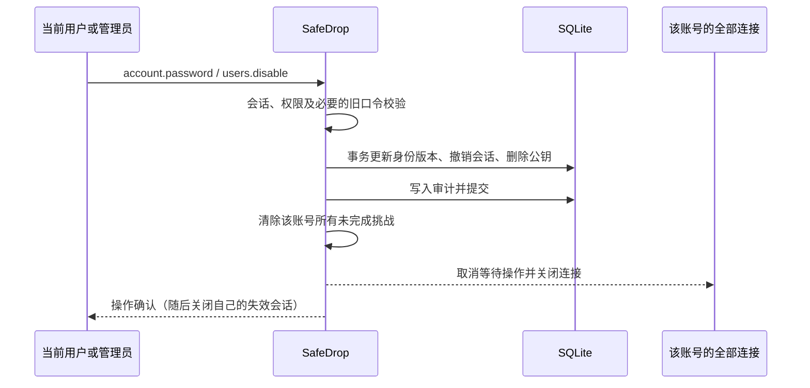

停用后口令登录、公钥挑战、已有挑战证明及已有会话全部被拒绝。口令登录在异步 scrypt 后复查停用状态和身份版本，不能用旧快照补建会话；绑定公钥和修改口令在异步重新认证后同样复查。账号撤销立即触发连接的 AbortController，打断带宽等待；上传打开文件后、写入循环和持久化确认前，下载读出后、完成上传发布前均复查身份。停用或改密不收回已发送、已落盘或正在由操作系统完成的 I/O 字节，也不保证中止已经开始的密码学计算；这些计算结束后不得提交新的身份或业务确认。服务关闭会等待已取消的请求收尾后再关闭 SQLite。

### 4.3 兼容现有数据的升级

SQLite `user_version` 从 0 增量迁移至 1。一个事务为 `users` 增加 `disabled`、`authVersion`（均默认 0），新增 `invitations`、`settings` 和邀请索引。原账号标识、名称、口令散列、角色、档位、文件、上传任务、确认偏移、公钥及审计事件保持不变；对象目录和暂存目录不清理。只在实际改密或停用时删除相应账号公钥。重复启动不重复执行迁移，未知更高版本拒绝继续启动。旧会话仍按既有规则在服务启动时撤销。

`scripts/data-snapshot.mjs` 仅输出旧表记录的 SHA-256 指纹。版本 3 容器验证在已有应用运行时先取快照，更新容器后核对每条原记录仍存在且内容相同，允许追加审计；会话的 `revoked` 字段排除于指纹，因为进程重启必须使旧会话失效。旧账号的新增字段按默认 0 归一化。它检查数据库记录的保留，不替代磁盘备份或所有对象内容的逐文件验证；文件内容及续传另由传输与迁移用例检查。

## 5. 文件列表、上传与续传

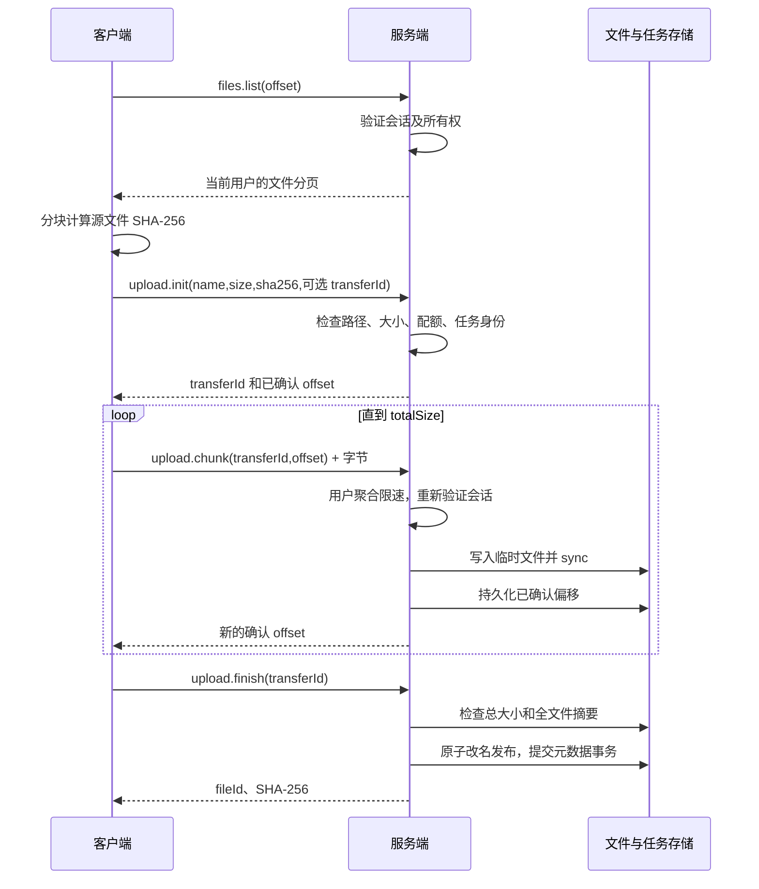

确认偏移是数据库中记录的可恢复位置，不是客户端自报位置。文件 sync 在偏移更新之前；若进程中断留下超出已确认位置的数据，重传从已确认位置覆盖。相同块的重传需比对已确认字节，内容不同则拒绝，不重复追加。每个上传任务有互斥锁，避免两个连接同时写相同偏移。

断线或服务器重启后重新认证，再调用 upload.init 携带任务标识。文件名、大小、摘要必须与原任务一致。上传使用预留大小计入配额，防止多个并发任务合计超额。完成请求重复发送会返回原文件结果。发布改名成功而元数据事务未完成的进程崩溃窗口，通过再次 finish 时查找最终对象恢复。

取消模块为 `upload.cancel`：核验所有权并持久化清理意图，确认暂存及可能遗留的最终对象删除后，再移除任务记录、记录完成审计并释放预留空间；失败保留预留并允许重试。详见 5.1。

### 5.1 文件管理、删除意图与失败恢复

| 操作 | 字段 | 授权与结果 |
| --- | --- | --- |
| `storage.usage` | 无 | 只返回当前账号的 `limit,used,reserved,available,fileCount,transferCount,overQuota` |
| `files.rename` | `fileId,name` | 仅所有者；只更新显示名称，返回更新后的公开文件属性 |
| `files.delete` | `fileId` | 仅所有者；持久化删除意图、停止下载、清理磁盘、提交元数据后才成功 |
| `upload.cancel` | `transferId` | 仅所有者；共用上传互斥锁，确认暂存与遗留对象均已清理后释放预留 |

普通用户与管理员均不能凭已知标识修改或删除其他用户的文件，也不能查询其他账号的配额；管理员角色不扩大文件操作权限。文件修改及取消上传合计每账号每分钟最多 60 次，跨连接共享。重命名和上传共用最多 180 字符的文件名验证，拒绝空白名、路径分隔符、控制字符、冒号及 `.` / `..`，通过参数化 SQL 写入并由 Vue 文本转义展示。允许同名文件，文件身份始终由服务器标识区分。

重命名不移动、复制或覆盖磁盘对象，不改变 fileId、所有权、大小、SHA-256、创建时间或配额。已经开始的下载以及使用同一 fileId 和正确前缀的续传继续有效。浏览器保存过的本地文件不会自动改名；服务端显示名与本地文件名可不同。

SQLite 从版本 1 增量迁移到版本 2，只新增 `deletions(id,kind,userId,created)` 表，原账号、邀请、开关、文件、任务、公钥和审计行不改写。从版本 0 更新时按顺序执行账号与删除意图两次增量迁移。`files.list`、`transfers.list` 根据该表附加 `deleting` 状态，原表与内容路径保持兼容。

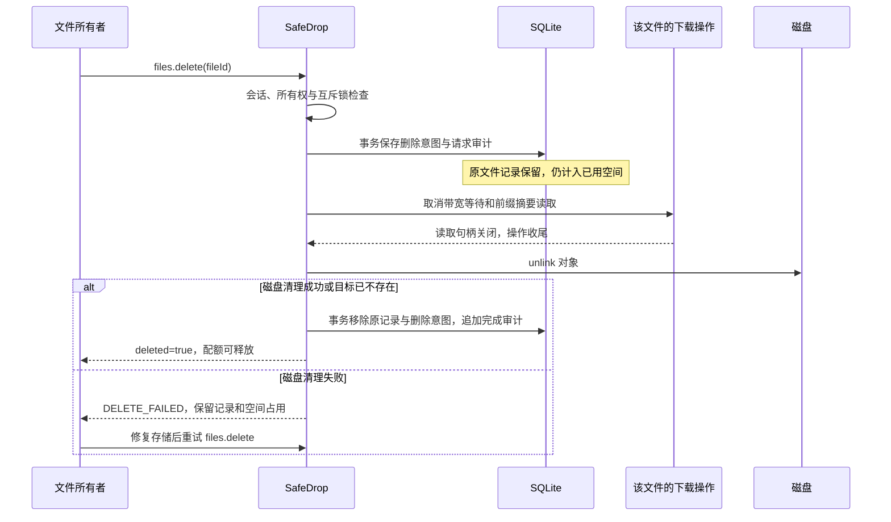

删除意图写入后，新下载、续传及重命名立即拒绝，失败时也不会重新开放内容。服务端按 fileId 记录进行中的下载操作，取消其带宽等待和前缀哈希，等应用持有的读取句柄关闭后再删磁盘对象；下载每个异步阶段及实际发送响应前重新检查文件状态。删除无法收回已经发送或保存的内容。

磁盘失败返回 `DELETE_FAILED`，界面显示“删除待重试”，并保留原记录、已用空间和删除意图。取消上传时显示“取消待重试”，保留整个文件大小的预留；不能因只清理了一部分路径而释放空间。`upload.cancel` 同时检查 `staging` 和 `objects`，覆盖上传发布改名成功、元数据事务尚未提交时的崩溃窗口。正在初始化暂存、写入或发布的任务由同一互斥锁保护，竞争取消返回 `TRANSFER_BUSY`，暂停后可重试。

删除请求一旦保存为持久化意图，已授权的清理会继续收尾，即使请求者断线或会话失效；这不允许新的文件读取或修改。进程中断、磁盘清理后元数据事务失败时，原行和占用仍保留。重启不自动清理，原账号手动重试；已接受的清理中 `ENOENT` 可视作目标已无内容，元数据事务成功后才释放占用。成功后重复删除返回 `NOT_FOUND`，不会再次扣减或影响其他文件。磁盘实际损坏、外部进程干预和永久写入故障仍需部署维护者处理。

暂存创建失败返回 `UPLOAD_PREPARE_FAILED`，保留任务和预留，标记为待取消清理，避免在不确定是否有遗留内容时直接丢弃记录。分块写入失败不推进确认偏移、不释放预留；排除存储故障后可从原确认偏移覆盖重试。已删除文件的客户端下载任务停止，不再提供恢复按钮；本地已有文件仍由用户控制。

### 5.2 账号配额统计

`used` 为已完成文件大小之和，包含删除待重试的文件；`reserved` 为所有未完成上传的完整声明大小之和，包含已写入部分与取消待重试任务。完成上传在同一事务中将预留转换为已用，二者不重复计费。`available=max(0,limit-used-reserved)`；若部署配额低于已有占用，`overQuota=true`，仍允许下载、重命名、删除与取消，但拒绝新的超额上传。

默认每账号 1 GiB、单文件最多 512 MiB、未完成上传最多 16 个；新建上传要求已完成文件与未完成上传合计不超过 1000 个，初始化时即占用最终文件数量预算，避免新接受的任务完成后突破上限；旧版本已接受的任务不在迁移中截断。配额检查与创建任务在第一个异步磁盘操作之前同步执行，同一进程的多连接不能超额预留。当前部署为单应用进程，不声称提供多副本事务调度。

界面从 `storage.usage` 读取三类空间及总配额、文件/任务数量，不以当前筛选结果或仅已加载列表推算。统计代表账号逻辑配额，不是宿主机磁盘剩余容量。全局预算和维护另由第 08 项机制控制，见下一节。

### 5.3 全局预算、安全清理与一致备份

SQLite 版本 4 只新增上传活动时间表，旧任务按原创建时间回退，不改写原表记录。全局预算汇总所有者文件和完整上传预留；交付不复制内容。物理余量同时覆盖最低保留与未写入的全部预留，创建前同步检查、分块等待后复查，失败不推进确认偏移。

新增 `maintenance.status`、`maintenance.cleanup`、`maintenance.backup` 均需管理员鉴权。状态只提供汇总值及备份编号，不提供其他用户内容。清理确认字段须为“清理过期上传”，每批最多 16 个，逐项复查活动时间与互斥锁；后台清理默认关闭，只有显式配置才启用。失败沿用持久化意图和占用保留规则。

备份设置应用屏障，拒绝新业务并等待在途请求收尾，再生成数据库快照、复制对象和暂存、导出原审计链段并校验清单。失败副本不标为完成，仍计入备份预算。恢复只写不存在的新目录，故障标记阻止从不完整目录启动，不自动替换业务卷。

审计记录具有逻辑容量上限和操作预算，拒绝日志也有余量保护；不自动截断或重建历史。登录、公钥及会话变更与审计使用事务，写入失败不会留下半提交身份状态。备份归档保留完整链；外部宿主机工具可定期保存检查点，目标必须脱离应用写权限。本地同一 OS 账号的不同目录不自动构成独立保管。

配置、命令、恢复演练和首版限制见[存储维护与恢复](存储维护与恢复.md)。这些机制按单应用进程实现，不声称覆盖多副本调度、任意规模 DoS 或所有硬件故障。

## 6. 下载、磁盘检查点与并发限速

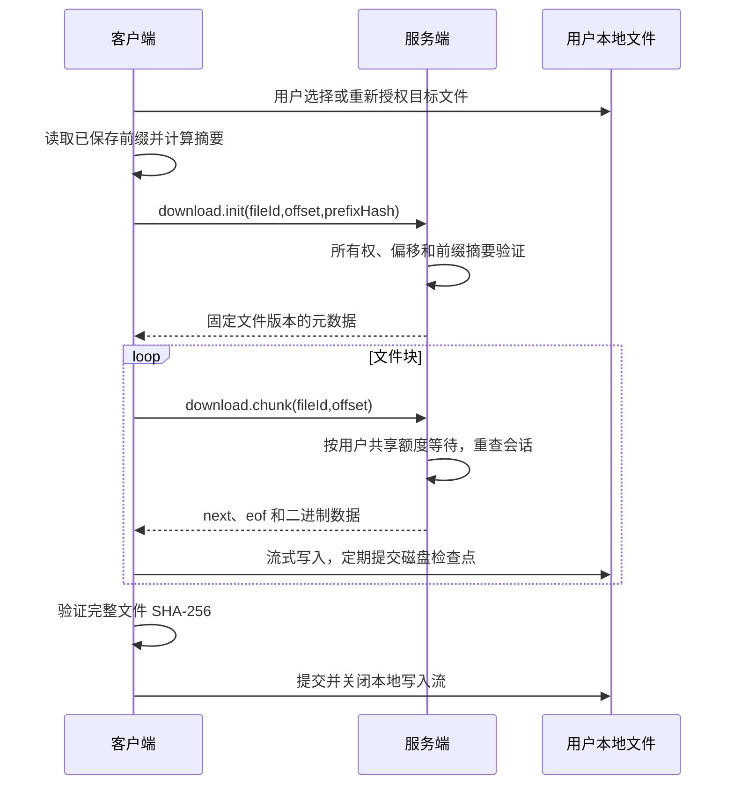

fileId 对应不可变文件对象，不原地覆盖版本。客户端检查块偏移、next 和长度，结束后比较完整摘要。发生暂停或可处理异常时提交已写入位置；浏览器强退可能丢失最近未提交段，恢复以已提交检查点为准。

限速模块按 userId 维护共享的时间预算，单次预留同步完成，等待异步执行；同一账号的上传、下载、多个任务及多个连接共用预算。普通/VIP 默认 1/4 MiB/s。首块可以突发，不能将极短样本当作稳定吞吐量。服务端每连接最多排队 8 条消息、全局排队载荷 16 MiB，并限制报文速率与并发摘要计算。

### 6.1 账号间受控交付

文件仍由原上传者拥有。SQLite 版本 3 只新增 `deliveries` 表及索引，不复制文件内容，不修改现有文件、任务、删除意图、账号、邀请或审计行。每条授权记录包含服务器生成的 `id`、`fileId`、`ownerId`、`recipientId`、发送时名称、创建时间及撤销状态/原因。有效的 `(fileId,recipientId)` 有唯一索引，重复或并发发送返回同一授权，不重复创建记录或计算存储。撤销后重新发送使用新授权标识，旧请求不能借新授权恢复。

| 操作 | 关键字段 | 身份与结果 |
| --- | --- | --- |
| `deliveries.prepare` | `fileId,recipient` | 所有者先核对可用接收账号，返回精确账号名及本人文件的公开属性 |
| `deliveries.create` | `fileId,recipient` | 所有者创建只读授权；返回 `deliveryId,created`，重复发送幂等 |
| `deliveries.received` | `offset` | 当前接收者的有效文件，每页 12 条，包含 `deliveryId`、发送者及当前文件属性 |
| `deliveries.sent` | `offset` | 当前所有者的发送历史，每页 12 条；有效、手动撤销、文件删除、账号停用原因 |
| `deliveries.revoke` | `deliveryId` | 仅该授权的文件所有者可撤销；对已失效授权重复撤销不重新开放权限 |
| `download.init/chunk` | 原字段加 `deliveryId` | 收件下载必须带本条授权标识；本人文件继续使用原接口字段 |

接收账号按已有区分大小写的账号名精确匹配，仅接受已注册且未停用账号，不允许发给自己。核对账号不返回账号目录、口令、公钥或角色。发送者界面必须先核对具体账号，再勾选确认并提交；提交时服务端再次验证文件所有权、文件未进入删除流程及接收账号状态。接收者、无关用户及管理员均不能发送他人文件或代撤销授权；管理员只有在被明确授权为接收者时，才取得对应对象的读取权限。

每账号每分钟最多 30 次核对/创建请求，创建另有每分钟 30 次保护；撤销每分钟最多 60 次。每个所有者及每个接收者最多各 1000 条有效授权，同一文件最多 32 个有效接收者。列表固定 12 条分页；限流沿用单进程内存计数，重启重置，不声称是分布式限流。授权历史与审计长期增长仍需第 08 项的归档维护。

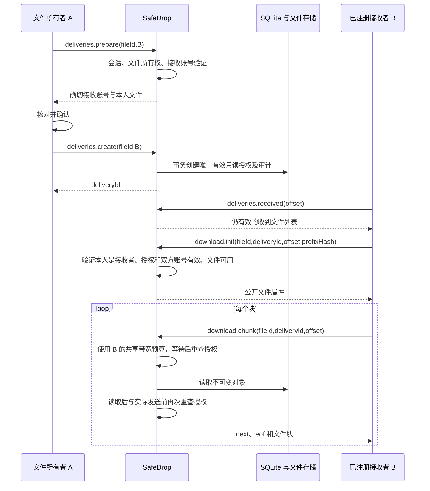

`owned()` 保持原样用于文件修改与上传任务。下载使用独立 `readable()`，每次验证当前会话；没有 `deliveryId` 时只允许本人文件，有 `deliveryId` 时必须同时匹配授权标识、文件标识、当前接收者、文件所有者、未撤销状态、双方账号可用和文件未处于删除流程。失败授权对已知的原接收者返回 `DELIVERY_UNAVAILABLE`，对无关账号返回 `NOT_FOUND`，不能凭授权标识获得文件元数据。元数据、续传前缀、每个分块、异步等待后、读取后及实际发送响应前都核验，不依靠列表或初始化的一次检查。

接收者不能修改/删除原文件、取消原上传、撤销他人授权或对原文件转授权。内容只存储一份，大小和文件数仍计入 A；B 的下载使用 B 自己的账号档位、共享带宽和会话预算，不占用 B 的存储。多个有效接收者不重复占用原文件存储。接收者可以把已取得的内容另存、复制或重新上传为自己的新文件；当前方案不提供 DRM 或防复制能力。

重命名只改变当前显示名，所有者、文件标识、内容、摘要和授权均不变；收件/发件列表随文件显示当前名称，原本地下载文件不会自动改名。源文件被移除后，发送历史保留发送时名称，不再向原接收者返回可下载元数据。

### 6.2 授权撤销与下载中止

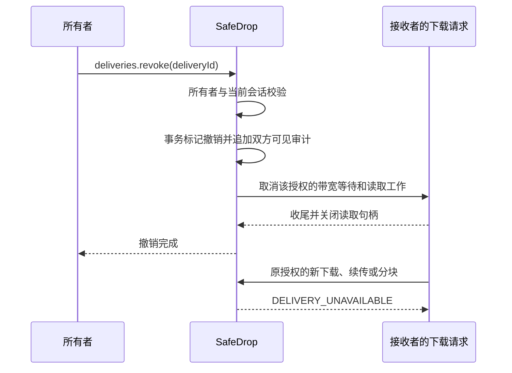

进行中的读取按文件、授权、当前下载者和文件所有者登记。手动撤销仅中止该条授权，其他接收者和所有者的下载保持有效。每个接收请求固定绑定 `deliveryId`；撤销并重新发送不能让旧请求在等待后自动匹配到新授权。重启后有效及已撤销状态继续保留。

源文件开始删除时，与删除意图在同一事务撤销该文件的全部有效授权，原因 `file-deleted`；即使随后磁盘清理失败，授权也不恢复。账号停用事务撤销该账号作为发送者或接收者的全部有效授权，原因 `account-disabled`，并立即取消相关下载。修改口令会撤销身份会话和公钥，文件接收授权本身保留，重新登录后仍按授权访问；用户可自行检查并撤销不需要的发送记录。

撤销能阻止后续尚未发送的字节，不能收回已经发送、保存或复制的内容。客户端收到授权失效后停止任务，不再显示恢复按钮，并清理该授权的下载检查点引用；磁盘已有内容仍由用户控制。接收文件的请求、缓存键和暂停任务都绑定授权标识，本人文件保留原缓存键，避免破坏旧下载续传。

### 6.3 交付审计与可见范围

`deliveries.create`、`deliveries.download`、`deliveries.revoke` 记录文件和授权标识、发送者/接收者标识与账号、偏移或失效原因。普通用户可看到自己参与的交付事件，无关普通账号看不到；管理员沿用全局审计权限。事件参与者字段只由服务端构建，客户端不能指定审计可见范围。

`download.init` 接受接收请求时记录“下载开始”；直接请求首块也会记录，不能通过跳过初始化绕开交付日志。单连接对直接分块的开始去重集合最多 128 项；显式初始化/续传会产生新开始事件。该事件只表示服务端接受了下载请求，不证明收件方已经读取、保存或校验完成。界面只显示授权有效/失效，不显示“已读”或“对方已接收完成”。

## 7. 会话撤销、异常与安全中心

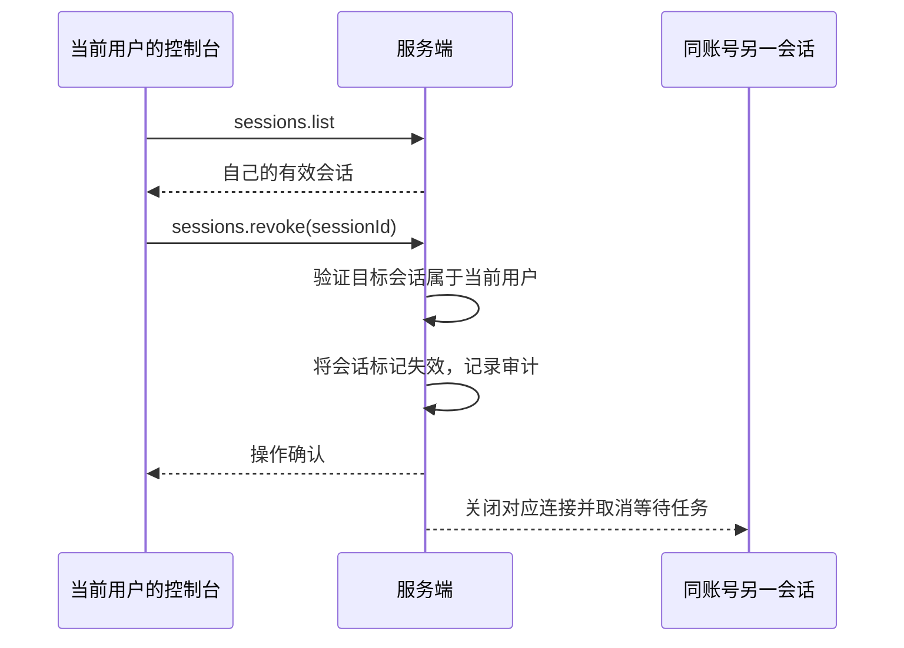

服务端每条业务消息验证会话有效期与撤销状态；异步等待带宽、摘要校验等步骤后再次验证关键权限。只能停止尚未授权/发送的数据，不能收回客户端已经收到的字节。认证失败、越权、格式与资源限制等错误记录脱敏事件；不记录口令、私钥、签名正文或文件内容。

畸形或超大报文关闭违规连接；普通业务失败返回明确 code。认证后的业务错误不会以关闭连接表示文件完成。异常连接关闭会撤销其会话并取消等待操作，其他用户继续工作。

## 8. 可校验审计与独立验收

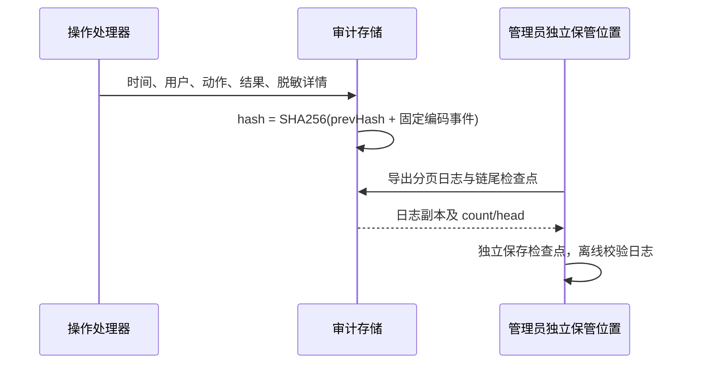

初始前驱为 64 个零字符。验证序号连续、前驱一致、事件摘要及外部检查点匹配。应用启动时检查已有日志链，链不一致则拒绝启动。管理员可以导出全部审计，普通用户可看自己的最近事件及本人参与的交付事件。检查点未签名，其可信度来自独立保管；与日志一起被攻击者改写后不再是可信锚。

独立安全验收工具创建临时 CA、临时账号和临时数据，启动真实 HTTPS/WSS 服务，执行断言并生成 HTML/JSON。生产界面只读取结果，不提供远程触发“攻击测试”的接口。自动验收与浏览器人工验收的覆盖范围需分别陈述，不能相互替代。

`report.latest` 仅管理员可读。缺失报告返回 `report:null`；存在时元数据为 `reportEncoding:"json"`，UTF-8 JSON 放在二进制载荷内，上限仍为 256 KiB，超限返回 `REPORT_TOO_LARGE`。报告不占用 16 KiB 元数据字段，109 场景报告可完整展示；服务端不提供拆分超大报告或触发测试的接口，维护者可在本地查看原文件。

## 9. 待进一步验证

容器镜像构建、基本网络隔离、HTTPS/WSS 传输、单条 HSTS 安全策略及重启续传通过版本 2 验收；账号策略通过版本 3、文件管理与配额通过版本 4、受控交付通过版本 5。08 最小版及相关回归通过版本 6，保留 371 条原记录，一致备份、宿主机独立检查点核对及新目录恢复通过。Edge B01～B29 按各轮范围通过；B27 为使用者执行、工具核对，其他本轮维护页结果由扩展直接观察。全局预算、审计容量和 ENOSPC/短写/零写/sync 失败受控注入均有自动证据；报告读取修复后又通过最终编译版及浏览器复验。版本、资源和证据分界见《验证记录.md》及《浏览器验收清单.md》。

公网证书签发、浏览器强退后的最近检查点恢复、长时间空闲连接、真实断电及硬件故障、长期负载、供应链镜像扫描、录屏演示和全新 Windows 环境复现仍需继续验证。首版为单应用进程，保留完整审计库，不提供在线裁剪；备份不另加密，旧副本和失败副本不自动删除。后续范围和优先级见《开发路线图.md》。安全范围与实际测试结果一起报告，不以“所有测试通过”推导出绝对安全。
