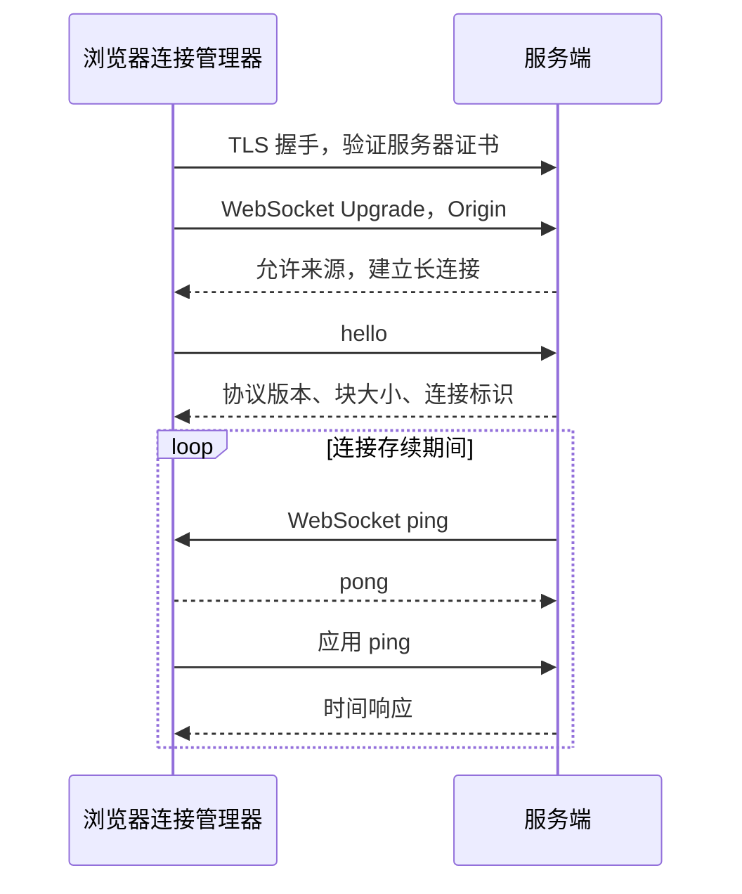
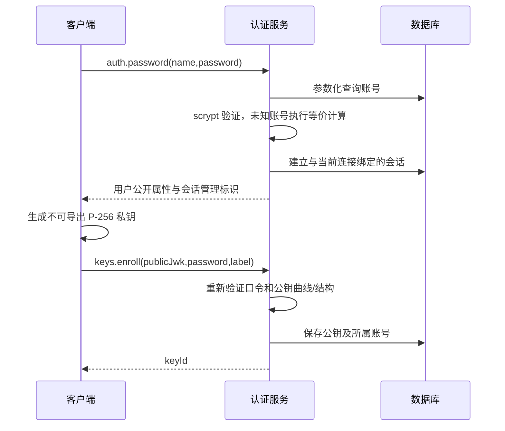
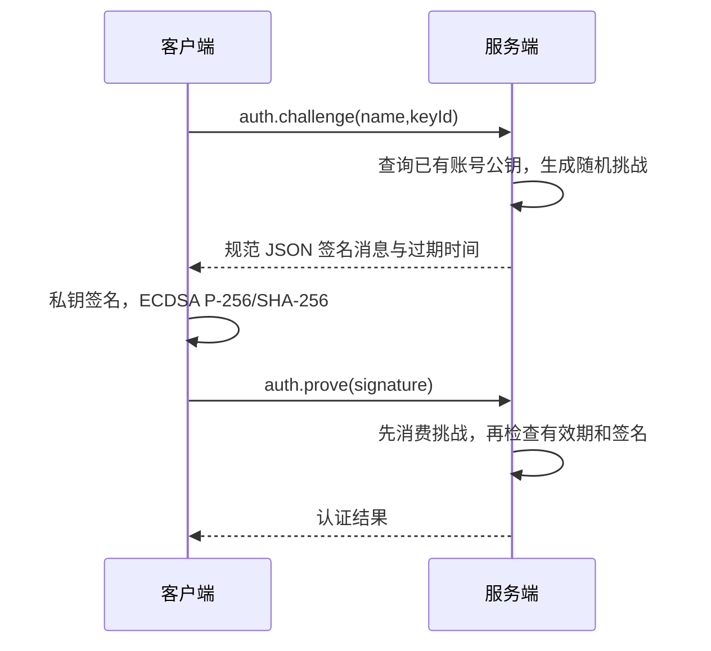
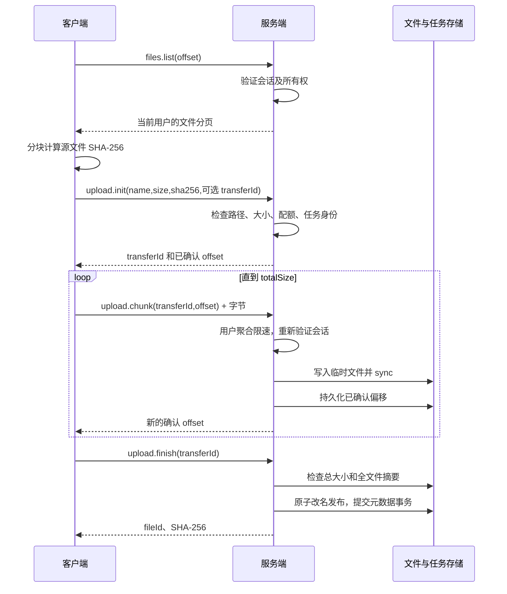
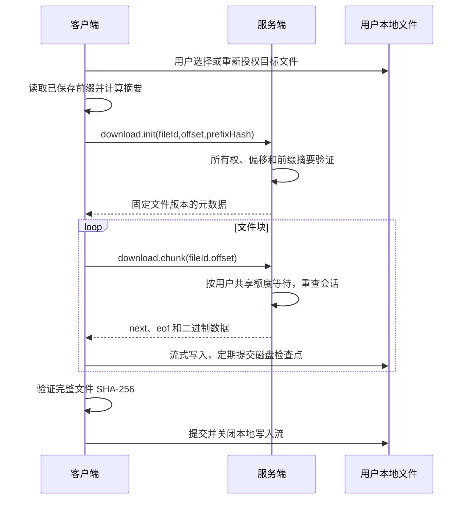
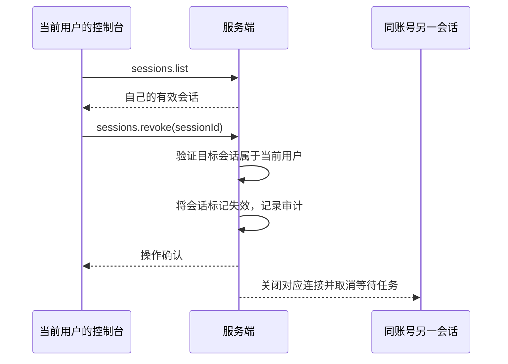
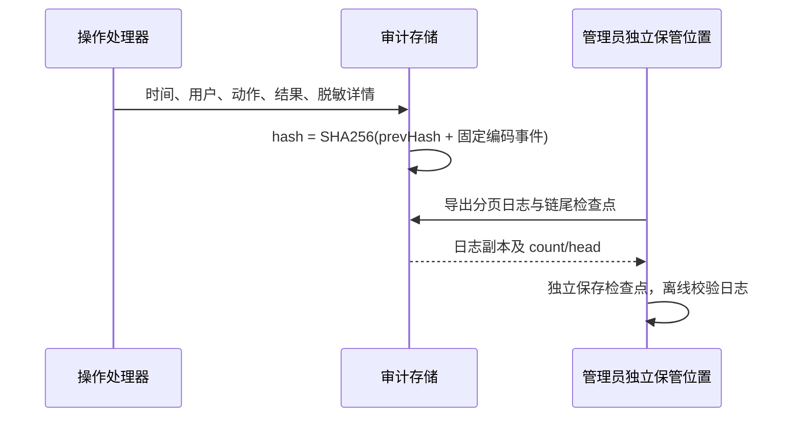

# SFT/1 协议与安全设计

版本：首个实现，2026-11-12。工程位置：`shared/protocol.ts`、`server/app.ts`、`server/store.ts`、`web/client.ts`。

## 1. 目标、信任与边界

保护文件内容、账号身份、访问权限、可用性与操作记录。客户端与网络对端可以恶意；任意客户端字段都不作为授权依据。信任部署宿主机、标准密码库、初始化账号流程、用户核对安装的本地 CA 或公网证书链，以及用户独立保存的审计检查点。

实际实现的控制包括：TLS 服务器认证、P-256 一次性挑战认证、带盐 scrypt 口令散列、SQLite 参数化查询、逐消息授权、随机物理文件标识、任务所有权、全文件 SHA-256、持久化确认偏移、协议大小检查、有界请求队列、按用户聚合限速、会话撤销、哈希链审计。

上传内容不自动执行、解压或渲染；文件内容通过二进制 WSS 数据返回，前端文件名由 Vue 文本转义。当前没有病毒扫描、端到端加密或静态数据加密功能，不应在报告中写成已实现。

## 2. 分层与报文头

浏览器 ↔ TLS ↔ WebSocket ↔ SFT/1。TLS 保护通道，WebSocket 提供双向长连接和消息边界，SFT/1 规定业务语义。容器模式的 TLS 终止位置见运行说明。

一个 WebSocket 二进制消息只携带一个 SFT/1 报文。所有多字节整数为大端：

```text
 0                  8                 16                 24                32 bits
 +-----------------------------------------------------------------------+
 |                         Magic = 0x53465431                             |
 +-----------------+-----------------+-----------------------------------+
 | Version = 1     | Type = 1/2      | Flags = 0                         |
 +-----------------+-----------------+-----------------------------------+
 |                         Request ID                                    |
 +-----------------------------------------------------------------------+
 |                         Stream ID                                     |
 +-----------------------------------------------------------------------+
 |                         Metadata Length                               |
 +-----------------------------------------------------------------------+
 |                         Payload Length                                |
 +-----------------------------------------------------------------------+
 | UTF-8 JSON Metadata ... | Binary Payload ...                           |
 +-----------------------------------------------------------------------+
```

固定头 24 字节。type=1 为请求，type=2 为响应。requestId 关联请求和响应；streamId 为保留的连接内流标识，首版客户端使用 0，并通过 JSON 中的持久化 transferId/fileId 区分传输任务。并发实现为多个异步任务交错发送有界文件块，不声称已有独立优先级流调度。

JSON 元数据上限 16 KiB，载荷上限 256 KiB。总长度必须严格等于 24 + metadataLength + payloadLength。非法魔数、版本、标志、类型、JSON、长度会导致连接关闭。文件列表分页，避免控制消息超过上限。二进制文件不经 Base64 编码；签名这种短控制字段使用 Base64。

请求示例：`{"op":"upload.chunk","transferId":"服务器生成的 UUID","offset":262144}`，载荷为本块字节。成功响应包含 `ok:true`；业务失败响应为 `{"ok":false,"code":"错误码"}`。文件内容不依赖 TCP 断连确定边界。

## 3. 建连、保活与状态



服务端显式调用 socket.setKeepAlive，20 秒 WebSocket 心跳。30 秒内未认证的连接关闭；客户端应用心跳为 15 秒。文件完成后连接仍保留。异常断线可退避重连；身份需要重新建立，已撤销会话不会自动恢复。会话默认一小时，最多每用户 8 个有效会话。服务器启动时将旧会话失效，避免把上次进程的连接身份延续到新连接。

## 4. 口令认证与公钥绑定



口令散列使用每账号随机盐、scrypt N=32768、r=8、p=1、32 字节结果；比较使用 timingSafeEqual。输入长度、每 IP 登录频率及全局并发散列次数均受限制。服务端不接收私钥。公钥登录不等于 mTLS，也不证明存在防钓鱼硬件认证器。



签名消息为固定顺序 JSON 数组，含协议用途、连接标识、账号、公钥标识、32 字节随机值、到期时间。有效期 30 秒，签名采用 IEEE-P1363 格式，防止客户端和服务端编码不一致。挑战绑定连接且只允许一次证明尝试；撤销的公钥不能完成尚未使用的挑战。

## 5. 文件列表、上传与续传



确认偏移是数据库中记录的可恢复位置，不是客户端自报位置。文件 sync 在偏移更新之前；若进程中断留下超出已确认位置的数据，重传从已确认位置覆盖。相同块的重传需比对已确认字节，内容不同则拒绝，不重复追加。每个上传任务有互斥锁，避免两个连接同时写相同偏移。

断线或服务器重启后重新认证，再调用 upload.init 携带任务标识。文件名、大小、摘要必须与原任务一致。上传使用预留大小计入配额，防止多个并发任务合计超额。完成请求重复发送会返回原文件结果。发布改名成功而元数据事务未完成的进程崩溃窗口，通过再次 finish 时查找最终对象恢复。

取消模块为 upload.cancel：核验所有权、清除暂存文件与任务记录、记录审计、释放预留空间。

## 6. 下载、磁盘检查点与并发限速



fileId 对应不可变文件对象，不原地覆盖版本。客户端检查块偏移、next 和长度，结束后比较完整摘要。发生暂停或可处理异常时提交已写入位置；浏览器强退可能丢失最近未提交段，恢复以已提交检查点为准。

限速模块按 userId 维护共享的时间预算，单次预留同步完成，等待异步执行；同一账号的上传、下载、多个任务及多个连接共用预算。普通/VIP 默认 1/4 MiB/s。首块可以突发，不能将极短样本当作稳定吞吐量。服务端每连接最多排队 8 条消息、全局排队载荷 16 MiB，并限制报文速率与并发摘要计算。

## 7. 会话撤销、异常与安全中心



服务端每条业务消息验证会话有效期与撤销状态；异步等待带宽、摘要校验等步骤后再次验证关键权限。只能停止尚未授权/发送的数据，不能收回客户端已经收到的字节。认证失败、越权、格式与资源限制等错误记录脱敏事件；不记录口令、私钥、签名正文或文件内容。

畸形或超大报文关闭违规连接；普通业务失败返回明确 code。认证后的业务错误不会以关闭连接表示文件完成。异常连接关闭会撤销其会话并取消等待操作，其他用户继续工作。

## 8. 可校验审计与独立验收



初始前驱为 64 个零字符。验证序号连续、前驱一致、事件摘要及外部检查点匹配。应用启动时检查已有日志链，链不一致则拒绝启动。管理员可以导出全部审计，普通用户只看自己的最近事件。检查点未签名，其可信度来自独立保管；与日志一起被攻击者改写后不再是可信锚。

独立安全验收工具创建临时 CA、临时账号和临时数据，启动真实 HTTPS/WSS 服务，执行断言并生成 HTML/JSON。生产界面只读取结果，不提供远程触发“攻击测试”的接口。自动验收与浏览器人工验收的覆盖范围需分别陈述，不能相互替代。

## 9. 待进一步验证

容器镜像构建、基本网络隔离、HTTPS/WSS 传输、单条 HSTS 安全策略及容器重启续传已于 2026-11-17 通过版本 2 容器验收；本机 Edge 的原生文件保存、暂停后刷新恢复、公钥、双向并发、限速与审计流程也已通过，结果见《验证记录.md》及《浏览器验收清单.md》。公网证书签发、浏览器强退后的最近检查点恢复、长时间空闲连接、磁盘写入错误、全局磁盘与审计增长上限、供应链镜像扫描、录屏演示和全新 Windows 环境复现仍需继续验证。后续范围和优先级见《开发路线图.md》。安全范围与实际测试结果一起报告，不以“所有测试通过”推导出绝对安全。
