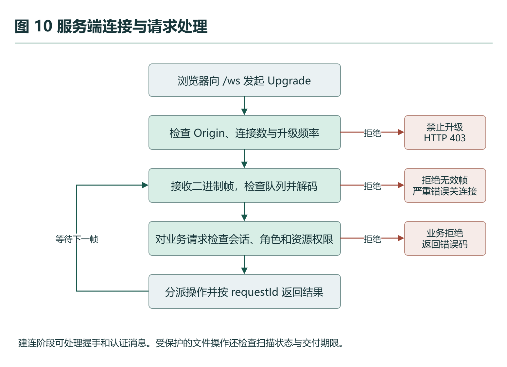

# SafeDrop 安全文件传输与审计平台实验报告

《软件与系统安全》实验 1B · 安全文件传输软件设计与实现

| 项目 | 内容 |
| --- | --- |
| 软件与协议 | SafeDrop 0.1.0，SFT/1 |
| 功能验收基线 | `28a3f4fa5deea226a81f33d813f500627065b96d` |
| 报告修订 | 2026-11-23（北京时间） |
| 源码与提交历史 | [logic-xx/safedrop](https://github.com/logic-xx/safedrop) |

## 摘要

本实验实现了一个面向受控用户组的文件传输系统。浏览器与服务端保持一条经过证书验证的 WSS 通道，应用层协议 SFT/1 在这条通道上承载认证、文件列表、上传和下载等请求。应用使用确定的报文长度、请求编号、持久化偏移和整文件 SHA-256，解决多任务交错、断线续传和文件完成判定三个问题。服务端负责身份绑定、逐次访问检查、账号级带宽限制和审计。扩展功能包括指定用户交付、授权到期、内容扫描、管理员双因素认证，以及独立校验的加密备份与恢复。

课程核心功能已有实际浏览器和自动化证据。历史 Edge 验收观察到两个上传与一个下载同时推进，刷新后从确认位置继续，以及普通和 VIP 速率差异。最终功能基线的 Ubuntu 作业通过 183 个 TLS/WSS 场景，最终 Linux 容器还复验了扫描、期限、重启、MFA 和加密恢复。报告分别记录环境与方法。应用层控制可减少已测资源滥用，公网链路饱和和长期负载没有实验数据。

**关键词**　安全文件传输、WebSocket、断点续传、访问控制、可校验审计

## 1 实验目标与课件对应关系

实验 1B 的核心问题是让多个用户通过长连接可靠交换文件，同时在请求入站、状态更新和内容发出时都执行相应的安全检查。课程讲义《实验 1 讲解 2026.pdf》给出了报头、流程及证书的设计示例。本报告采用讲义第 34 页所列的 Web 开发路线。

| 课件位置 | 实验要求或示例 | 报告对应内容 |
| --- | --- | --- |
| 第 33–35 页 | 多用户并发、完整传输、安全防护，视频展示编译、部署和测试 | 第 2、4、6、7、9 节。并发完整性、证书失败、SQL 注入拒绝和应用层资源约束分别取证 |
| 第 36–39 页 | 长连接及 keepalive、服务端功能流程、各协议模块时序、报头和正确性说明 | 第 3–5 节。图 2 展示固定报头，图 3–11 解释主要模块。连接管理由浏览器页面内组件承担，独立系统守护进程未实现 |
| 第 40 页 | 断点续传、公钥身份认证、同时上传和下载的 GUI、按身份限速 | 第 5 节给出实现，第 7 节给出四项各自的实际观察及测量范围 |
| 第 41–48 页 | 区分控制与载荷，显式确定文件长度和完成点，限制服务端可访问目录，设计可解析的报头 | 第 2.3、3.2、4.2、5.2 节。图 2 及逐字段表、硬性上限、确认偏移和容器挂载配置均可核对 |
| 第 49–62 页 | PKI、证书绑定与 HTTPS 示例 | 第 2.2、6.1 节。区分服务端 TLS 证书与应用层用户公钥，说明本地 CA 和未实测的公网证书 |
| 第 2–3、33 页 | 未加密 ZIP、Git 链接、按要求命名的源码目录、实际 MP4、PDF 或 DOCX 报告 | 仓库链接见首页，复现及录制见第 9 节。Markdown 是报告编辑源稿，提交格式按讲义办理 |

## 2 部署架构与信任边界

### 2.1 组件职责与实现位置

| 层或组件 | 处理内容 | 主要代码入口 |
| --- | --- | --- |
| 浏览器 | Vue 3 文件工作台、上传和下载队列、会话界面、Web Crypto 公钥签名、IndexedDB 保存设备数据 | [web/App.vue](../web/App.vue)、[web/client.ts](../web/client.ts) |
| 应用层协议 | SFT/1 编解码、请求响应匹配、报文及元数据上限 | [shared/protocol.ts](../shared/protocol.ts)、[server/app.ts](../server/app.ts) |
| 应用与业务存储 | 文件和授权访问控制、SQLite 元数据、私有对象文件和暂存、操作记录 | [server/store.ts](../server/store.ts)、[server/storage.ts](../server/storage.ts) |
| 扫描器 | 通过受限 INSTREAM 接收待检字节，返回检测结果，应用判定能否放行 | [server/clamd.ts](../server/clamd.ts)、[server/scans.ts](../server/scans.ts)、[扫描器镜像定义](../deploy/scanner/Dockerfile) |
| 网关与运维 | HTTPS/WSS 入口、隔离网络、加密备份、检查点、离线校验及恢复 | [本地 Caddy 配置](../deploy/Caddyfile.local)、[server/backup.ts](../server/backup.ts)、[scripts/maintenance.ts](../scripts/maintenance.ts) |

WebSocket 提供双向、保持打开的连接和消息边界。SFT/1 在其中定义文件长度、分块偏移、鉴权、错误和完成语义。文件块使用二进制格式，控制字段使用 UTF-8 JSON。与在同一套接口中用 JSON 传输文件内容相比，这样可以避免对每块文件做 Base64 编码，同时保留可扩展的控制字段。服务端按连接匹配请求和响应，任务标识可跨连接恢复。

### 2.2 TLS 信任路径

本机直跑由 Node 提供 HTTPS/WSS，Compose 由 Caddy 终止 TLS。浏览器使用经核对的本地 CA 公共证书验证 localhost 服务证书与主机名。应用在 WebSocket 升级时另检查固定 Origin 和入口路径，浏览器发出的业务请求还需通过应用层身份认证。公钥登录验证的是用户是否持有本机已绑定私钥，TLS 证书验证的是连接目标服务端，两者保护的身份不同。

Compose 的网关到应用之间采用隔离内网 HTTP/WS，ClamD 也在受控网络接收文件流。因此部署需信任宿主机、网关、应用及隔离网络。**TLS 提供传输通道加密，SafeDrop 服务端可以处理明文和扫描文件，所以不提供端到端加密。** 公网配置已提供，本实验没有验证实际域名签发、证书续期或外网访问。

### 2.3 目录与进程访问范围

课件第 45 页要求用可检查的配置体现服务端可读写范围。SafeDrop 同时在 Linux 容器层和业务层实施限制。

| 层级 | 明确配置与效果 |
| --- | --- |
| 应用进程 | [compose.yaml](../compose.yaml) 指定 UID/GID `10001:10001`、只读根文件系统、丢弃 capabilities、禁止提权，并规定 CPU、内存与 PID 上限。临时目录使用有大小限制的 `tmpfs` |
| 业务文件及报告 | 应用数据卷挂载于 `/data`，运行目录下的 `objects` 和 `staging` 分别存放已发布对象与上传暂存。项目 `reports` 在容器内只读挂载。应用无需暴露宿主机文件系统路径供客户端遍历 |
| 网络 | 基础本地部署只绑定网关的 `127.0.0.1:8443`。独立验证项目通过 [Compose 覆盖配置](../deploy/compose.verify.yaml) 使用 `127.0.0.1:18443`。应用和扫描端口不向宿主机发布 |
| 扫描器 | 单独用户与签名数据卷，只读根、单独临时目录和 CPU、内存、PID 上限。服务端可发送字节供扫描，扫描器没有业务卷挂载 |
| 文件所有权 | 客户端提交显示名称，服务端校验名称并生成随机物理标识。数据库按认证用户和精确授权查询。管理员可以维护账号与系统，读取他人文件仍需满足文件所有权或交付规则 |

在 Windows 上直接启动时，进程以启动它的用户访问本地目录。应用层权限仍生效，操作系统层边界由 Windows 用户目录权限提供。Linux 容器的只读根与独立用户复验不能推导为 Windows 已有相同的文件系统沙箱。

## 3 SFT/1 协议封装与操作约定

### 3.1 固定报头与长度校验

每个 WebSocket 二进制消息内有一个 SFT/1 报文，按 `固定头（24 B）+ UTF-8 JSON 元数据 + 二进制载荷` 排列。多字节整数用大端序。解码端先检查实际总长，再检查头字段与两个声明长度，最后解析 UTF-8 JSON。

| 字节偏移 | 大小 | 字段 | 解释与约束 |
| --- | ---: | --- | --- |
| 0–3 | 4 B | Magic | 固定 `0x53465431`，按 ASCII 对应 SFT1 |
| 4 | 1 B | Version | 当前版本为 1 |
| 5 | 1 B | Type | 1 为请求，2 为响应。业务入口接收请求类型 |
| 6–7 | 2 B | Flags | 当前定义为 0，解码拒绝非零值 |
| 8–11 | 4 B | Request ID | 响应沿用请求编号。业务请求要求正值，浏览器用它找到对应的待完成请求 |
| 12–15 | 4 B | Stream ID | 保留字段，当前浏览器默认使用 0。跨会话定位依靠服务端任务或文件标识 |
| 16–19 | 4 B | Metadata Length | JSON 的字节数上限为 16 KiB，解码后须为对象 |
| 20–23 | 4 B | Payload Length | 原始字节数上限为 256 KiB，可以为 0。客户端的非 `upload.chunk` 请求不得附带二进制载荷 |

声明长度必须满足 `实际总长 = 24 + 元数据字节数 + 载荷字节数`。SFT/1 的最大单帧为 278552 字节，包含 24 B 固定头、16 KiB 元数据和 256 KiB 文件块。以纯 ASCII 业务心跳 `{"op":"ping"}` 为例，元数据是 13 字节，载荷为 0，整帧是 37 字节。若请求编号为 7，固定头的字节如下。这些字节按编码规范计算。

~~~text
53 46 54 31   01   01   00 00   00 00 00 07   00 00 00 00   00 00 00 0D   00 00 00 00
   Magic     Ver  Type   Flags    Request ID    Stream ID    Metadata      Payload
~~~

| 操作组 | 代表性请求 | 状态或结果 |
| --- | --- | --- |
| 连接与身份 | `hello`、`ping`、`auth.password`、`auth.challenge`、`auth.prove` | 通道能力、心跳响应、待完成的双因素挑战或已认证会话 |
| 所有者操作 | `files.list`、`files.scan`、`upload.init`、`upload.chunk`、`upload.finish` | 分页结果、扫描状态、确认偏移或已发布文件标识 |
| 下载与交付 | `download.init`、`download.chunk`、`deliveries.create`、`deliveries.revoke` | 文件元数据、下一偏移、结束标记、期限或拒绝原因 |
| 审计与维护 | `events.query`、`audit.verify`、`maintenance.backup` | 可见时段统计、快照游标、审计校验或备份状态 |

### 3.2 长连接从建立到恢复

浏览器打开 `/ws`，TLS 和 WebSocket 升级完成后可用 `hello` 获得协议版本、连接标识、块大小和心跳间隔。服务端在底层 TCP 连接显式调用 `setKeepAlive(true, 30000)`，每 20 秒发送 WebSocket ping 并跟踪 pong。页面在线时每 15 秒发送应用层 ping。服务端还通过心跳检查已认证会话状态。一次目录查询、分块确认或正常文件完成之后，连接继续承载下一次请求。

异常关闭会取消连接上未完成的请求并暂停界面任务。遇到非正常断连，客户端采用退避重连。业务会话绑定原连接，新连接要重新认证，再用任务标识或文件标识查询确认偏移。服务进程重启也不会自动继承原 WebSocket 会话。页面内连接管理覆盖打开页面期间的长连接维护。关闭页面或系统暂停后，浏览器不会启动独立操作系统守护进程。长时间空闲和浏览器异常退出的专项仍待验证。

## 4 服务端处理与实验正确性

### 4.1 从数据帧到业务响应

请求分派和拒绝路径见附录 A 图 10。

服务器为每条连接分配上下文，状态包含会话、未完成请求数和取消信号。应用在分派前检查消息边界、速率、队列和审计预算。客户端待响应请求上限为 6。服务端按连接排队，单连接未完成请求达到 8 或全局排队字节超出 16 MiB 时拒绝继续接收。无法解码的帧会关闭连接，能识别对应请求的业务拒绝会返回相同 `requestId` 与稳定错误码。过载与会话撤销可取消等待中的读写。

浏览器工作台的文件列表来自数据库的分页查询。服务端采用已认证用户的身份作为过滤条件，分页查询返回最多 12 行文件信息并附扫描状态。交付列表走独立的参与者权限路径，对方获准读取的交付不会变为接收人自有文件。

文件列表的调用及响应见附录 A 图 11。

### 4.2 结束判定与状态不变量

| 不变量 | 正常路径 | 异常与重试时的行为 |
| --- | --- | --- |
| 业务完成明确可判定 | 上传初始化先声明全长和 SHA-256，已确认偏移等于声明长度后还须显式完成并重新校验内容 | 文件块越界、提前完成、摘要不符均拒绝。客户端断线只结束当次连接，不触发文件发布 |
| 已确认偏移只指向可复用字节 | 文件块写入成功并同步到磁盘后更新 SQLite 偏移，返回结果给发送者 | 数据库偏移保持原值的未确认字节不会被当成成功。重复块须完全落入已确认范围且字节相同，冲突失败 |
| 重连恢复同一个任务或对象 | 刷新后客户端重选同一文件或授权同一保存目标，服务端核对任务归属及信息 | 上传名称、大小和摘要不匹配时拒绝续传。下载前缀不匹配时拒绝接受旧偏移 |
| 能退回失败状态而不泄露后续内容 | 获取下载授权、限速等待、读取、发出前分段复查 | 撤销、过期、账号失效、删除和扫描不通过都会阻止后续字节，已保存内容无法撤回 |
| 取消与发布不会重复计费 | 任务创建时按全长预留，完成事务将预留转为已用。删除或清理成功后释放 | 清理失败保留占用并可重试。互斥和持久化删除意图覆盖取消、完成和故障重启之间的竞争 |

以一个 64 MiB 文件为例，256 KiB 的理论分块数为 256。若可确认的位置是 34 MiB，后续从该偏移继续读取。长度公式只说明协议如何判定进度，实际浏览器操作及恢复位置见第 7 节记录。

## 5 业务模块及关键实现

### 5.1 邀请、身份认证与会话

默认通过限时单次邀请注册。管理员可以关闭自助注册。服务端保存邀请摘要，登记账号与消费邀请在事务内复核，两个同时请求同一邀请时最多一人成功。口令存储使用随机盐和 scrypt，摘要比较使用常量时间接口。SQLite 查询使用参数绑定。管理员停用账号或用户改密后，相关会话和绑定公钥失效，文件仍按数据保留策略处理。

浏览器绑定 P-256 公钥时需要重新验证口令，私钥以不可导出的 CryptoKey 保存在原浏览器设备。服务器提供短时随机挑战，将其绑定到当前连接、账号、用途和已登记公钥，先消费挑战再验证签名。启用 MFA 的管理员使用口令和 TOTP。第二步通过前没有业务权限。恢复码单次消费，仅允许进入双因素重新绑定流程。分别参见[协议与安全设计](协议与安全设计.md)和[管理员双因素认证](管理员双因素认证.md)。

### 5.2 上传下载、GUI 并发及账号限速

浏览器文件工作台将上传与下载显示为可独立暂停和恢复的任务，每个页面同一时刻最多三个运行任务。上传先通过 `upload.init` 登记名称、大小和摘要，并预留整个文件。文件块同步、偏移写入成功后才确认。下载先调用 `download.init` 获取大小和摘要，再用 `download.chunk` 请求数据块，按返回的下一偏移推进，最终比较全文件 SHA-256。支持原生文件保存权限的浏览器可通过本地文件前缀恢复。不支持该能力时，小文件可使用内存 Blob 下载，原生磁盘续传路径仍受浏览器支持限制。未正常退出的下载可能只能恢复到最后一个持久化检查点。

限速由服务端的 [Bandwidth 调度器](../server/limits.ts) 实施。对同一账号，调度器在单调时钟上同步预留开始时间，将下一个可用时刻前推 `块字节数 / 档位速率`，因此多个会话和多个任务共享同一时间预算。普通档默认 1 MiB/s，VIP 档默认 4 MiB/s，下载按实际接收账号计费。等待过长会拒绝新请求，进程内预算随进程生命周期建立。这不构成跨节点限速。瞬时速率可受首块和采样方式影响，实验采用持续区间测量，见第 7.2 节。

### 5.3 内容检测与受控交付

上传发布时登记扫描任务。ClamD 对有大小与超时限制的文件流检查签名，应用核对摘要、记录代次、引擎和签名库时效。通过与审计在同一事务发布。扫描命中进入逻辑隔离，未扫描、过期、无法完整检测或引擎失败时均禁止下载和交付。逻辑隔离保留原对象和占用，管理员不能跳过检测放行。真实引擎的标准测试签名在隔离 Linux 环境验证。模拟界面的受控隔离状态只用于观察反馈。扫描不能保证发现所有恶意文件。详见[文件扫描与隔离](文件扫描与隔离.md)。

所有者可以向已注册账号发送只读授权，服务端在原对象上检查接收者、授权标识和扫描状态。新授权由服务器根据当前时间计算期限，可选择 1–720 个整数小时，默认 168 小时。旧授权的无期限值仅作兼容。有效授权的重复发送不会改期。重发已撤销或过期的授权会产生不同标识，原标识不会重新生效。到期判定与后台审计写入解耦，后台记录尚未完成时仍要在读取路径拒绝，独立期限信号可取消等待中的下载。**撤销与到期能限制后续访问，不能收回已保存的内容。** 详见[交付授权到期](交付授权到期.md)。

### 5.4 安全事件浏览与审计链

新时间线支持展开、平移、缩放、详情与分页。服务端把角色和参与者过滤同时应用于聚合与列表，保证普通用户看不到无关账号的事件。查询使用左闭右开的时段并限制最长 31 天，第一页固定审计序号边界，后续页沿用同一范围和边界。分布计数覆盖可见时段，列表由游标分页，因而新事件到来时不会在已有快照中插入。时间线便于定位事件，审计完整性需由独立校验流程证明。

每条审计记录按序号串联，其摘要由前一记录的摘要文本和本条事件原始文本计算得到。校验检查连续序号、前序摘要和该条 SHA-256。运维端可附加独立保存的 `{count, head}` 检查点，与同一序号的摘要对照。**哈希链依赖独立可信检查点**。若攻击者可重写原库与检查点，链内自洽不足以证明历史真实。审计容量不足时限制相应写入，保护已有记录。

### 5.5 一致备份、密钥与恢复

维护过程协调在途写入和扫描，对 SQLite、对象、任务以及审计链段取得一致视图。格式 2 加密备份以独立于 MFA 的备份密钥为根，通过 HKDF-SHA-256 派生每副本密钥，用 AES-256-GCM 认证并加密清单和条目。轮换后保留旧密钥，使旧副本能继续解密。要求加密时缺密钥会拒绝创建。旧明文副本须显式选择兼容读取。在线业务文件本身未静态加密，校验或恢复所需临时明文需存放在受保护目录。

恢复时对照副本和早于备份的可信检查点，验证认证标签、条目摘要、SQLite 完整性及审计链，再写到不存在的目标目录。恢复失败不会替换运行中的原库，部分写入以失败标记隔离。备份独立密钥、MFA 独立密钥和部署 CA 私钥按用途分别保管。详见[存储维护与恢复](存储维护与恢复.md)及[备份加密与密钥管理](备份加密与密钥管理.md)。

## 6 威胁、防护与验证方法

### 6.1 威胁模型

保护对象包括文件字节、账号及会话、授权状态、备份和可追溯的审计记录。外部网络、所有客户端输入和上传文件均按不可信处理。普通账号可能故意发送越权、畸形或过量请求，授权接收者也可能保存已收到的内容。可信条件包括正确核验的 CA、受控的部署主机和内网、标准密码库、合理的服务端时间，以及应用进程无法改写的独立检查点。具备宿主机控制权的一方可以越过部分应用边界，本实验不提供对被完全控制宿主机的隔离证明。

| 威胁或异常 | 主要控制 | 采用的验证及可观察结果 | 结果边界 |
| --- | --- | --- | --- |
| 中间人、非允许网页来源 | HTTPS/WSS 校验证书链与主机名，升级阶段固定 Origin | 真实 TLS/WSS 环境拒绝不可信 CA、错误主机名及非允许 Origin，可信连接仍能运行（E01、E08、E09） | 网关内网是可信部署边界，公网域名没有实际验证 |
| SQL 注入、非法文件名 | SQLite 参数绑定，文件名校验，服务端控制物理对象路径 | 登录注入用例不能绕过身份检查，目录穿越文件名被拒绝（E01、E02） | 已测试输入覆盖相应入口，未声明完全排除所有实现缺陷 |
| 暴力认证、连接与资源耗尽 | 认证和升级频率限制，连接数、帧长、队列、带宽与全局存储预算 | 畸形或超大帧、认证频率、账号聚合带宽、存储配额等用例通过（E01、E02、E08） | 只覆盖应用层资源滥用，公网 DDoS、链路带宽耗尽和多节点压力未实测 |
| 未登录、跨账号读取、旧公钥或会话重试 | 连接绑定、对象归属、一次挑战、公钥与会话撤销 | 不相关账号、已撤销会话和旧签名被拒，管理员也不能直接读取其他用户对象（E01–E04） | 管理员 TOTP 可选，当前没有账号自动恢复机制 |
| 内容改变、读写故障、恢复位置错误 | 整文件摘要、严格偏移、同步后确认、完整预留、清理失败保留计费 | 提前完成、错误摘要、冲突块、短写、前缀误配等被拒。重启仍可从记录位置续传（E01、E02） | 文件写入与数据库异常包括受控故障注入，不能代替真实硬件故障或断电测试 |
| 有害或不完整可检内容 | 引擎检测、结果时效、未通过阻止读取、逻辑隔离 | Linux 容器真实引擎识别标准测试签名，拒绝隔离、不可完整检测和故障路径（E05、E08） | 受扫描规则和签名覆盖限制，界面夹具的隔离示例另单列 |
| 到期授权继续读取 | 逐阶段检查、独立定时取消、持久化终态 | 等带宽后、读取后和发送前补核。跨重启、重发和恢复时旧期限保持（E03、E08） | 已保存的客户端副本不受后续授权控制 |
| 审计重写、备份损坏或泄露 | 哈希链与独立检查点、独立密钥和认证加密、隔离恢复 | 校验检查点、错钥和篡改拒绝、SQLite 和文件清单验证成功（E06、E09） | 校验者和检查点的可信性需要由部署者维持 |
| 多账号事件泄露、构建证据套错对象 | 事件角色过滤、快照游标、运行时组成和镜像 ID 绑定 | 普通用户范围、完整时段分布和稳定翻页通过。固定最终镜像组成经同一镜像扫描门槛核验（E07–E10） | 大审计库长期压力及镜像仍存在的中、低、未知发现未在此项消除 |

证据编号按[交付证据索引](交付证据索引.md)解释，完整的威胁和测试入口见[安全验证矩阵](安全验证矩阵.md)。这些用例在自己的应用、临时账号或 CI 隔离环境内运行。

### 6.2 环境、测量口径及证据类型

测试由不同环境分工。历史 Edge 观察确认真实的界面操作与磁盘保存结果。TLS/WSS 自动测试确认协议层的精确偏移、身份和错误断言。Windows 与 Ubuntu 平台作业独立记录测试数，镜像作业确认 Linux 运行时、真实扫描与隔离，宿主机原卷操作确认升级前的数据是否留下。这几类证据回答的问题不同，覆盖有交集。

| 环境 | 取证方式 | 可以据此确认 |
| --- | --- | --- |
| 早期 Edge B01–B09 | 真实浏览器、受控本机部署、文件大小和 SHA-256 比对 | 多任务、原生保留、续传、公钥及带宽样本 |
| Windows 和 Ubuntu CI | Node 24.22.3 的实际平台构建与默认套件，Ubuntu 额外运行安全场景 | 源码编译与平台结果。Ubuntu 的独立场景报告提供明确断言 |
| Linux x64 容器 CI | 启动实际应用、网关和扫描器镜像，验证功能并扫描最终镜像 | 真实容器组成与镜像身份、隔离网络、严格入口、ClamAV、重启与恢复 |
| 本机原卷及接口补核 | 使用者用普通 PowerShell 操作，工具读取生成的报告，再核对实际 HTTPS/WSS 和恢复副本 | 保留已有数据、真实入口连接条件、加密备份及独立离线恢复 |
| 安全中心专项 Edge B51–B55 | 在回环 HTTP 夹具直接操作，审计输入为合成事件 | 真实界面上可见范围的区别、拖动和缩放、快照分页及布局，TLS 与扫描由其他证据支持 |

## 7 实验结果与分析

### 7.1 课程加分项的直接证据

下表沿用已归档结果。步骤、浏览器范围和文件摘要见[浏览器验收清单](浏览器验收清单.md) B01–B09 及对应的[验证记录](验证记录.md)。

| 课件加分项 | 操作、样本和实际结果 |
| --- | --- |
| 上传断点续传 | B04 以 64 MiB 文件上传。先在 8.5 MiB 暂停并继续，另一次在 34 MiB 暂停，刷新登录并重选原文件，观察到进度继续到 34.75 MiB。最终下载件 SHA-256 与源一致 |
| 下载断点续传 | B05 选择原生磁盘保存，先在 4.75 MiB 暂停并恢复，52.75 MiB 时再次暂停。刷新、重新登录及授权后从 52.75 MiB 恢复。恢复过程中保持一个任务条目，最后 64 MiB 的文件按字节及 SHA-256 与源一致 |
| 基于公钥的身份认证 | B06 完成同一浏览器的公钥登记、退出后以该公钥重新认证、撤销并再次尝试。已撤销公钥被拒。错误签名与挑战重放由对应自动场景验证 |
| GUI 同时上传和下载 | B03 同时运行两个 32 MiB 上传和一个 64 MiB 下载，三个进度交错增长。上传服务端摘要均正确，保存的下载件与原件逐字节一致。B02 另验证 784 字节中文文件与空文件 |
| 按身份限制带宽 | B08 比较普通档与 VIP 档，并在普通档同时进行两上传和一下载。增加任务后，共享预算附近的速率按照合计数据量计算，见下表 |

### 7.2 带宽的实测计算

区间平均速率以确认字节增量除以经过秒数计算。单位为 MiB 和 MiB/s。对同一账号的并发任务，将各自区间字节增量相加，再除以共同采样时长。

| B08 历史样本 | 区间增量和用时 | 计算或观察结果 |
| --- | --- | ---: |
| 普通档，64 MiB 文件单上传 | 从 12.75 到 33.5 MiB，增量 20.75 MiB。20.762 s | 约 0.999 MiB/s |
| 普通档，两个上传加一个下载 | 三个任务各前进 9.5 MiB，合计 28.5 MiB。28.471 s | 合计约 1.001 MiB/s |
| VIP 档，同一个 64 MiB 文件单上传 | 剩余 57.75 MiB。用秒级完成事件推定 13.955–14.955 s | 约 3.86–4.14 MiB/s |

普通档的单任务速率与三任务合计相近，说明样本内未观察到按任务翻倍的带宽。VIP 的完成事件只有秒级精度，结果用区间表达，后一次看到已完成的时刻没有当成精确完成时间。本测量来自早期受控环境，只有所列样本，可用于说明身份档位和聚合限制，不能估计最大吞吐、普遍网速或延迟分布。出处为[浏览器验收清单](浏览器验收清单.md)的 B08 采样表。

### 7.3 最终代码基线与原卷复验

| 方式 | 基线与结果 |
| --- | --- |
| GitHub Actions 平台构建与默认测试 | `28a3f4f`，Windows 64 项中 61 通过、3 跳过。Ubuntu 64 项中 58 通过、6 跳过，均零失败 |
| 独立协议安全场景 | Ubuntu CI 为 **183/183**。本机留存的独立 TLS/WSS 报告同样为 183/183，包含各自的环境和报告信息 |
| CI 源码与实际 Linux x64 容器 | 四个作业全成功。版本 12 容器通过扫描、到期、MFA、加密恢复、旧 CA、严格 HTTPS/WSS、运行时组成及新事件查询重启前后检查。应用、网关、扫描器的最终实际镜像原始高危和严重发现各为 0 |
| 新安全中心浏览器观察 | 事件候选在此前 Edge B51–B55 夹具通过。例子来自合成审计的受控界面，实际原卷入口复验未增加浏览器点击。浏览器观察与容器重启/API 检查各自记录 |
| 使用者本机原卷操作 | 普通 PowerShell 完成版本 12 原卷验收，保持账号、CA、独立备份密钥和原 MFA 设置，保留 **1062 条原记录** |
| 工具实际入口和备份补核 | 实际 HTTPS 健康 200，错误主机名拒绝、CSP 和严格 WSS 通过。实际入口 `index-DUBTec1l.js` 与当时的本机最终构建字节相同。不与 CI 资源认作同一个构建结果。加密备份和独立检查点再验证后，隔离副本 SQLite 7，`integrity_check=ok`，37 个文件、888 条审计 |

两个默认平台测试均有真实 ClamAV 直连、旧新网关二进制及真实凭据扫描合成样本复验的配置型跳过。对应内容由镜像或源码作业独立执行。Ubuntu 另跳过两个 Windows PowerShell 专用用例和一个非 Linux 上拒绝生成最终运行时证明的用例，Windows 作业执行。平台测试、专用探针和 183 场景的数量各自列示。CI 为隔离新卷，1062 条原记录来自本机保留原卷，888 条审计来自具体时间点的隔离恢复副本。

成功轮次为 [GitHub Actions 45008996789](https://github.com/logic-xx/safedrop/actions/runs/45008996789)。官方作业日志与制品元数据已保存。三份官方 ZIP 取得连接器引用，但本机未能读取归档字节，摘要复算、安全解包和对应的剩余风险明细仍待归档。证据路径及可公开范围见[交付证据索引](交付证据索引.md)。

## 8 实现演进、问题定位与实验局限

### 8.1 从问题到复验

| 问题 | 定位与修正 | 复验依据 |
| --- | --- | --- |
| 切换账号时可能残留旧任务，恢复下载可能新增重复条目 | 明确把界面队列和请求生命周期绑定到创建它的认证上下文。重用暂停任务，隔离旧连接的延迟响应 | 历史 Edge 续传和账号切换复验，以及浏览器会话竞争自动用例。见[浏览器验收清单](浏览器验收清单.md) |
| 安全事件页只取最近记录，范围统计和分页失真 | 由服务端统一过滤可见范围，再分别返回完整时段分布和序号快照分页。界面后台刷新保留当前详情 | Edge B51–B55 与 TLS/WSS 查询验证，实际 Linux 和本机原卷补核分列。见[验证记录](验证记录.md) |
| 首轮事件查询版本的真实容器功能通过，但镜像门槛失败 | 保留 [run 45004963588](https://github.com/logic-xx/safedrop/actions/runs/45004963588) 的失败记录。定位应用和扫描器各一个系统 `libssl3t64` HIGH，核对运行时实际依赖后省去未使用系统包，并将新组成证明绑定到所扫描镜像 | 后续 `28a3f4f` 的最终 Linux 版本 12 和三镜像门槛通过。保留 Node 内置 OpenSSL 3.5.9，此轮没有给内置库打补丁。见[镜像风险与修补](镜像风险与修补.md) |
| 原卷入口的首轮补核误用了 CI 前端构建资源名 | 先读取实际本机入口引用，再与本机最终构建按字节比对 | 新核对通过，原失败探针仍保留，Ubuntu/容器 runner、Windows runner 和原卷各记自己的产物身份。见[验证记录](验证记录.md) |

同一项功能需要分别回答三个问题：设计约束写在何处，实际运行时是否执行该约束，交付记录能否定位到验证过的环境和文件。预期失败、重试及其发生环境与成功结果一起保存，便于追溯改动依据。

### 8.2 已知局限

- 连接管理器随浏览器页面运行，操作系统没有额外守护进程。单节点状态、应用层资源约束和现有测试不支持对公网 DDoS、多节点扩展或长期高负载作结论。
- 断点续传依赖可恢复的确认偏移或磁盘检查点。浏览器突然退出、真实断电、硬件故障及全新 Windows 机器尚未完成专项复验。
- TLS 和备份加密保护各自路径。在线业务对象可由受信任服务端处理，内容扫描存在遗漏，授权终止无法影响已被接收端保存的副本。
- 审计一致性依赖独立可信锚点。新备份密钥与源库不同用途，旧格式、临时明文和外部介质还需独立保护。
- 镜像门槛只涵盖已用数据库对具体镜像的发现。网关已记录的中风险、其他中低未知发现及静态依赖识别限制继续保留。公网证书签发和外网访问未实测。

## 9 Windows 编译、部署与演示复现

### 9.1 在独立目录中编译和启动

准备 Windows 独立源码目录，安装 Node.js 24.x、npm 和 OpenSSL。本机应用兼容下限为 24.14.0，主要验收用 24.22.3。以下为 Windows PowerShell 的复现步骤，启动时使用临时数据。普通用户从工作台上传测试样本前需有可用的本机回环 ClamAV 或使用现有 Compose 扫描器。

~~~powershell
node --version
npm --version
npm ci
npm run setup
npm run build
npm start
~~~

访问 `https://localhost:8443`，核对并信任该临时部署生成的公开 CA 证书。初始化账号资料只在本机私下查看，私钥、口令、邀请及 MFA 信息不得进入录像或交付包。若还需复现 Linux 容器，在启用 Docker Desktop Linux x64 引擎及所需扫描器资源的专用环境按[运行与验收](运行与验收.md)执行。容器验收支持 `./scripts/verify-container.ps1 -CheckOnly` 后执行完整验证，独立验证入口为 `https://localhost:18443`。复现时应把当前环境版本、源码提交和证书信任方式写入记录。

### 9.2 自动检查及演示观察顺序

~~~powershell
npm test
npm run security:report
~~~

运行后分别查看平台测试的通过、跳过及失败，查看 `reports/latest.json` 的独立安全场景。只使用临时账号与无害样本演示文件操作。

| 步骤 | 操作与应留证据 |
| --- | --- |
| 编译与部署 | 在 Windows 录制依赖安装、构建和启动，显示安全入口，以及测试报告生成结果 |
| 正常与并发传输 | 先完成源文件入库，再并行两次上传及一次保存。记录任务状态、输入输出字节数和 `Get-FileHash -Algorithm SHA256` 对照 |
| 上传/下载续传及公钥 | 观察暂停位置、刷新后的确认偏移和最终摘要，演示专用公钥的绑定登录及撤销 |
| 访问控制与隔离 | 第三方账号只观察自己可见的列表。协议层拒绝使用独立测试结果。隔离界面的无害受控示例与真实引擎证据分别标注 |
| 期限、审计与恢复 | 显示到期后拒绝、时间线范围与分页，在独立环境演示一致加密备份和新目录恢复 |

### 9.3 离线恢复与提交

先单独保存备份创建前的可信检查点，再准备加密副本和相应密钥。替换下列参数为临时环境中的实际路径，`NEW_DIR` 需为不存在的目录。核对数据库完整性、对象清单、样本 SHA-256 和审计检查点。

~~~powershell
npm run maintenance -- verify --source COPY --key-file KEY --anchor ANCHOR
npm run maintenance -- restore --source COPY --key-file KEY --anchor ANCHOR --target NEW_DIR
~~~

本机已在当前 Windows 的独立解包目录验证过上一批源码 ZIP 的离线安装和生产构建。该检查仅证明当前主机上的解包、依赖与构建，不能称为首次使用这台机器或全新 Windows 系统实测。演示操作及可复用素材见[演示脚本](演示脚本.md)。课程截止为北京时间 2026-11-24 23:55。按[交付与复现](交付与复现.md)整理源码目录、实际 MP4 与报告文件。课程要求的完整实录仍待补。

## 10 结论

SafeDrop 在经过证书验证的长连接上实现了可定界、可验证、可恢复的应用层文件传输。历史浏览器实测直接支持四项加分能力。最终平台测试、独立安全用例、实际 Linux 容器及本机原卷操作分别验证当前代码的运行与数据保持。实验中最关键的三个约束是：文件块只按持久化位置确认，授权在发送前仍可拒绝，审计与恢复从独立可信证据检查。全新 Windows 复现、实际演示、CI 制品补归档和已记录的残余风险保留在交付记录中。

## 附录 A 服务端流程及列表查询

图 10 以课程讲义第 38 页的服务端处理流程为参照，呈现 SafeDrop 实现中的升级、接收、分派和拒绝。Caddy 提供需要浏览器验证证书的 HTTPS/WSS 入口，WebSocket 应用负责检查 Origin 和业务权限。

## 附录 B 实际界面观察

图 12 为 Edge B51–B55 的时间线夹具截图。该操作验证可见时段、分页和详情。截图中的隔离事件是合成审计记录。

图 13 为扫描界面专项的 Edge 夹具截图，展示允许下载的无害已通过文件与受控隔离行。真实检测及下载、交付的拒绝证据以 Linux CI 为准。

## 参考与追溯

- 《实验 1 讲解 2026.pdf》，2026-11-10。课程提交要求第 2–3 页，实验 1B 第 31–48 页，PKI 与证书第 49–62 页。
- 工程协议、操作与用例入口。[协议与安全设计](协议与安全设计.md) · [运行与验收](运行与验收.md) · [浏览器验收清单](浏览器验收清单.md) · [安全验证矩阵](安全验证矩阵.md)
- 实验结果和限制。[验证记录](验证记录.md) · [交付证据索引](交付证据索引.md) · [镜像风险与修补](镜像风险与修补.md) · [项目仓库](https://github.com/logic-xx/safedrop)
