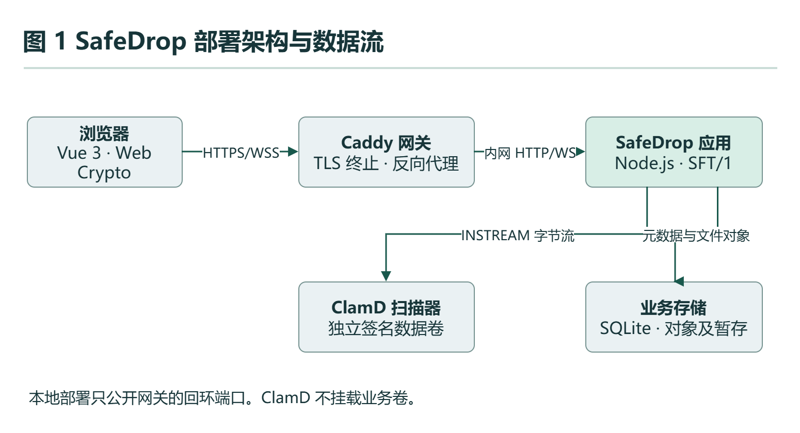
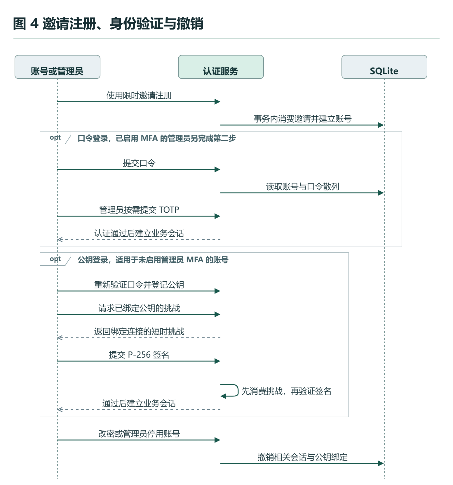
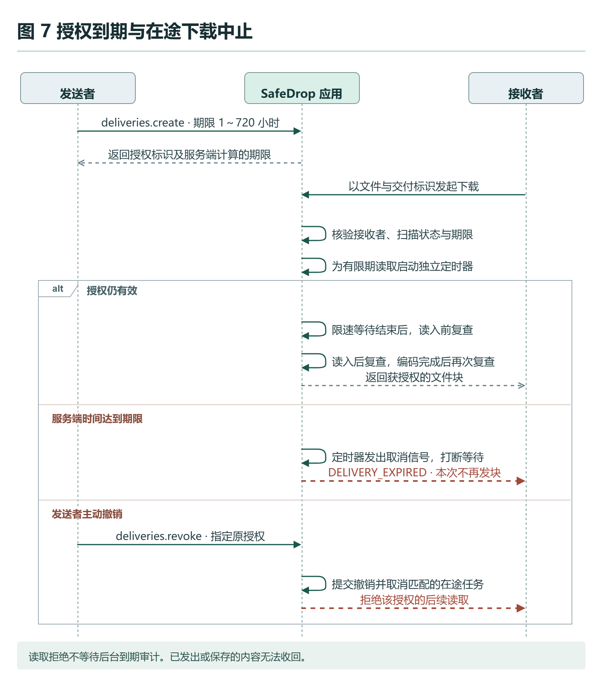
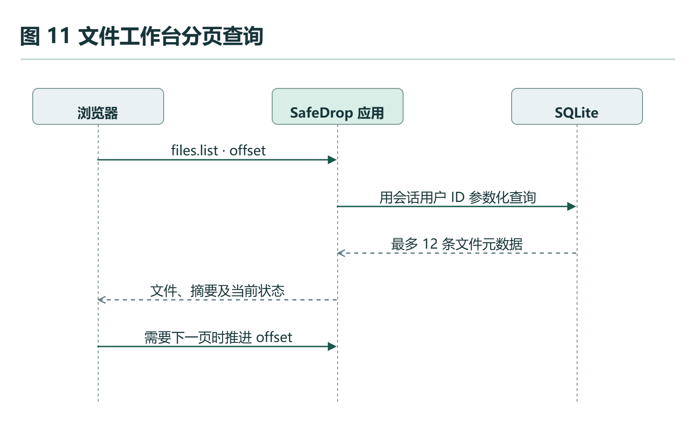
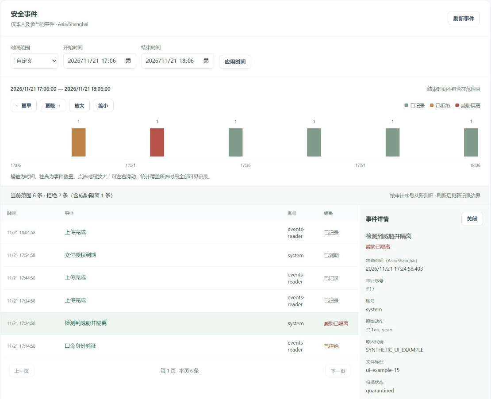

# SafeDrop 安全文件传输与审计平台实验报告

《软件与系统安全》实验 1B · 安全文件传输软件设计与实现

| 项目 | 内容 |
| --- | --- |
| 软件与协议 | SafeDrop 0.1.0，SFT/1 |
| 功能验收基线 | `28a3f4fa5deea226a81f33d813f500627065b96d` |
| 报告修订 | 2026-11-24（北京时间） |
| 源码与提交历史 | [logic-xx/safedrop](https://github.com/logic-xx/safedrop) |

## 摘要

本实验实现了一个面向受控用户组的文件传输系统。浏览器与服务端保持一条经过证书验证的 WSS 通道，应用层协议 SFT/1 在这条通道上承载认证、文件列表、上传和下载等请求。应用使用确定的报文长度、请求编号、持久化偏移和整文件 SHA-256，解决多任务交错、断线续传和文件完成判定三个问题。服务端负责身份绑定、逐次访问检查、账号级带宽限制和审计。扩展功能包括指定用户交付、授权到期、内容扫描、管理员双因素认证，以及独立校验的加密备份与恢复。

课程核心功能已有实际浏览器和自动化证据。历史 Edge 验收观察到两个上传与一个下载同时推进，刷新后从确认位置继续，以及普通和 VIP 速率差异。最终功能基线的 Ubuntu 作业通过 183 个 TLS/WSS 场景，最终 Linux 容器还复验了扫描、期限、重启、MFA 和加密恢复。报告分别记录环境与方法。应用层控制可减少已测资源滥用，公网链路饱和和长期负载没有实验数据。

**关键词**　安全文件传输、WebSocket、断点续传、访问控制、可校验审计

## 1 实验目标与课件对应关系

实验 1B 的核心问题是让多个用户通过长连接可靠交换文件，同时在请求入站、状态更新和内容发出时都执行相应的安全检查。课程讲义《实验 1 讲解 2026.pdf》给出了报头、流程及证书的设计示例。本报告采用讲义第 34 页所列的 Web 开发路线。

| 课件位置 | 实验要求或示例 | 报告对应内容 |
| --- | --- | --- |
| 第 33–35 页 | 多用户并发、完整传输、安全防护，视频展示编译、部署和测试 | 第 2、4、6、7、9 节。并发完整性、证书失败、SQL 注入拒绝和应用层资源约束分别取证 |
| 第 36–39 页 | 长连接及 keepalive、服务端功能流程、各协议模块时序、报头和正确性说明 | 第 1.1 节说明设计取舍，第 3–5 节说明协议与实现。图 2 展示固定报头，图 3–11 解释主要模块。连接管理由浏览器页面内组件承担，独立系统守护进程未实现 |
| 第 40 页 | 断点续传、公钥身份认证、同时上传和下载的 GUI、按身份限速 | 第 5 节给出实现，第 7 节给出四项各自的实际观察及测量范围 |
| 第 41–48 页 | 区分控制与载荷，显式确定文件长度和完成点，限制服务端可访问目录，设计可解析的报头 | 第 2.3、3.1、4.2、5.2 节。图 2 及逐字段表、硬性上限、确认偏移和容器挂载配置均可核对 |
| 第 49–62 页 | PKI、证书绑定与 HTTPS 示例 | 第 2.2、6.1 节。区分服务端 TLS 证书与应用层用户公钥，说明本地 CA 和未实测的公网证书 |
| 第 2–3、33 页 | 未加密 ZIP、Git 链接、按要求命名的源码目录、实际 MP4、PDF 或 DOCX 报告 | 仓库链接见首页，复现及录制见第 9 节。Markdown 是报告编辑源稿，提交格式按讲义办理 |

### 1.1 设计出发点与取舍

- **把文件完成与连接关闭分开。** 一次传输结束后，用户还需要查询列表或发起其他任务。WSS 保留连接和消息边界，SFT/1 用显式长度、请求编号及完成操作区分业务状态。这样，断线只表示通信中断，重连时仍可查询任务进度。报头与保活分别见第 3.1、3.2 节。
- **让续传位置有可核对的依据。** 断线可能使确认响应丢失，客户端显示的进度与服务端实际写入状态就会出现差异。上传在文件块同步落盘后更新确认偏移，下载恢复前则核对本地已保存部分的前缀摘要。逐块同步需要额外的磁盘操作，前缀校验需要重新读取已有字节。第 4.2 节说明了正确性条件，B04、B05 分别记录实际恢复的位置。
- **让同一账号的传输共享额度。** 一个用户可以同时打开多个标签页或启动多个任务，按单连接发放额度会使总用量随着连接数扩大。服务端按账号统一调度发送时刻，让并发任务共享各自档位的预算。验收时比较同一时间窗口内的合计进度，普通档和 VIP 的采样见第 7.2 节。
- **让授权检查覆盖等待与发送之间的变化。** 接收方开始下载时可能有权限，限速等待或读取过程中授权仍可能撤销或到期。服务端在关键时点重新检查，并为有限期读取配置独立取消信号。相应代价是每块读取需要重复检查。图 7 和第 6.1 节 E03、E08 给出时序及验证。
- **给恢复过程留下独立的校验依据。** 如果日志和检查点始终处在同一权限范围，恢复时很难判断它们是否一起被改写。因此维护端独立保管可信检查点，离线校验通过后再恢复到新目录。这增加了检查点和密钥的保管工作。相关流程与实际恢复证据见第 5.4、5.5 和第 7.3 节。

## 2 部署架构与信任边界

### 2.1 组件职责与实现位置

| 层或组件 | 处理内容 | 主要代码入口 |
| --- | --- | --- |
| 浏览器 | Vue 3 文件工作台、上传和下载队列、会话界面、Web Crypto 公钥签名、IndexedDB 保存设备数据 | [web/App.vue](../web/App.vue)、[web/client.ts](../web/client.ts) |
| 应用层协议 | SFT/1 编解码、请求响应匹配、报文及元数据上限 | [shared/protocol.ts](../shared/protocol.ts)、[server/app.ts](../server/app.ts) |
| 应用与业务存储 | 文件和授权访问控制、SQLite 元数据、私有对象文件和暂存、操作记录 | [server/store.ts](../server/store.ts)、[server/storage.ts](../server/storage.ts) |
| 扫描器 | 通过受限 INSTREAM 接收待检字节，返回检测结果，应用判定能否放行 | [server/clamd.ts](../server/clamd.ts)、[server/scans.ts](../server/scans.ts)、[扫描器镜像定义](../deploy/scanner/Dockerfile) |
| 网关与运维 | HTTPS/WSS 入口、隔离网络、加密备份、检查点、离线校验及恢复 | [本地 Caddy 配置](../deploy/Caddyfile.local)、[server/backup.ts](../server/backup.ts)、[scripts/maintenance.ts](../scripts/maintenance.ts) |

WebSocket 提供双向、保持打开的连接和消息边界。SFT/1 在其中定义文件长度、分块偏移、鉴权、错误和完成语义。文件块使用二进制格式，控制字段使用 UTF-8 JSON。与在同一套接口中用 JSON 传输文件内容相比，这样可以避免对每块文件做 Base64 编码，同时保留可扩展的控制字段。服务端按连接匹配请求和响应，任务标识可跨连接恢复。

### 2.2 TLS 信任路径

本机直跑由 Node 提供 HTTPS/WSS，Compose 由 Caddy 终止 TLS。浏览器使用经核对的本地 CA 公共证书验证 localhost 服务证书与主机名。应用在 WebSocket 升级时另检查固定 Origin 和入口路径，浏览器发出的业务请求还需通过应用层身份认证。公钥登录验证的是用户是否持有本机已绑定私钥，TLS 证书验证的是连接目标服务端，两者保护的身份不同。

HTTP 入口提供前端静态资源和 `/health`，业务文件通过鉴权后的 SFT/1 读写。静态路由检查规范化路径是否位于前端目录中，并按类型白名单返回资源。应用设置内容安全策略（CSP）、HSTS、`nosniff` 和禁止框架嵌入，限制脚本来源及站外嵌入。Caddy 为本地 HTTPS 入口设置统一的 HSTS 响应。实际入口、错误主机名拒绝和 CSP 证据见第 7.3 节。

Compose 的网关到应用之间采用隔离内网 HTTP/WS，ClamD 也在受控网络接收文件流。因此部署需信任宿主机、网关、应用及隔离网络。**TLS 提供传输通道加密，SafeDrop 服务端可以处理明文和扫描文件，所以不提供端到端加密。** 公网配置已提供，本实验没有验证实际域名签发、证书续期或外网访问。

### 2.3 目录与进程访问范围

课件第 45 页要求用可检查的配置体现服务端可读写范围。SafeDrop 同时在 Linux 容器层和业务层实施限制。

| 层级 | 明确配置与效果 |
| --- | --- |
| 应用进程 | [compose.yaml](../compose.yaml) 指定 UID/GID `10001:10001`、只读根文件系统、丢弃 capabilities、禁止提权，并规定 CPU、内存与 PID 上限。临时目录使用有大小限制的 `tmpfs` |
| 业务文件及报告 | 应用数据卷挂载于 `/data`，运行目录下的 `objects` 和 `staging` 分别存放已发布对象与上传暂存。项目 `reports` 在容器内只读挂载。应用无需暴露宿主机文件系统路径供客户端遍历 |
| 网络 | 基础本地部署只绑定网关的 `127.0.0.1:8443`。独立验证项目通过 [Compose 覆盖配置](../deploy/compose.verify.yaml) 使用 `127.0.0.1:18443`。应用和扫描端口不向宿主机发布 |
| 扫描器 | 单独用户与签名数据卷，只读根、单独临时目录和 CPU、内存、PID 上限。服务端可发送字节供扫描，扫描器没有业务卷挂载 |
| 文件所有权 | 客户端提交显示名称，服务端校验名称并生成随机物理标识。数据库按认证用户和精确授权查询。管理员可以维护账号与系统，读取他人文件仍需满足文件所有权或交付规则 |

在 Windows 上直接启动时，进程以启动它的用户访问本地目录。应用层权限仍生效，操作系统层边界由 Windows 用户目录权限提供。Linux 容器的只读根与独立用户复验不能推导为 Windows 已有相同的文件系统沙箱。

**持久化与重启。** SQLite 存储账号及身份版本、文件和上传偏移、交付权限、扫描状态、维护相关记录和审计链。`objects/` 保管已发布内容，`staging/` 保管尚未发布的文件块。数据库按 `user_version` 增量迁移，当前架构为 7。应用启动先校验审计链、撤销旧会话，并将被中断的扫描退回待处理。用户重新认证后，仍可查看自己保留的文件、任务和授权。正在进行的请求、连接和进程内限速排程重新建立。参见[数据层](../server/store.ts)和[服务启动](../server/app.ts)。

## 3 SFT/1 协议封装与操作约定

### 3.1 固定报头与长度校验

每个 WebSocket 二进制消息内有一个 SFT/1 报文，按 `固定头（24 B）+ UTF-8 JSON 元数据 + 二进制载荷` 排列。多字节整数用大端序。解码端先检查实际总长，再检查头字段与两个声明长度，最后解析 UTF-8 JSON。

| 字节偏移 | 大小 | 字段 | 解释与约束 |
| --- | ---: | --- | --- |
| 0–3 | 4 B | Magic | 固定 `0x53465431`，按 ASCII 对应 SFT1 |
| 4 | 1 B | Version | 当前版本为 1 |
| 5 | 1 B | Type | 1 为请求，2 为响应。业务入口接收请求类型 |
| 6–7 | 2 B | Flags | 当前定义为 0，解码拒绝非零值 |
| 8–11 | 4 B | Request ID | 响应沿用请求编号。业务请求要求正值，浏览器用它找到对应的待完成请求 |
| 12–15 | 4 B | Stream ID | 保留字段，当前浏览器默认使用 0。跨会话定位依靠服务端任务或文件标识 |
| 16–19 | 4 B | Metadata Length | JSON 的字节数上限为 16 KiB，解码后须为对象 |
| 20–23 | 4 B | Payload Length | 原始字节数上限为 256 KiB，可以为 0。客户端的非 `upload.chunk` 请求不得附带二进制载荷 |

声明长度必须满足 `实际总长 = 24 + 元数据字节数 + 载荷字节数`。SFT/1 的最大单帧为 278552 字节，包含 24 B 固定头、16 KiB 元数据和 256 KiB 文件块。以纯 ASCII 业务心跳 `{"op":"ping"}` 为例，元数据是 13 字节，载荷为 0，整帧是 37 字节。若请求编号为 7，固定头的字节如下。这些字节按编码规范计算。

~~~text
53 46 54 31   01   01   00 00   00 00 00 07   00 00 00 00   00 00 00 0D   00 00 00 00
   Magic     Ver  Type   Flags    Request ID    Stream ID    Metadata      Payload
~~~

| 操作组 | 代表性请求 | 状态或结果 |
| --- | --- | --- |
| 连接与身份 | `hello`、`ping`、`auth.password`、`auth.challenge`、`auth.prove` | 通道能力、心跳响应、待完成的双因素挑战或已认证会话 |
| 所有者操作 | `files.list`、`files.scan`、`upload.init`、`upload.chunk`、`upload.finish` | 分页结果、扫描状态、确认偏移或已发布文件标识 |
| 下载与交付 | `download.init`、`download.chunk`、`deliveries.create`、`deliveries.revoke` | 文件元数据、下一偏移、结束标记、期限或拒绝原因 |
| 审计与维护 | `events.query`、`audit.verify`、`maintenance.backup` | 可见时段统计、快照游标、审计校验或备份状态 |

### 3.2 长连接从建立到恢复

浏览器打开 `/ws`，TLS 和 WebSocket 升级完成后可用 `hello` 获得协议版本、连接标识、块大小和心跳间隔。服务端在底层 TCP 连接显式调用 `setKeepAlive(true, 30000)`，每 20 秒发送 WebSocket ping 并跟踪 pong。页面在线时每 15 秒发送应用层 ping。服务端还通过心跳检查已认证会话状态。一次目录查询、分块确认或正常文件完成之后，连接继续承载下一次请求。

三种探测各有用途。TCP keepalive 可帮助系统发现失联的对端，WebSocket ping/pong 检查这条连接是否仍可收发，应用层 `ping` 经 SFT/1 编解码和请求编号匹配后返回服务端时间，可以确认应用仍处理请求。未登录连接默认有 30 秒认证时限，已进入 MFA 第二步时按该挑战的有效期处理。业务操作逐次检查会话，心跳是连接回收的另一条路径。实现见[浏览器连接客户端](../web/client.ts)和[服务端连接处理](../server/app.ts)。

异常关闭会取消连接上未完成的请求并暂停界面任务。遇到非正常断连，客户端采用退避重连。业务会话绑定原连接，新连接要重新认证，再用任务标识或文件标识查询确认偏移。服务进程重启也不会自动继承原 WebSocket 会话。页面内连接管理覆盖打开页面期间的长连接维护。关闭页面或系统暂停后，浏览器不会启动独立操作系统守护进程。长时间空闲和浏览器异常退出的专项仍待验证。

## 4 服务端处理与实验正确性

### 4.1 从数据帧到业务响应

请求分派和拒绝路径见附录 A 图 10。

服务器为每条连接分配上下文，状态包含会话、未完成请求数和取消信号。WebSocket 升级限制活动连接数及升级请求频率，禁用 WebSocket 消息压缩，按 SFT/1 最大帧设定载荷上限。应用在分派前检查消息边界、速率、队列和审计预算。客户端待响应请求上限为 6。服务端按连接排队，单连接未完成请求达到 8 或全局排队字节超出 16 MiB 时拒绝继续接收。无法解码的帧会关闭连接，能识别对应请求的业务拒绝会返回相同 `requestId` 与稳定错误码。过载与会话撤销可取消等待中的读写。

浏览器工作台的文件列表来自数据库的分页查询。服务端采用已认证用户的身份作为过滤条件，分页查询返回最多 12 行文件信息并附扫描状态。交付列表走独立的参与者权限路径，对方获准读取的交付不会变为接收人自有文件。

文件列表的调用及响应见附录 A 图 11。

### 4.2 结束判定与状态不变量

| 不变量 | 正常路径 | 异常与重试时的行为 |
| --- | --- | --- |
| 业务完成明确可判定 | 上传初始化先声明全长和 SHA-256，已确认偏移等于声明长度后还须显式完成并重新校验内容 | 文件块越界、提前完成、摘要不符均拒绝。客户端断线只结束当次连接，不触发文件发布 |
| 已确认偏移只指向可复用字节 | 文件块写入成功并同步到磁盘后更新 SQLite 偏移，返回结果给发送者 | 数据库偏移保持原值的未确认字节不会被当成成功。重复块须完全落入已确认范围且字节相同，冲突失败 |
| 重连恢复同一个任务或对象 | 刷新后客户端重选同一文件或授权同一保存目标，服务端核对任务归属及信息 | 上传名称、大小和摘要不匹配时拒绝续传。下载前缀不匹配时拒绝接受旧偏移 |
| 能退回失败状态而不泄露后续内容 | 获取下载授权、限速等待、读取、发出前分段复查 | 撤销、过期、账号失效、删除和扫描不通过都会阻止后续字节，已保存内容无法撤回 |
| 取消与发布不会重复计费 | 任务创建时按全长预留，完成事务将预留转为已用。删除或清理成功后释放 | 清理失败保留占用并可重试。互斥和持久化删除意图覆盖取消、完成和故障重启之间的竞争 |

以一个 64 MiB 文件为例，256 KiB 的理论分块数为 256。若可确认的位置是 34 MiB，后续从该偏移继续读取。长度公式只说明协议如何判定进度，实际浏览器操作及恢复位置见第 7 节记录。

## 5 业务模块及关键实现

### 5.1 邀请、身份认证与会话

#### 邀请、口令与账号停用

注册默认采用限时单次邀请，将创建账号的入口限制在已知用户组。管理员在「账号与邀请」选择邀请注册或关闭自助注册，创建 1–168 小时有效的邀请，也可撤销尚未使用的邀请。令牌只在创建时显示，SQLite 保存令牌摘要、签发者、期限、使用和撤销状态。受邀者在登录页选择「使用邀请注册」，自己设置口令，获得普通档用户权限。服务端在计算口令散列前初查令牌和注册策略，在写库前重新核对有效期、未消费及未撤销状态，再事务提交账号、邀请消费和审计。两个申请并发使用同一令牌时最多成功一次。

登录与改密使用随机盐和 scrypt，口令摘要用常量时间接口比较，账号等用户输入使用 SQLite 参数绑定。用户在「安全中心」输入当前口令和新口令。散列计算完成后，服务端复查当前会话及身份版本，在同一事务更新口令、增加身份版本、撤销全部会话和公钥并记审计，随后关闭相关连接。用户用新口令重新认证，仍能找到原文件和未完成上传。已启用的 MFA 保持原配置，初始化文件不会回写新口令。

管理员可在账号列表停用目标账号。服务端保护最后一个可用管理员，将停用标记、身份版本、会话、公钥以及与该账号相关的收发授权一并更新，随后取消相关在途任务。文件和预留仍保留，旧口令、旧公钥或未完成的认证挑战都不能恢复访问。当前界面没有重新启用入口。日常管理权限覆盖邀请、账号停用、全局事件、审计和存储维护。管理员自己上传的文件仍走普通所有者规则，其他用户的文件也需要符合所有权或精确交付授权。参见[账号管理与登录协议](协议与安全设计.md)及[账号模块验收](验证记录.md)。

#### 设备公钥与独立撤销

用户在「安全中心」用当前口令确认绑定。浏览器通过 Web Crypto 生成 P-256 密钥对，将不可导出的私钥 `CryptoKey` 和绑定标识存入本设备 IndexedDB；服务端只接收校验后的公钥 JWK、设备标签及归属。登录时浏览器先按用户名找到本机绑定，服务端构造 30 秒有效的挑战，包含用途、连接、账号、公钥标识和随机值。浏览器签名，服务端先消费挑战，再复查公钥仍有效并验证签名，成功后才建立认证会话。这项实现是 SFT/1 的设备挑战签名，WebAuthn 和 Passkey 属于后续范围。

「撤销公钥」需要再验证当前口令，删除对应服务端公钥并阻止后续登录，已登录连接仍按会话规则处理。「撤销会话」对自己的指定会话写入撤销记录并中止连接，可用于终止另一标签页的传输。普通会话默认一小时，每账号最多八条有效会话；连接断开或应用重启时旧会话也会失效。账号被停用、修改口令或认证因子发生变化时，还会按身份变更规则撤销关联公钥及会话。参见[浏览器签名与设备存储](../web/client.ts)和[身份与会话分派](../server/app.ts)。

#### 管理员 TOTP 与受限恢复

管理员可在「安全中心」以当前口令发起绑定，手动向验证器录入本次密钥，再用一枚六位验证码确认。绑定材料只在当前连接保留，五分钟内需完成。启用后，正确口令只建立带账号和身份版本的两分钟挑战，验证码验证、已使用时间步写入、会话创建与审计提交成功才取得业务权限。服务端接受当前 30 秒步及相邻步，持久化防重放和账号失败计数，切换连接或重启不能清零锁定。启用时撤销旧公钥，公钥登录无法跳过第二因素。

服务端用独立部署密钥对 TOTP 秘密作 AES-256-GCM 加密，认证附加数据绑定账号。界面只在签发时显示十份恢复码，库里仅留绑定账号的摘要和消费状态。验证器丢失时，用户先验证口令，再消费一份恢复码，只获得最多五分钟的受限会话。该会话可以查看 MFA 状态、重新绑定、取消绑定或退出。重新绑定须再次验证当前口令及新验证器的验证码，然后轮换旧密钥和恢复码。正常会话执行停用 MFA 或更新恢复码也须提供当前口令、新验证码和明确确认。独立 MFA 部署密钥不在业务备份内，恢复启用过 MFA 的数据时要另行提供原密钥。参见[管理员双因素认证](管理员双因素认证.md)与[实现](../server/mfa.ts)。

### 5.2 上传下载、GUI 并发、账号限速与文件管理

浏览器文件工作台将上传与下载显示为可独立暂停和恢复的任务，每个页面同一时刻最多三个运行任务。上传先通过 `upload.init` 登记名称、大小和摘要，并预留整个文件。服务端同步落盘并更新偏移后才确认文件块。断线重连后，浏览器重新认证，通过 `upload.init` 提交原任务标识和文件信息。服务端核对任务归属及名称、大小、摘要，匹配时以服务端记录的偏移继续，信息不符时拒绝续传原任务。

下载恢复时，浏览器根据已保存的偏移计算本地前缀摘要，并由 `download.init` 提交给服务端。服务端读出同长度的源文件前缀做校验。摘要不一致时返回 `PREFIX_MISMATCH`。通过后，浏览器用 `download.chunk` 从接受的偏移取块，检查每次返回的下一偏移，并在完成后核对全文件 SHA-256。原生磁盘续传依赖浏览器保存权限，未正常退出时可能只保留到最后一个持久化检查点。浏览器不支持原生保存时，小文件可走 Blob 下载。

限速由服务端的 [Bandwidth 调度器](../server/limits.ts) 实施。对同一账号，调度器在单调时钟上同步预留开始时间，将下一个可用时刻前推 `块字节数 / 档位速率`，因此多个会话和多个任务共享同一时间预算。普通档默认 1 MiB/s，VIP 档默认 4 MiB/s，下载按实际接收账号计费。等待过长会拒绝新请求，进程内预算随进程生命周期建立。这不构成跨节点限速。瞬时速率可受首块和采样方式影响，实验采用持续区间测量，见第 7.2 节。

#### 分块确认、完成与异常恢复

例如服务端已将某上传的确认偏移写为 34 MiB，但浏览器没来得及收到确认便断线。客户端重新登录并选择同一文件，按账号、名称、大小和整文件摘要匹配 IndexedDB 的任务标识或服务端未完成任务。以 `upload.init` 返回的 34 MiB 为准。已确认区间的重发只有在字节相同且完全落在已确认范围内时才成功。相反，如果磁盘写入完成但数据库还没更新，超出旧偏移的字节仍未获确认；重试从旧偏移写入。收到所有块后，`upload.finish` 重新读取整文件校验实际大小和 SHA-256，才将暂存文件发布为对象、扣除预留并事务登记扫描。发布确认丢失时，同一所有者可用原任务标识取得已完成结果。

下载保存目标需用户授权。浏览器将保存句柄和已提交位置保存在本设备，按账号、对象以及具体交付授权区分。原生保存每推进约 4 MiB 提交一次磁盘检查点，正常暂停时尝试保存当前位置，异常退出只能从已提交位置恢复。续传时服务端校验本地前缀摘要对应的源对象内容，下载结束还要同时满足已知总长、块响应 `next` 与 `eof` 的约定及整文件 SHA-256。校验失败不会显示传输成功。桌面 Edge/Chrome 支持原生保存的路径，缺少该能力时普通 Blob 下载上限为 32 MiB。

多选/拖放可创建上传任务，下载通过工作台或收件列表加入队列。队列提供摘要计算、传输、暂停、校验及完成状态。暂停和浏览器重连保留任务依据，主动取消则进入下述服务端删除流程。账号切换时客户端隔离旧队列和迟到响应，避免旧任务被新会话继续。校验代码和证据入口见[客户端任务队列](../web/App.vue)、[SFT/1 协议文档](协议与安全设计.md)及第 7 节。

#### 文件管理、配额与安全删除

文件工作台分页读取自己的文件，页面支持按名称搜索、重命名、删除和清理未完成上传。名称搜索在客户端过滤已读取的列表；服务端分页仍绑定当前账号。重命名只更新显示名，文件标识、字节和摘要保持，已有授权和下载位置继续指向原对象。当前版本不提供回收站。

界面将已完成文件计入「已用」，将未完成上传的**声明全长**计入「预留」，可用量由两者从账号配额扣减。默认每账号 1 GiB、单文件最大 512 MiB、文件和未完成上传共最多 1000 项，同时未完成上传最多 16 项。创建任务时先校验账号与全局预算再建暂存文件。例如 100 MiB 文件只上传了 10 MiB，逻辑预留仍是 100 MiB。发布完成才把该预留转为已用；新建任务出错而暂存无法确认时，系统保留任务和预留并提示清理。

用户确认永久删除或取消后，服务端先复查所有权并占用对象锁，持久化删除意图，再中断该文件在途读取，撤销关联授权，清理随机物理标识对应的文件。取消上传时同时检查暂存及可能遗留的发布对象。磁盘删除成功后才事务删除对象或任务记录并释放容量。失败会留下「删除待重试」或「取消待重试」及原占用，重启后仍可重试；被标记文件的后续读取受阻。账号隔离、短写及清理失败等验收见[文件与配额记录](验证记录.md)。

### 5.3 内容检测与受控交付

#### 扫描状态和放行条件

上传发布时事务登记待扫描任务，工作台可先显示摘要校验完成，实际读取要等扫描通过。扫描器通过 ClamD `INSTREAM` 接收受大小与超时限制的字节流，不接收宿主机文件路径。应用在扫描前后检查引擎版本及签名库时效，确认送检字节数与 SHA-256，扫描结果绑定对象、大小、摘要和本次扫描代次。判定与审计在同一事务提交，避免旧扫描覆盖新请求，也避免没有审计的放行。默认签名库最长允许 72 小时，已通过结果默认 168 小时后需重新检查。

| 界面状态 | 用户能做什么 | 服务端处理 |
| --- | --- | --- |
| 未扫描或结果过期 | 所有者在工作台点「请求扫描」或「重试扫描」 | 原有文件没有有效记录时默认阻止读取；重新排队更换扫描代次 |
| 等待扫描、正在扫描 | 查看状态，等待结果 | 文件可留在列表但不可下载或交付；重启将中断的扫描还原为待处理 |
| 扫描通过 | 所有者可下载或交付，接收者须另有有效授权 | 创建交付、下载初始化、分块和发出响应前仍检查可读状态；发起重扫会先使既有读取失效并取消在途下载 |
| 扫描未完成或已隔离 | 所有者可重试扫描或按规则删除文件 | 超时、签名过期、引擎不可用及无法完成检查均拒绝放行。检测命中进入逻辑隔离，原对象和占用保留，接收者及管理员不能代所有者强制放行 |

真实引擎检出标准测试签名及拒绝下载、交付的证据来自隔离 Linux CI。附录 B 图 13 的无害文件和受控隔离行说明用户界面怎样显示结果。**扫描不能保证发现所有恶意内容。** 参见[扫描队列](../server/scans.ts)、[ClamD 客户端](../server/clamd.ts)和[文件扫描与隔离](文件扫描与隔离.md)。

#### 交付创建、撤销、到期和重启

所有者可以向已注册账号发送只读授权，服务端在原对象上检查接收者、授权标识和扫描状态。新授权由服务器根据当前时间计算期限，可选择 1–720 个整数小时，默认 168 小时。旧授权的无期限值仅作兼容。有效授权的重复发送不会改期，重发已撤销或过期的授权会产生不同标识。

用户先在工作台点「发送给用户」，用 `deliveries.prepare` 核对显示出的账号与文件，勾选后用 `deliveries.create` 提交。服务端在实际创建时重新检查所有者、文件状态、扫描和接收账号有效性，拒绝发给自己或停用账号。SQLite 存放授权标识、原对象、收发双方、创建时间、到期时间及终止原因。原文件只占所有者的空间，接收者通过「收发文件」下载，并使用自己的带宽。接收者无权改名、删除、再授权或重扫。发送方可查阅已发送记录与到期时间，收件方仍可看到到期记录及禁用的下载入口。标签反映授权状态，下载开始事件也只记录开始读取。

有限期的下载请求有独立定时器。带宽等待结束、读入文件之前、读入之后，以及响应编码完成而尚未发出时，服务端都会复查可读状态。若等待中到期，定时器会发出取消信号，该请求返回 `DELIVERY_EXPIRED`，不再发送文件块。发送者主动撤销则持久化撤销，并取消匹配原授权的在途任务。后台到期审计即使尚未写入，读取路径仍按服务端时间拒绝。**撤销与到期能限制后续访问，不能收回已保存的内容。** 详见[交付授权到期](交付授权到期.md)。

例如接收者在到期前已保存了首块，下一块正在限速队列里等待。服务器时间达到授权终点时，该请求被取消。接收者之后即使保有本地保存句柄和前缀摘要，原授权也无法通过初始化校验。若发送者删除文件，或任一方账号停用，相关授权随之终止。重启后连接需重新认证，数据库中的有效期限和撤销原因仍存在，旧授权不会重新生效。真实 Linux 探针验证等待取消、过期、重启和恢复，附录 B 图 14 显示模拟时钟下的按钮状态。

### 5.4 安全事件浏览与审计链

新时间线支持展开、平移、缩放、详情与分页。服务端把角色和参与者过滤同时应用于聚合与列表，保证普通用户看不到无关账号的事件。查询使用左闭右开的时段并限制最长 31 天，第一页固定审计序号边界，后续页沿用同一范围和边界。分布计数覆盖可见时段，列表由游标分页，因而新事件到来时不会在已有快照中插入。时间线便于定位事件，审计完整性需由独立校验流程证明。

用户可在「安全中心」先选最近一小时、一天、一周或自定义时间，再用柱状概览缩小范围，点记录按需看准确时间、事件结果和对象。普通账号能看到自己的操作、自己对象的扫描事件及参与的交付事件。管理员拥有全局事件视图。`events.query` 先按账号权限和时间取得可见序号上限，再对同一快照统计范围内各时段和查询列表。翻页以最后一条已返回序号向前继续，刷新才获取新快照。空的普通用户查询不会暴露全局审计序号。详情投影限定字段及响应字节数，原始审计内容保留给有权限的校验和导出。参见[事件查询](../server/events.ts)和附录 B 图 12。

每条审计记录按序号串联，其摘要由前一记录的摘要文本和本条事件原始文本计算得到。校验检查连续序号、前序摘要和该条 SHA-256。运维端可附加独立保存的 `{count, head}` 检查点，与同一序号的摘要对照。**哈希链依赖独立可信检查点**。若攻击者可重写原库与检查点，链内自洽不足以证明历史真实。审计容量不足时限制相应写入，保护已有记录。

管理员在「审计与验证」可以校验当前链、分页导出日志与检查点或载入已有检查点对照。外部维护端还可在可信 HTTPS 下单独取得小型检查点并排他保存。应用对关键状态写入先预留审计预算，按动作记录成功或拒绝，拒绝日志另有限频和余量保护。管理员界面也可查看由本机命令生成的测试报告；网页仅读取现有 JSON，生成测试报告走独立命令。长报告通过受限二进制载荷返回，以避开 SFT/1 元数据长度限制。参见[校验与导出入口](../scripts/maintenance.ts)及[协议与安全设计](协议与安全设计.md)。

### 5.5 存储保护、一致备份与恢复

#### 全局预算、磁盘保护和过期清理

账号配额防止单个用户占满资源，全局预算约束多个账号合计的占用。默认总逻辑预算 10 GiB、对象与任务合计 10000 项、最低磁盘余量 256 MiB。新任务按整文件大小核对全局容量和数量，磁盘则核对真实可用字节能否同时覆盖最低余量、所有未写完字节和新任务。写块时再读取实际文件系统余量。比如其他程序在上传途中占用了磁盘，服务端可以停止后续写入并保留原偏移和预留。无法读取余量会拒绝新建与继续写入。

「存储与维护」可让管理员查看压力、运行安全清理和检查备份状态。清理只选取超过活动期限的未完成上传，默认期限七天，每批最多 16 项。服务端重新检查活动时间和对象锁，跳过刚有活动或正在处理的任务，后续沿用持久化删除意图和失败保留机制。已完成文件不在这项清理范围内。默认手动运行，也可通过 `CLEANUP_INTERVAL_SECONDS` 启用定时检查。默认审计逻辑预算 64 MiB，容量不足时限制需要审计的写操作，保留已有记录供维护者归档；该预算不能代替对 SQLite、WAL、备份目录和磁盘实际空间的监控。参见[存储预算代码](../server/storage.ts)及[存储维护与恢复](存储维护与恢复.md)。

#### 一致快照、加密与离线恢复

维护过程协调在途写入和扫描，对 SQLite、对象、任务以及审计链段取得一致视图。格式 2 加密备份以独立于 MFA 的备份密钥为根，通过 HKDF-SHA-256 派生每副本密钥，用 AES-256-GCM 认证并加密清单和条目。轮换后保留旧密钥，使旧副本能继续解密。要求加密时缺密钥会拒绝创建。旧明文副本须显式选择兼容读取。在线业务文件本身未静态加密，校验或恢复所需临时明文需存放在受保护目录。

管理员从维护页请求备份。应用先暂停接收新业务并阻止新的扫描，等待已接收的请求和扫描收尾，再复核管理员会话、密钥位置、备份份数、容量和磁盘余量。暂存区内创建 SQLite 快照、复制对象及未完成上传，并按原内容归档审计链段。校验通过后才发布完成的备份，成功或失败均离开维护状态。默认备份上限 3 份、20 GiB，失败后留下的副本也占预算，界面不会自动删旧。密钥由维护端在受保护路径初始化及轮换，新副本采用当前密钥编号，旧副本用原编号选择保留的密钥。独立密钥文件由维护者单独保管。

恢复时对照副本和早于备份的可信检查点，验证认证标签、条目摘要、SQLite 完整性及审计链，再写到不存在的目标目录。恢复失败不会替换运行中的原库，部分写入以失败标记隔离。备份独立密钥、MFA 独立密钥和部署 CA 私钥按用途分别保管。详见[存储维护与恢复](存储维护与恢复.md)及[备份加密与密钥管理](备份加密与密钥管理.md)。

例如可信介质先保存了第 51 条原始审计的序号和摘要。之后创建的副本可以包含更多事件，离线工具重算原链，并检查副本里第 51 条摘要是否与外部记录相同。只改写副本尾部或删除、重排日志会受到链与清单校验约束；有能力重算整个历史的人仍需与独立保管的旧摘要匹配。检查点只约束它锚定的历史前缀，无法证明它之后的记录未经可信边界内的人改写。若该序号不在备份内或摘要不符，校验失败。通过后恢复程序才写新目录。实际运行部署还需单独提供原 MFA 密钥（如有启用），并验证恢复数据及原有权限。附录 B 图 15 展示历史备份创建界面，第 7.3 节分别列出真实原卷及恢复副本证据。

## 6 威胁、防护与验证方法

### 6.1 威胁模型

保护对象包括文件字节、账号及会话、授权状态、备份和可追溯的审计记录。外部网络、所有客户端输入和上传文件均按不可信处理。普通账号可能故意发送越权、畸形或过量请求，授权接收者也可能保存已收到的内容。可信条件包括正确核验的 CA、受控的部署主机和内网、标准密码库、合理的服务端时间，以及应用进程无法改写的独立检查点。具备宿主机控制权的一方可以越过部分应用边界，本实验不提供对被完全控制宿主机的隔离证明。

| 威胁或异常 | 主要控制 | 采用的验证及可观察结果 | 结果边界 |
| --- | --- | --- | --- |
| 中间人、非允许网页来源 | HTTPS/WSS 校验证书链与主机名，升级阶段固定 Origin | 真实 TLS/WSS 环境拒绝不可信 CA、错误主机名及非允许 Origin，可信连接仍能运行（E01、E08、E09） | 网关内网是可信部署边界，公网域名没有实际验证 |
| SQL 注入、非法文件名 | SQLite 参数绑定，文件名校验，服务端控制物理对象路径 | 登录注入用例不能绕过身份检查，目录穿越文件名被拒绝（E01、E02） | 已测试输入覆盖相应入口，未声明完全排除所有实现缺陷 |
| 暴力认证、连接与资源耗尽 | 认证和升级频率限制，连接数、帧长、队列、带宽与全局存储预算 | 畸形或超大帧、认证频率、账号聚合带宽、存储配额等用例通过（E01、E02、E08） | 只覆盖应用层资源滥用，公网 DDoS、链路带宽耗尽和多节点压力未实测 |
| 未登录、跨账号读取、旧公钥或会话重试 | 连接绑定、对象归属、一次挑战、公钥与会话撤销 | 不相关账号、已撤销会话和旧签名被拒，管理员也不能直接读取其他用户对象（E01–E04） | 管理员 TOTP 可选，当前没有账号自动恢复机制 |
| 内容改变、读写故障、恢复位置错误 | 整文件摘要、严格偏移、同步后确认、完整预留、清理失败保留计费 | 提前完成、错误摘要、冲突块、短写、前缀误配等被拒。重启仍可从记录位置续传（E01、E02） | 文件写入与数据库异常包括受控故障注入，不能代替真实硬件故障或断电测试 |
| 有害或不完整可检内容 | 引擎检测、结果时效、未通过阻止读取、逻辑隔离 | Linux 容器真实引擎识别标准测试签名，拒绝隔离、不可完整检测和故障路径（E05、E08） | 受扫描规则和签名覆盖限制，界面夹具的隔离示例另单列 |
| 到期授权继续读取 | 逐阶段检查、独立定时取消、持久化终态 | 等带宽后、读取后和发送前补核。跨重启、重发和恢复时旧期限保持（E03、E08） | 已保存的客户端副本不受后续授权控制 |
| 审计重写、备份损坏或泄露 | 哈希链与独立检查点、独立密钥和认证加密、隔离恢复 | 校验检查点、错钥和篡改拒绝、SQLite 和文件清单验证成功（E06、E09） | 校验者和检查点的可信性需要由部署者维持 |
| 多账号事件泄露、构建证据套错对象 | 事件角色过滤、快照游标、运行时组成和镜像 ID 绑定 | 普通用户范围、完整时段分布和稳定翻页通过。固定最终镜像组成经同一镜像扫描门槛核验（E07–E10） | 大审计库长期压力及镜像仍存在的中、低、未知发现未在此项消除 |

证据编号按[交付证据索引](交付证据索引.md)解释，完整的威胁和测试入口见[安全验证矩阵](安全验证矩阵.md)。这些用例在自己的应用、临时账号或 CI 隔离环境内运行。

### 6.2 环境、测量口径及证据类型

测试由不同环境分工。历史 Edge 观察确认真实的界面操作与磁盘保存结果。TLS/WSS 自动测试确认协议层的精确偏移、身份和错误断言。Windows 与 Ubuntu 平台作业独立记录测试数，镜像作业确认 Linux 运行时、真实扫描与隔离，宿主机原卷操作确认升级前的数据是否留下。这几类证据回答的问题不同，覆盖有交集。

| 环境 | 取证方式 | 可以据此确认 |
| --- | --- | --- |
| 早期 Edge B01–B09 | 真实浏览器、受控本机部署、文件大小和 SHA-256 比对 | 多任务、原生保留、续传、公钥及带宽样本 |
| Windows 和 Ubuntu CI | Node 24.22.3 的实际平台构建与默认套件，Ubuntu 额外运行安全场景 | 源码编译与平台结果。Ubuntu 的独立场景报告提供明确断言 |
| Linux x64 容器 CI | 启动实际应用、网关和扫描器镜像，验证功能并扫描最终镜像 | 真实容器组成与镜像身份、隔离网络、严格入口、ClamAV、重启与恢复 |
| 本机原卷及接口补核 | 使用者用普通 PowerShell 操作，工具读取生成的报告，再核对实际 HTTPS/WSS 和恢复副本 | 保留已有数据、真实入口连接条件、加密备份及独立离线恢复 |
| 安全中心专项 Edge B51–B55 | 在回环 HTTP 夹具直接操作，审计输入为合成事件 | 真实界面上可见范围的区别、拖动和缩放、快照分页及布局，TLS 与扫描由其他证据支持 |

### 6.3 自动检查与供应链证据

| 检查 | 如何运行及判读 |
| --- | --- |
| 构建与回归 | [GitHub Actions 工作流](../.github/workflows/security.yml)在 Windows、Ubuntu 按锁文件安装并编译，随后运行 `npm test`。Ubuntu 另运行 `npm run security:report`，用独立的临时账号和数据，通过真实 TLS/WSS 检查相应协议断言并生成 JSON/HTML 报告。使用受控扫描结果的用例与真实引擎专用检查分列 |
| 依赖审计 | 源码作业将生产依赖和完整依赖分别审计。生产高危/严重发现阻断。开发范围的限时例外要求公告、包名、安装版本、依赖范围和有效期精确匹配，过期会阻断。构建链中历史接受的风险保留在专门记录中 |
| 凭据与制品 | 以固定版本 Gitleaks 扫描当前非忽略源码和可达提交历史。用独立合成样本验证真实检测及报告脱敏，制品上传前再查白名单内的报告。扫描失败或命中均拒绝上传；不把整个本机报告目录或业务数据归档 |
| 运行时证明 | 镜像作业实际启动应用、网关和 ClamAV。应用及扫描器证明核对固定 Node/C++ 文件、运行时清单、系统 OpenSSL 缺省、Node 静态 TLS/QUIC 状态；网关另校验实际二进制及固定 Go 依赖；扫描器另核官方包来源、版本及签名检查。版本 12 报告包含实际镜像标识和重启前后的功能断言 |
| 最终镜像扫描 | Trivy 分别扫描实际应用、网关和扫描器镜像。门禁按采用的漏洞库、原始发现和有依据的厂商修复判定，核对结果与实际测试镜像身份。只扫描基础镜像或读到旧报告不能证明当前最终镜像通过 |

第 7.3 节报告实际通过数。安全检查入口、例外规则与证据产物范围见[安全自动化](安全自动化.md)和[镜像风险与修补](镜像风险与修补.md)。最终运行时省去了未使用的系统 OpenSSL。Node 内置 OpenSSL 仍为 **3.5.9**，本次运行时修订没有为其打补丁。

## 7 实验结果与分析

### 7.1 课程加分项的直接证据

下表沿用已归档结果。步骤、浏览器范围和文件摘要见[浏览器验收清单](浏览器验收清单.md) B01–B09 及对应的[验证记录](验证记录.md)。

| 课件加分项 | 操作、样本和实际结果 |
| --- | --- |
| 上传断点续传 | B04 以 64 MiB 文件上传。先在 8.5 MiB 暂停并继续，另一次在 34 MiB 暂停，刷新登录并重选原文件，观察到进度继续到 34.75 MiB。最终下载件 SHA-256 与源一致 |
| 下载断点续传 | B05 选择原生磁盘保存，先在 4.75 MiB 暂停并恢复，52.75 MiB 时再次暂停。刷新、重新登录及授权后从 52.75 MiB 恢复。恢复过程中保持一个任务条目，最后 64 MiB 的文件按字节及 SHA-256 与源一致 |
| 基于公钥的身份认证 | B06 完成同一浏览器的公钥登记、退出后以该公钥重新认证、撤销并再次尝试。已撤销公钥被拒。错误签名与挑战重放由对应自动场景验证 |
| GUI 同时上传和下载 | B03 同时运行两个 32 MiB 上传和一个 64 MiB 下载，三个进度交错增长。上传服务端摘要均正确，保存的下载件与原件逐字节一致。B02 另验证 784 字节中文文件与空文件 |
| 按身份限制带宽 | B08 比较普通档与 VIP 档，并在普通档同时进行两上传和一下载。增加任务后，共享预算附近的速率按照合计数据量计算，见下表 |

### 7.2 带宽的实测计算

区间平均速率以确认字节增量除以经过秒数计算。单位为 MiB 和 MiB/s。对同一账号的并发任务，将各自区间字节增量相加，再除以共同采样时长。

| B08 历史样本 | 区间增量和用时 | 计算或观察结果 |
| --- | --- | ---: |
| 普通档，64 MiB 文件单上传 | 从 12.75 到 33.5 MiB，增量 20.75 MiB。20.762 s | 约 0.999 MiB/s |
| 普通档，两个上传加一个下载 | 三个任务各前进 9.5 MiB，合计 28.5 MiB。28.471 s | 合计约 1.001 MiB/s |
| VIP 档，同一个 64 MiB 文件单上传 | 剩余 57.75 MiB。用秒级完成事件推定 13.955–14.955 s | 约 3.86–4.14 MiB/s |

普通档的单任务速率与三任务合计相近，说明样本内未观察到按任务翻倍的带宽。VIP 的完成事件只有秒级精度，结果用区间表达，后一次看到已完成的时刻没有当成精确完成时间。本测量来自早期受控环境，只有所列样本，可用于说明身份档位和聚合限制，不能估计最大吞吐、普遍网速或延迟分布。出处为[浏览器验收清单](浏览器验收清单.md)的 B08 采样表。

### 7.3 最终代码基线与原卷复验

| 方式 | 基线与结果 |
| --- | --- |
| GitHub Actions 平台构建与默认测试 | `28a3f4f`，Windows 64 项中 61 通过、3 跳过。Ubuntu 64 项中 58 通过、6 跳过，均零失败 |
| 独立协议安全场景 | Ubuntu CI 为 **183/183**。本机留存的独立 TLS/WSS 报告同样为 183/183，包含各自的环境和报告信息 |
| CI 源码与实际 Linux x64 容器 | 四个作业全成功。版本 12 容器通过扫描、到期、MFA、加密恢复、旧 CA、严格 HTTPS/WSS、运行时组成及新事件查询重启前后检查。应用、网关、扫描器的最终实际镜像原始高危和严重发现各为 0 |
| 新安全中心浏览器观察 | 事件候选在此前 Edge B51–B55 夹具通过。例子来自合成审计的受控界面，实际原卷入口复验未增加浏览器点击。浏览器观察与容器重启/API 检查各自记录 |
| 使用者本机原卷操作 | 普通 PowerShell 完成版本 12 原卷验收，保持账号、CA、独立备份密钥和原 MFA 设置，保留 **1062 条原记录** |
| 工具实际入口和备份补核 | 实际 HTTPS 健康 200，错误主机名拒绝、CSP 和严格 WSS 通过。实际入口 `index-DUBTec1l.js` 与当时的本机最终构建字节相同。不与 CI 资源认作同一个构建结果。加密备份和独立检查点再验证后，隔离副本 SQLite 7，`integrity_check=ok`，37 个文件、888 条审计 |

两个默认平台测试均有真实 ClamAV 直连、旧新网关二进制及真实凭据扫描合成样本复验的配置型跳过。对应内容由镜像或源码作业独立执行。Ubuntu 另跳过两个 Windows PowerShell 专用用例和一个非 Linux 上拒绝生成最终运行时证明的用例，Windows 作业执行。平台测试、专用探针和 183 场景的数量各自列示。CI 为隔离新卷，1062 条原记录来自本机保留原卷，888 条审计来自具体时间点的隔离恢复副本。

成功轮次为 [GitHub Actions 45008996789](https://github.com/logic-xx/safedrop/actions/runs/45008996789)。官方作业日志与制品元数据已保存。三份官方 ZIP 取得连接器引用，但本机未能读取归档字节，摘要复算、安全解包和对应的剩余风险明细仍待归档。证据路径及可公开范围见[交付证据索引](交付证据索引.md)。

课程录屏另使用本机独立源码和临时账号。操作者录制 Windows 构建、交付及恢复等代表性场景；录屏目录中的安全报告为 **183/183**。工具复算 `demo-b.bin` 与接收者保存的 `received-demo-b.bin`，SHA-256 一致。录屏恢复目录的只读检查为 `integrity_check=ok`，共 **3 个文件**，独立于表中的 37 文件原卷恢复记录。到期片段使用回环夹具时钟，隔离页面使用已有受控素材，真实扫描和在途到期拒绝仍引用实验室自动与容器证据。

## 8 实现演进、问题定位与实验局限

### 8.1 从问题到复验

| 问题 | 定位与修正 | 复验依据 |
| --- | --- | --- |
| 切换账号时可能残留旧任务，恢复下载可能新增重复条目 | 明确把界面队列和请求生命周期绑定到创建它的认证上下文。重用暂停任务，隔离旧连接的延迟响应 | 历史 Edge 续传和账号切换复验，以及浏览器会话竞争自动用例。见[浏览器验收清单](浏览器验收清单.md) |
| 安全事件页只取最近记录，范围统计和分页失真 | 由服务端统一过滤可见范围，再分别返回完整时段分布和序号快照分页。界面后台刷新保留当前详情 | Edge B51–B55 与 TLS/WSS 查询验证，实际 Linux 和本机原卷补核分列。见[验证记录](验证记录.md) |
| 首轮事件查询版本的真实容器功能通过，但镜像门槛失败 | 保留 [run 45004963588](https://github.com/logic-xx/safedrop/actions/runs/45004963588) 的失败记录。定位应用和扫描器各一个系统 `libssl3t64` HIGH，核对运行时实际依赖后省去未使用系统包，并将新组成证明绑定到所扫描镜像 | 后续 `28a3f4f` 的最终 Linux 版本 12 和三镜像门槛通过。保留 Node 内置 OpenSSL 3.5.9，此轮没有给内置库打补丁。见[镜像风险与修补](镜像风险与修补.md) |
| 原卷入口的首轮补核误用了 CI 前端构建资源名 | 先读取实际本机入口引用，再与本机最终构建按字节比对 | 新核对通过，原失败探针仍保留，Ubuntu/容器 runner、Windows runner 和原卷各记自己的产物身份。见[验证记录](验证记录.md) |

同一项功能需要分别回答三个问题：设计约束写在何处，实际运行时是否执行该约束，交付记录能否定位到验证过的环境和文件。预期失败、重试及其发生环境与成功结果一起保存，便于追溯改动依据。

### 8.2 已知局限

- 连接管理器随浏览器页面运行，操作系统没有额外守护进程。单节点状态、应用层资源约束和现有测试不支持对公网 DDoS、多节点扩展或长期高负载作结论。
- 断点续传依赖可恢复的确认偏移或磁盘检查点。浏览器突然退出、真实断电、硬件故障及全新 Windows 机器尚未完成专项复验。
- TLS 和备份加密保护各自路径。在线业务对象可由受信任服务端处理，内容扫描存在遗漏，授权终止无法影响已被接收端保存的副本。
- 审计一致性依赖独立可信锚点。新备份密钥与源库不同用途，旧格式、临时明文和外部介质还需独立保护。
- 镜像门槛只涵盖已用数据库对具体镜像的发现。网关已记录的中风险、其他中低未知发现及静态依赖识别限制继续保留。公网证书签发和外网访问未实测。

## 9 从源码搭建与复现实验

将交付源码解压到独立目录，打开 PowerShell 并进入含 `package.json`、`package-lock.json` 和 `compose.yaml` 的项目根目录。两条路线默认都使用 `https://localhost:8443`，在同一台机器一次运行其中一套。各实例信任各自的 CA。首次登录需要应用启动、浏览器信任该实例的 CA 和本次初始化的账号。完整的上传后读取、交付和扫描验证还需要配置可用的 ClamAV 及有效官方签名库。

### 9.1 Windows 本机运行

**前置环境**　Windows PowerShell、Node.js 24.x（`>=24.14.0 <25`，验收固定 24.22.3）、随附 npm、能够运行的 OpenSSL 命令行及桌面 Edge 或 Chrome。用桌面浏览器验证原生保存和下载续传。若 `openssl.exe` 不在 PATH，将 `$env:OPENSSL_PATH` 设为它的实际完整路径再运行初始化。无需为本机基本登录启动 Docker。

~~~powershell
node --version
npm.cmd --version
openssl.exe version
npm.cmd ci
npm.cmd run build
npm.cmd run setup
~~~

`npm.cmd ci` 联网按 `package-lock.json` 安装依赖。录屏中的 `npm.cmd ci --offline --cache '..\npm-cache'` 使用提前准备的 npm 缓存安装同一锁文件的依赖。助教可以直接使用上述联网命令，源码包无需附缓存。随后的 `npm.cmd run build` 从交付源码实际执行 Vue 类型检查、服务端 TypeScript 编译与 Vite 构建，生成 `build/` 和 `dist/`。`npm.cmd run setup` 为本次目录生成本地 CA、TLS 服务证书、SQLite 结构及初始化账号。

**基本登录**　在项目根目录执行 `npm.cmd start`。看到 `SafeDrop ready: https://localhost:8443` 后，核对本次生成的 `.local/tls/ca.crt`，在 Windows 证书安装向导中选择「当前用户」和「受信任的根证书颁发机构」，重开浏览器后访问 `https://localhost:8443`。导入公开 CA 证书即可，服务端私钥留在运行目录。用第 9.3 节的随机口令登录。在没有可用扫描引擎时仍可验证登录、页面和上传登记，文件只有经扫描通过后才能下载或交付。

**完整传输与扫描**　使用官方 Windows x64 ClamAV 1.5.5 和有效签名。从安装包的 `conf_examples` 复制 `freshclam.conf.sample` 和 `clamd.conf.sample`，在工具目录另存为 `freshclam.conf` 和 `clamd.conf`，去除启用的 `Example` 行。为二者设置同一个已存在、对运行用户可读写的 `DatabaseDirectory`，路径用引号包起来。参见 [ClamAV 1.5.5 官方发布](https://github.com/Cisco-Talos/clamav/releases/tag/clamav-1.5.5)及[官方 Windows 配置](https://docs.clamav.net/manual/Usage/Configuration.html#windows)。

| 文件 | 主要配置值 |
| --- | --- |
| `freshclam.conf` | `DatabaseMirror database.clamav.net` |
| `clamd.conf` 监听 | `Foreground yes`、`TCPAddr 127.0.0.1`、`TCPSocket 3310` |
| `clamd.conf` 检查 | `AlertEncrypted yes`、`AlertExceedsMax yes`、`StreamMaxLength 512M`、`MaxFileSize 512M`、`MaxScanSize 1024M`、`MaxFiles 10000`、`MaxRecursion 16`、`MaxScanTime 60000` |

用表中的值更新配置中的对应项，每项占一行。签名时效、更新策略和其他限制见[SafeDrop 扫描说明](文件扫描与隔离.md)。

在单独的 PowerShell 中先更新签名，再启动只监听回环的扫描服务。把示例工具目录替换为实际位置。保持窗口运行。

~~~powershell
$clamav = 'C:\Tools\clamav-1.5.5.win.x64'
& (Join-Path $clamav 'freshclam.exe') "--config-file=$(Join-Path $clamav 'freshclam.conf')"
# 确认签名更新完成后执行以下两行
$env:TZ = 'UTC'
& (Join-Path $clamav 'clamd.exe') "--config-file=$(Join-Path $clamav 'clamd.conf')"
~~~

待引擎加载完签名，在应用终端的项目根目录设置扫描地址并启动。若已启动基本登录实例，先在该应用终端按 `Ctrl+C`，再用相同目录和以下变量重启。

~~~powershell
$env:CLAMD_HOST = '127.0.0.1'
$env:CLAMD_PORT = '3310'
npm.cmd start
~~~

上传一个无害的小文件，等看到「扫描通过」再下载或交付。「扫描未完成」时可检查 ClamD 是否监听、签名发布时间是否在 72 小时以内，以及引擎时间是否正确。更新签名并让运行中的 ClamD 重新加载，之后由所有者重试扫描。

### 9.2 Docker Compose 运行

**前置环境**　Docker Desktop 的 Linux x64 引擎、Docker Compose v2、BuildKit，能下载锁定的基础镜像、npm/Go 依赖、官方 ClamAV 构建包和签名库。扫描器配置的内存上限为 4 GiB，Docker 总内存还须留给应用、网关及构建。使用未用过的 Compose 项目名，例如 `safedrop-review`，并在本节命令中保持一致，使命名数据卷属于本次评阅。首次容器构建会在镜像构建阶段安装依赖并从源码构建；宿主机 Node 和 OpenSSL 不是这条启动路线的前置条件。

~~~powershell
docker version
docker compose version
New-Item -ItemType Directory -Path '.local/compose-review','reports' -Force | Out-Null
docker compose -p safedrop-review config --quiet
docker compose -p safedrop-review up --build -d
docker compose -p safedrop-review ps
~~~

镜像内 Node 入口先初始化 `/data/store` 和 `/data/accounts.json` 再启动监听，Caddy 网关在应用健康后提供固定入口。确认 `app` 和 `gateway` 已启动，再导出网关的本地 CA。完整传输及扫描还要等 `scanner` 健康、签名满足时效，并用无害文件确认「扫描通过」；`app` 的健康检查只证明应用可响应。扫描器容器自行更新官方签名，Windows 宿主机无需另外运行 ClamAV。若初次加载尚未完成，可查看 `docker compose -p safedrop-review logs scanner`。本机入口和签名政策见[Compose 配置](../compose.yaml)及[扫描部署说明](文件扫描与隔离.md)。

~~~powershell
docker compose -p safedrop-review cp gateway:/data/caddy/pki/authorities/local/root.crt .local/compose-review/ca.crt
~~~

核对并将 `.local/compose-review/ca.crt` 安装到当前用户信任的根证书存储，再在桌面浏览器访问 `https://localhost:8443`。网关证书与 Windows 直跑生成的证书应分别信任。结束后用 `docker compose -p safedrop-review stop` 停止本评阅实例，保留其命名卷。

如果需要执行仓库的专用容器验收脚本，先在宿主机按锁文件安装 Node 依赖，并确认 Compose 支持验证覆盖文件所需的 v2.24.4 或更高版本。可先运行 `.\scripts\verify-container.ps1 -CheckOnly` 做静态检查。完整脚本使用另一个 `safedrop-check` 项目和 `https://localhost:18443`，适合有独立验证环境时复验。它和上述基本搭建是两条用途不同的入口。参见[容器运行及验证说明](运行与验收.md)。

### 9.3 初始化账号与登录权限

| 账号 | 角色与带宽档位 | 评阅时可做的事 |
| --- | --- | --- |
| `admin` | 管理员，VIP，默认 4 MiB/s | 账户及邀请、存储维护、全局安全事件、审计导出/校验及管理员 TOTP。其文件访问也受所有权和交付授权约束 |
| `alice` | 普通用户，普通档，默认 1 MiB/s | 上传、整理和发送自己的文件，读取别人授予给自己的文件，管理本机公钥和自己的会话、查看自己可见的事件 |
| `bob` | 普通用户，VIP，默认 4 MiB/s | 权限与 `alice` 相同，可作为接收者及速率档位对照 |

两个档位的额度均为单账号双向和多连接共享。初始化脚本为全新目录或新卷分别生成随机口令，初始管理员无需录屏人员的原口令。MFA 为管理员的可选功能，首次初始化不自动启用。用下面相应命令在不公开的终端查看本次生成的 `accounts.json`。既有环境改密后，初始化资料仍保留旧值，程序不会回写新口令。专用录屏夹具启动时则生成自己的临时账号和 `credentials.json`，与这里的初始化账号互相独立。参见[初始化实现](../scripts/setup.ts)。

~~~powershell
# Windows 本机运行
Get-Content -Raw -LiteralPath '.local/accounts.json'

# Docker Compose 运行
docker compose -p safedrop-review cp app:/data/accounts.json .local/compose-review/accounts.json
Get-Content -Raw -LiteralPath '.local/compose-review/accounts.json'
~~~

Compose 使用 Docker 从容器复制文件。应用最终镜像的入口是 `/nodejs/bin/node`，最小运行环境不提供旧 `docker compose exec app cat /data/accounts.json` 示例所依赖的系统工具。上述 `cp` 方式也是仓库容器验收脚本采用的方式。口令、账号文件、CA 私钥、MFA 秘密及备份密钥均留在评阅私有运行目录。参见[镜像定义](../Dockerfile)、[容器验收脚本](../scripts/verify-container.ps1)与[Docker 官方 compose cp 说明](https://docs.docker.com/reference/cli/docker/compose/cp/)。

### 9.4 自动检查和证据口径

~~~powershell
npm.cmd test
npm.cmd run security:report
~~~

运行后分别查看平台测试的通过、跳过及失败，查看 `reports/latest.json` 的独立安全场景。只使用临时账号与无害样本演示文件操作。

| 步骤 | 操作与应留证据 |
| --- | --- |
| 编译与部署 | 在 Windows 录制依赖安装、构建和启动，显示安全入口，以及测试报告生成结果 |
| 正常与并发传输 | 先完成源文件入库，再并行两次上传及一次保存。记录任务状态、输入输出字节数和 `Get-FileHash -Algorithm SHA256` 对照 |
| 上传/下载续传及公钥 | 观察暂停位置、刷新后的确认偏移和最终摘要，演示专用公钥的绑定登录及撤销 |
| 访问控制与隔离 | 第三方账号只观察自己可见的列表。协议层拒绝使用独立测试结果。隔离界面的无害受控示例与真实引擎证据分别标注 |
| 期限、审计与恢复 | 显示到期后拒绝、时间线范围与分页，在独立环境演示一致加密备份和新目录恢复 |

Windows/Ubuntu CI 已在各自 runner 执行锁文件安装、构建和默认测试，Linux x64 镜像作业另外执行容器和真实引擎验证。录屏使用本机独立的源码解包目录，完成缓存安装、生产构建、临时实例运行和可见演示。**全新 Windows 环境的人工端到端复现仍待补**。复现记录可保留环境版本、源码提交、登录和扫描结果，以及对应截图或报告。详见[验证记录](验证记录.md)。

### 9.5 离线恢复与提交

在新建的 Windows 演示数据目录中，管理员先在「审计与验证」导出检查点，另存到应用权限范围之外的可信位置。维护端为本次全新环境初始化独立备份密钥。若备份来自已有加密部署，应使用原密钥。参见[备份加密与密钥管理](备份加密与密钥管理.md)。

~~~powershell
npm.cmd run maintenance -- keys-init --key-file .local/data.backup-keys --data-dir .local/data --backup-dir .local/data.backups
~~~

密钥就绪后，管理员在「存储与维护」创建加密备份。将已复制的副本、保存的可信检查点及对应密钥交给离线维护工具。把下列占位参数换成实际路径，`NEW_DIR` 需为不存在的目录，先校验再恢复。恢复完成后核对数据库完整性、文件清单、样本 SHA-256 和审计检查点。

~~~powershell
npm.cmd run maintenance -- verify --source COPY --key-file KEY --anchor ANCHOR
npm.cmd run maintenance -- restore --source COPY --key-file KEY --anchor ANCHOR --target NEW_DIR
~~~

实验各段录屏使用正常运行的临时实例或明确标注的夹具，相关脚本和素材见[演示脚本](演示脚本.md)。课程截止为北京时间 2026-11-24 23:55。按[交付与复现](交付与复现.md)整理源码目录、由实际操作片段合成的 MP4 与报告文件。

## 10 结论

SafeDrop 在经过证书验证的长连接上实现了分块传输、完整性校验及断点续传。历史浏览器实测支持实验四项加分能力。身份、对象和交付授权的复查覆盖关键读写时点，扫描门禁、加密备份和独立检查点延伸了文件发布及恢复的安全边界。当前交付记录保留不同环境的测试、镜像及原卷证据，并列明全新 Windows 人工复现、CI 制品本机归档和已识别的风险边界。

## 附录 A 服务端流程及列表查询

图 10 以课程讲义第 38 页的服务端处理流程为参照，呈现 SafeDrop 实现中的升级、接收、分派和拒绝。Caddy 提供需要浏览器验证证书的 HTTPS/WSS 入口，WebSocket 应用负责检查 Origin 和业务权限。

## 附录 B 实际界面观察

图 12 为历史 Edge B51–B55 界面验收。先看顶部时间范围与横向柱形概览，再看列表当前页和事件详情。夹具以合成审计事件验证可见范围、缩放、分页及详情。

图 13 为历史 Edge B41–B45 扫描夹具截图。对比「已隔离」行的置灰下载、发送按钮与「扫描通过」行的可用按钮。隔离行是无害的受控状态，真实引擎检出和读取阻断见 [Linux CI 45008996789](https://github.com/logic-xx/safedrop/actions/runs/45008996789)。

图 14 为历史内置浏览器 IAB B48 的脱敏截图。标为「已到期」的两条有限期授权禁用了「下载 / 续传」，中间的旧无期限授权仍可下载。该镜头通过夹具推进交付时钟观察按钮状态，下载请求在途停止由独立协议及 Linux 容器用例验证。

图 15 为历史 Edge B38 的脱敏截图。管理员点击备份后，维护页提示「加密备份已完成并校验」，并显示当时的全局资源计数。独立检查点对照和新目录恢复由离线工具取证，录屏临时实例和原卷复验各自见第 7.3 节。

历史画面、每项操作和环境见[浏览器验收清单](浏览器验收清单.md)。

## 参考与追溯

- 《实验 1 讲解 2026.pdf》，2026-11-10。课程提交要求第 2–3 页，实验 1B 第 31–48 页，PKI 与证书第 49–62 页。
- 工程协议、操作与用例入口。[协议与安全设计](协议与安全设计.md) · [运行与验收](运行与验收.md) · [浏览器验收清单](浏览器验收清单.md) · [安全验证矩阵](安全验证矩阵.md)
- 实验结果和限制。[验证记录](验证记录.md) · [交付证据索引](交付证据索引.md) · [镜像风险与修补](镜像风险与修补.md) · [项目仓库](https://github.com/logic-xx/safedrop)
