# SafeDrop 安全文件传输实验报告

《软件与系统安全》实验 1B · SafeDrop 0.1.0 · 应用协议 SFT/1

| 项目 | 内容 |
| --- | --- |
| 日期 | 2026 年 11 月 24 日 |
| 本轮功能提交 | 下载回执 `71294d6`，文件夹 `0fa5a33`，批量下载 `d67255f` |
| 复现配置提交 | `dec2257`，固定三张公开 GHCR 镜像的摘要 |
| 历史容器与安全测试基线 | `28a3f4f` |
| 源码与 Git 历史 | [logic-xx/safedrop](https://github.com/logic-xx/safedrop) |

SafeDrop 通过同一条经过认证的 WSS 长连接完成个人文件夹管理、上传和下载。服务器保存已确认的传输偏移，客户端和服务器分别校验文件内容。应用还实现了设备公钥登录、文件扫描、指定接收方交付、账号级限速和可校验审计。

## 1 架构与访问边界

浏览器验证 Caddy 的 TLS 证书后，通过 WSS 与 Node.js 应用通信。SQLite 保存归属、上传偏移、扫描结果、授权和审计。文件对象按服务端随机标识存放，用户提交的文件名仅用于展示。ClamD 通过隔离网络接收待检文件字节。

| 组件 | 实际权限与网络配置 |
| --- | --- |
| Caddy 网关 | 本地部署只在宿主机回环发布 HTTPS。独立数据卷保存本次实例的证书和 CA。 |
| 业务进程 | UID/GID `10001:10001`，`read_only: true`，`cap_drop: [ALL]`，`no-new-privileges`。业务卷挂载到 `/data`，对象和暂存目录由应用管理。 |
| 扫描器 | UID/GID `65532:65532`，只读根文件系统，专用签名卷挂载到 `/data`。ClamD 只在内部网络提供服务，FreshClam 通过独立网络连接官方更新服务。 |

## 2 SFT/1 报文与长连接

WebSocket 每条二进制消息承载一个 SFT/1 报文。固定头为 24 字节，多字节整数为大端序，随后是 UTF-8 JSON 元数据与原始文件字节。解码首先核对版本、类型、标志和长度，再解析元数据。请求编号用于匹配响应，传输标识用于跨会话定位持久任务。

| 偏移 | 字段 | 含义 |
| --- | --- | --- |
| 0–3 | Magic | 固定为 `0x53465431`（SFT1） |
| 4–7 | Version、Type、Flags | 版本 1，区分请求和响应，标志位为 0 |
| 8–15 | Request ID、Stream ID | 响应回显请求编号，Stream ID 当前保留 |
| 16–23 | Metadata Length、Payload Length | 分别最多 16 KiB 和 256 KiB，实际总长须等于 24 加两字段的值 |

服务端通过 `setKeepAlive(true, 30000)` 启用 TCP KeepAlive，每 20 秒执行 WebSocket Ping/Pong 检查。浏览器在线时每 15 秒发送一条 SFT/1 `ping`。传输完成后可沿用同一连接查询文件。断线后浏览器退避重连，用户重新认证再恢复任务。

服务端对登录频率、连接数、帧大小、排队字节和账号带宽设上限，防止单连接或单账号耗尽应用资源。

**设计取舍**　文件下载后通常还要查列表或发起下一次操作。协议用显式长度和完成响应判断传输结束，让同一连接继续服务后续操作，也让掉线后的任务位置能独立查询。

## 3 身份认证、账号与会话

| 功能 | 操作与保护 |
| --- | --- |
| 邀请注册 | 管理员签发限时单次邀请，也可关闭自助注册。数据库只保存令牌摘要，创建账号与消费邀请在同一事务完成。新注册账号为普通档。 |
| 口令登录与改密 | 服务器用带随机盐的 scrypt 校验口令。登录与业务操作绑定 WSS 会话。改密使现有会话与原公钥绑定失效。管理员可停用账号，最后一个可用管理员受保护。 |
| 本机公钥 | 在安全中心用口令重新验证后登记 P-256 公钥。私钥以不可导出的形式保存在当前浏览器。登录挑战绑定连接与账号，短期有效且只能使用一次，可单独撤销绑定。 |
| 会话与管理员 MFA | 安全中心可撤销指定会话。管理员启用 TOTP 后，需完成口令和第二因子。一次性恢复码只授予重新绑定所需权限。 |
| 数据访问 | 登录用户可管理本人文件。指定接收人只有授权读取权。管理员可维护账号、存储与审计，读取业务文件仍需所有权或交付授权。 |

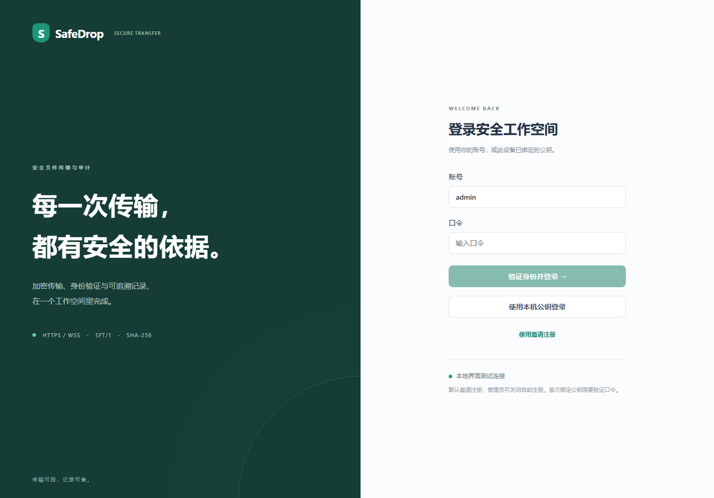

课件第 34 页允许自行设计认证。SafeDrop 在认证后的 WSS 连接上授权业务操作，邀请令牌用于注册。历史 Edge 操作验证了公钥登记与撤销、独立标签页会话撤销；管理员因子启用、恢复会话和验证码重放由专项测试覆盖。

## 4 文件夹、文件操作与配额

用户在根目录点击「新建文件夹」，输入名称并创建。对已有文件点击「移动到」，选中目标目录后确认。进入目录可查看、搜索和多选其中的文件，也可把文件移回根目录。

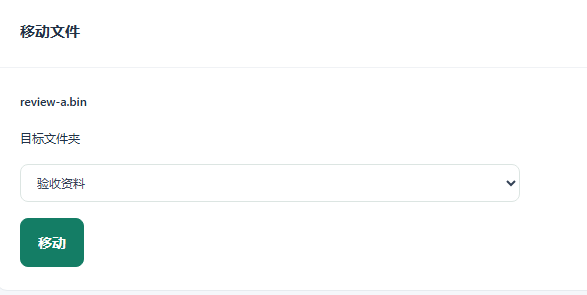

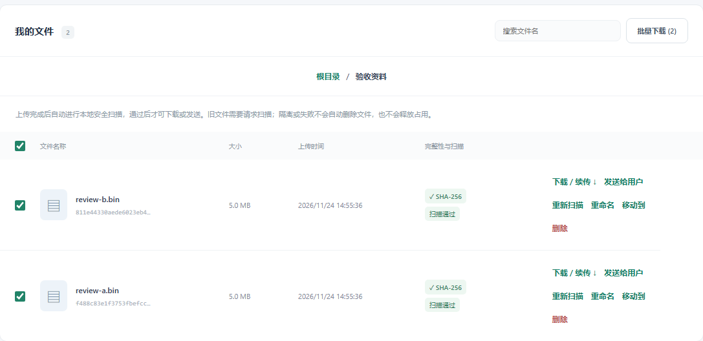

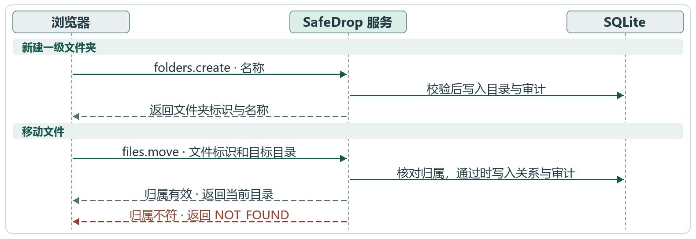

| 场景 | 服务器处理 |
| --- | --- |
| 目录归属 | 每账号最多 32 个一级文件夹，账号内名称唯一。SQLite 8 单独保存目录与归属，旧文件默认归根目录。移动时同时核对文件和目标目录的所有权，保留原对象、扫描、续传与交付关联。 |
| 文件维护 | 重命名只改显示名。删除前要求输入完整文件名确认，先阻止新读取并结束在途读取。删除失败显示「删除待重试」，保留文件记录和空间占用。 |
| 配额与预留 | 工作台展示已用、预留和可用。默认每账号 1 GiB、单文件 512 MiB。初始化上传先预留完整声明大小，完成后把预留转入已用。取消或过期清理确认后释放预留。 |

三张目录截图来自独立 Edge 回环界面复验。样本经真实 ClamAV 扫描，验证了两份文件移入、目录内多选及移回根目录。旧库迁移、文件或目标目录越权、交付关系保留由 TLS/WSS 专项测试确认。

## 5 批量传输、断点续传与回执

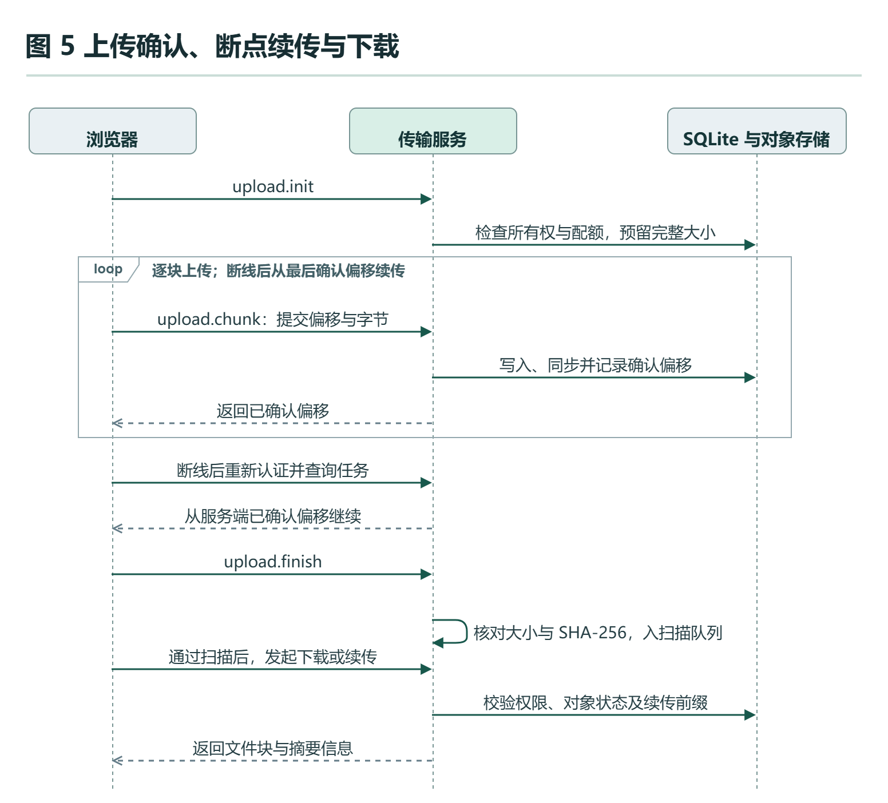

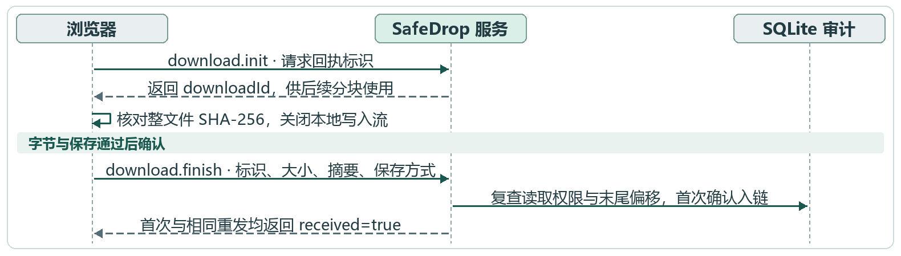

| 阶段 | 传输正确性 |
| --- | --- |
| 上传准备和写块 | `upload.init` 声明名称、全长和 SHA-256。每次 `upload.chunk` 同步落盘并更新 SQLite 偏移后才确认。已确认范围内的相同重发可幂等处理。 |
| 上传完成 | `upload.finish` 比对大小和整文件 SHA-256，发布对象并登记扫描。确认丢失时，可用原任务标识查询结果。 |
| 下载和恢复 | `download.init` 核对授权和本地文件前缀。每块检查偏移、长度、结束标志，最后比对整文件 SHA-256。原生保存每推进约 4 MiB 提交一个检查点，暂停时提交当前进度。 |
| 下载确认 | 原生写入流关闭后发送 `download.finish`，服务器复查权限、进度和摘要，同一标识的相同回执只记一次。普通浏览器记为已交给浏览器下载。 |

桌面 Edge / Chrome 可批量选文件上传，也可勾选扫描通过的自有文件后批量下载。下载时只需选择一次原生目录，每个文件单独排队、校验和保存，同名目标自动加编号。上传和下载共用单页三个活动任务。普通浏览器下载路径支持 32 MiB 以内文件。

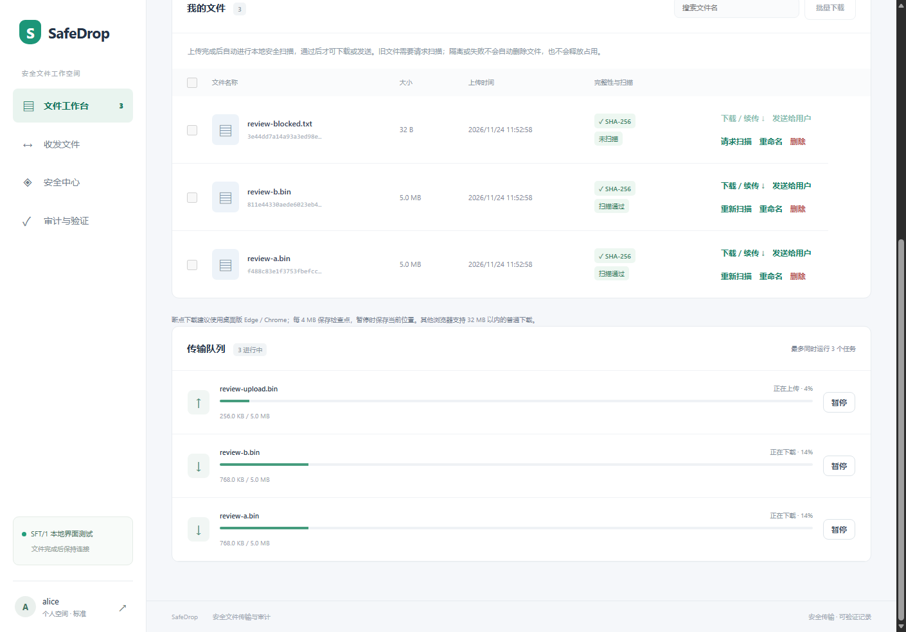

历史原生浏览器实测用 64 MiB 样本验证刷新续传。上传 34 MiB 时暂停，登录并重选源文件后推进到 34.75 MiB；下载到 52.75 MiB 时暂停，登录并重新授权目标文件后从 52.75 MiB 恢复。文件最终摘要一致。回执让审计能区分下载开始与客户端报告完成；服务端记录的是客户端报告。

## 6 用户档位与带宽实测

| 身份或状态 | 传输权限 | 默认带宽 |
| --- | --- | ---: |
| 未登录 | 上传初始化、下载初始化及分块请求返回 `AUTH_REQUIRED` | 不可传输 |
| 普通账号 `alice` | 自有文件，以及有效授权可读的文件 | 1 MiB/s |
| VIP 账号 `bob` | 文件权限与普通账号相同 | 4 MiB/s |

管理员是管理角色，普通和 VIP 是速度档位。服务器按账号为每块预留发送或接收时段，预算推进量为「块大小 ÷ 档位速率」。同一账号的上传、下载、标签页和连接共享预算；接收文件按接收账号计费。

### 6.1 本轮同负载对比

在新建 Docker Compose 项目中，以当前发布镜像和严格 WSS 连接测试。先由两个临时账号分别上传相同的 16 MiB 样本，经真实 ClamAV 扫描通过。普通和 VIP 的单下载同时启动；随后让普通账号的两个独立连接并发下载。每连接先接收的 1 MiB 用于预热，速率以剩余确认字节数除以实测秒数。完整下载均独立比对 SHA-256。

| 场景 | 采样有效字节 | 采样耗时 | 平均速率 |
| --- | ---: | ---: | ---: |
| 普通档，单下载 | 15 MiB | 14.997 s | 1.000 MiB/s |
| VIP 档，单下载 | 15 MiB | 3.745 s | 4.005 MiB/s |
| 普通档，两个连接并发下载 | 合计 30 MiB | 29.998 s | 合计 1.000 MiB/s |

未登录的三类传输请求实测均被拒绝，VIP 按文件标识读取普通账号对象也被拒绝。普通档使用两个连接时，合计速率保持在同一个账号预算内。测速使用宿主机测试网络，用于核对档位与聚合限制。

本轮 16 MiB 样本 SHA-256 为 `6113788516b712c1249737a7a99fa41ecb670bdfcbe691edd8967bbcdffc778d`。

### 6.2 历史 Edge 浏览器对比

历史 B08 以确认进度采样。普通档单上传在 20.762 s 增加 20.75 MiB，约 0.999 MiB/s。同账号两上传和一下载在 28.471 s 合计增加 28.5 MiB，约 1.001 MiB/s。VIP 上传相同的 64 MiB 文件，按秒级完成记录估算约 3.86–4.14 MiB/s。

## 7 扫描、隔离与指定接收人交付

上传发布后由独立 ClamD 检查文件流，同时核对送检字节的大小和 SHA-256。签名库默认有效期 72 小时，扫描通过记录默认有效期 168 小时。未扫描、超时、引擎不可用、检测范围不完整或签名过期时，下载和交付受阻。检出威胁后进入隔离状态，原对象与配额占用保留。补扫通过后才恢复读取资格。

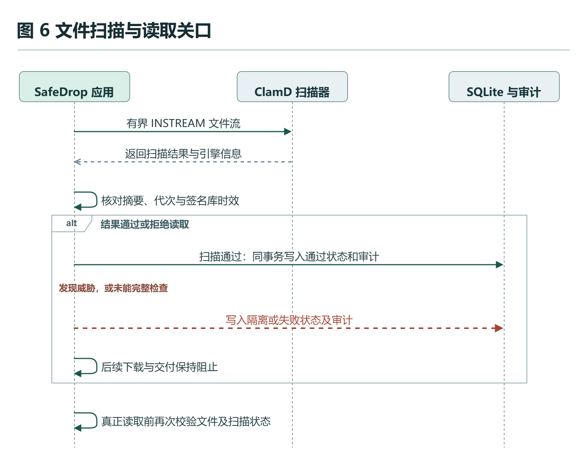

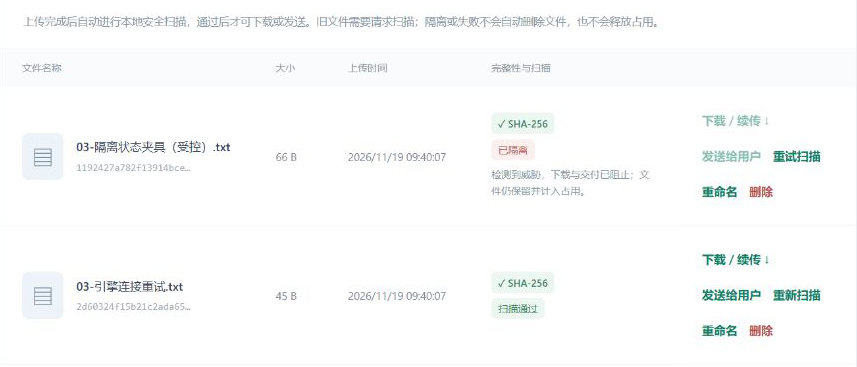

文件所有者输入接收账号，经核对、明确确认后发放只读授权。默认有效期 168 小时，可设置为 1–720 小时。接收人取得原对象的读取权，内容由所有者保存一份，接收人无法在收件入口改名、删除或转授权。撤销或到期触发在途读取取消，服务器在带宽等待结束、读取后和发出字节前继续检查授权。此前已保存的副本仍由接收人控制。

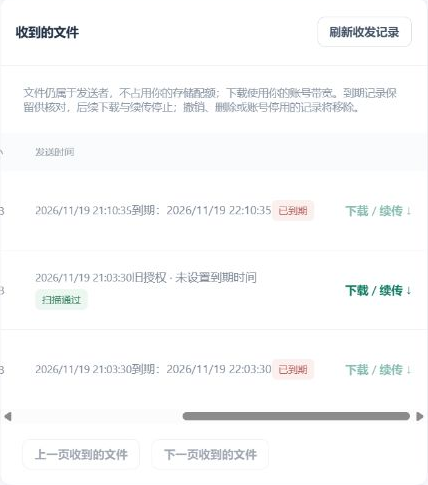

浏览器操作已验证接收文件真实落盘、撤销后列表更新及重发不复用旧授权。界面到期截图来自夹具时钟；实际到期、等待中止及重新启动后的终态另由协议测试和 Linux 探针验证。

## 8 审计、维护、备份与恢复

安全中心按当前角色和事件参与者过滤。可对时间范围缩放、平移、翻页和查看详情。第一页固定审计序号边界，后续页沿用同一快照。上传、下载开始、下载回执、扫描、交付与权限拒绝均有对应事件。

管理员可校验、导出审计链及独立检查点。每项摘要为「上一项摘要与本项原始事件拼接后的 SHA-256」。核对独立保存的检查点可发现相应历史前缀遭替换，检查点由部署者另行保管。

### 8.1 资源维护与加密恢复

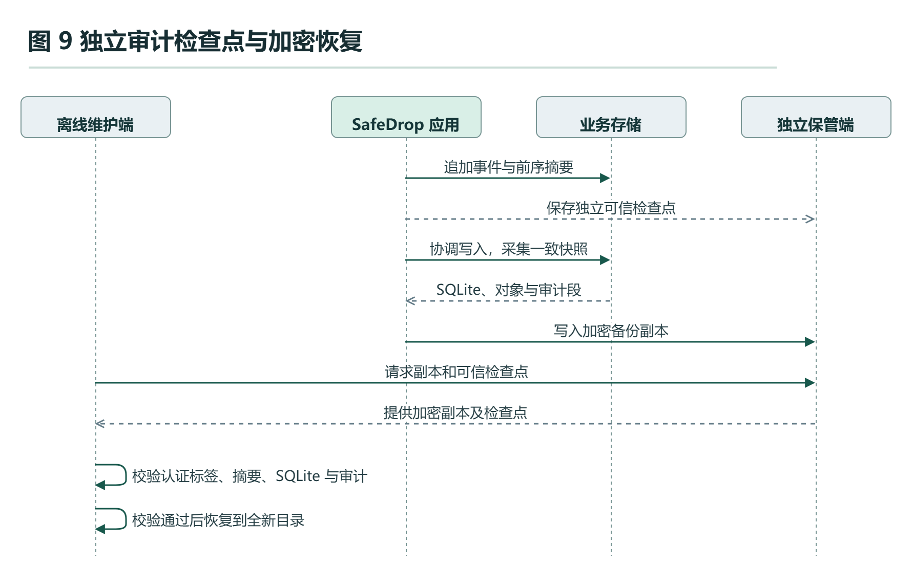

维护页检查磁盘余量、全局空间、审计容量及待清理的过期上传。空间不足时拒绝增加占用，过期清理先预览再确认。创建一致备份时等待在途写入和扫描完成，再保存 SQLite、业务对象和审计快照。

新备份用独立密钥经 HKDF-SHA-256 派生每副本密钥，使用 AES-256-GCM 保护副本。密钥轮换后保留旧钥以供旧备份解密。恢复工具校验认证标签、条目摘要、SQLite 与审计检查点，再恢复到新目录。Windows 和容器各有独立恢复证据。

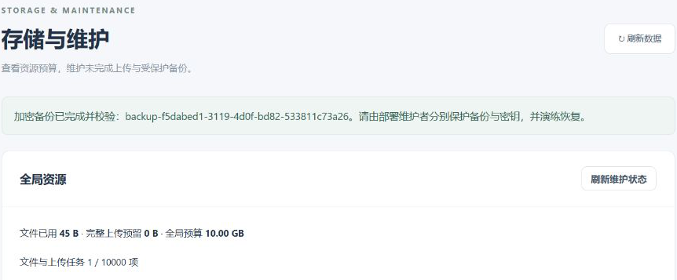

## 9 设计思路与问题定位

### 9.1 从中断场景开始

文件传到一半时，如果用户刷新页面，网络连接和页面内存都会重新建立，而服务端和本地磁盘可能各留下一部分字节。设计时先确定两类信息的寿命。浏览器用 WSS 承载课件要求的长连接，当前连接负责身份认证和消息往返。传输任务则用独立标识和持久化进度，重新登录后仍能按文件任务恢复。课件第 36–37 页的保活要求用连接标识验证，第 44 页的完成确认用单独的回执表示。

### 9.2 对照同类项目

- **File Browser** 把目录浏览和上传、删除等操作放在同一个网页入口。课件第 35 页用它展示文件管理界面。SafeDrop 也把操作放在文件工作台。为了让目录调整和文件传输各自独立，移动只更新目录归属，原文件标识仍用于下载和交付。[File Browser 项目](https://github.com/filebrowser/filebrowser)
- **tus** 通过 HTTP 查询服务器保存的上传偏移，请求携带的偏移不匹配时返回冲突。这个对照说明续传需要一个双方都可核对的进度。SFT/1 在长连接上用任务标识和服务端确认位置恢复，确认前提交磁盘写入与进度记录。[tus 协议](https://tus.io/protocols/resumable-upload#core-protocol)
- **OpenSSH SFTP** 可用 `reget`、`reput` 继续传输，续传依赖现有的部分副本与源文件一致。SafeDrop 下载恢复时校验本地前缀，最后再校验整文件 SHA-256。这样即使两个本地文件恰好同长，也能识别选错的前缀。[OpenSSH sftp 手册](https://man.openbsd.org/sftp)

### 9.3 如何从失败找到原因

**队列重复。** 早期 Edge 测试中，同一文件暂停后继续，会出现一个新任务和一个旧暂停条目。排查时把磁盘检查点和界面任务分开核对，定位到保存授权流程重复创建队列条目。修复后复用原任务，等待授权期间限制重复点击。从 56.75 MiB 暂停后继续的复验中，队列始终只有一个条目，最后完成下载。

**镜像摘要不一致。** 离线归档曾在导入前失败。用 Python 和 Windows tar 读取同一配置 blob，两次散列相同。随后核对 OCI 引用结构，发现原脚本把配置对象的 SHA-256 与本机镜像存储返回的 OCI 索引摘要相比。修复后沿索引和平台清单校验配置及层，导入后再查本机镜像身份，并用独立 Compose 容器完成传输验证。

两次排查都先确定要保持的状态，再分别观察对应层。续传检查字节位置、队列条目和最终摘要。分发检查归档内容、导入结果和容器实际运行的镜像。

## 10 实验结果与证据范围

| 场景 | 结果与证据范围 |
| --- | --- |
| 本轮 Windows 自动检查 | 构建通过。默认测试 61 通过、3 跳过。专项 186/186，含文件夹迁移、回执提前提交与摘要错误拒绝、重发和交付授权检查。 |
| Docker 双账号并发与长连接 | 文件夹基线中，两条独立 WSS 连接的上传、下载分块分别出现重叠。两份文件经真实扫描，下载逐字节一致。停止应用请求约 75 秒，两条连接各收到 4 次 WebSocket Ping，连接标识保持不变，已认证的文件列表仍可访问。 |
| 文件夹界面与回执 | 独立 Edge 回环实例使用真实 ClamAV 1.5.5 / 28192。两下载和一上传同时推进，一条下载在 512 KiB 暂停后恢复。两个下载与源文件 SHA-256 一致，产生两条保存回执。目录选择使用浏览器隔离存储适配器。 |
| Edge 原生目录与批量下载 | Edge 信任独立 Compose 实例的 CA，通过 HTTPS/WSS 登录。勾选两份扫描通过的文件，一次选择本地目录并允许保存。两份下载均已落盘，大小和 SHA-256 与原件一致。 |
| 历史 Linux 验收 | `28a3f4f` 的 CI 四个作业通过，安全场景 183/183。实际复验扫描、期限、MFA 和恢复。镜像扫描结果对应当时的镜像。见 [GitHub Actions 45008996789](https://github.com/logic-xx/safedrop/actions/runs/45008996789)。 |
| 回执版 Compose | 归档导入与公开 GHCR 匿名拉取均核对三张镜像身份。各用新卷与临时账号免构建启动。联网通过扫描、移动、下载落盘与 SHA-256 复核。提前回执被拒绝，相同回执发送两次只记一次。 |

| Compose 验收条件 | 实测结果 |
| --- | --- |
| 扫描器断网，过期种子 `28185` | 严格 HTTPS/WSS 可以登录和上传 262,181 字节，扫描返回 `SCAN_DATABASE_STALE`，下载和交付均被拒绝。 |
| 扫描器联网，同一镜像和新卷 | FreshClam 更新至 `28192`。扫描通过的样本移入文件夹，262,181 字节下载一致，完成回执后移回根目录。 |

联网样本 SHA-256 为 `fa9f6d4d0eb819b1c1a8dafbfce72e75ea736982972a472ad902cc88a497bdf7`。

| 并发测试下载件 | 字节数 | SHA-256 |
| --- | ---: | --- |
| `review-a (2).bin` | 5,243,003 | `f488c83e1f3753fbefcc95cc84090597ba8b37bbdaf0eeaaf33a114e6a420621` |
| `review-b.bin` | 5,243,201 | `811e44330aede6023eb49d4e204feefcb680d223e122f7b0dce87be6af4668c1` |

文件夹版回环测试用 Edge 隔离存储适配器验证同名保护。另一次 Edge 原生目录测试使用批量下载基线的严格 HTTPS/WSS 入口，实际保存结果如下。

| 原生目录下载件 | 字节数 | SHA-256（原件与下载件相同） |
| --- | ---: | --- |
| `native-batch-wak85sri-a.bin` | 6,508,380 | `04b5fcbb9eda32b7f5486f825b839de8913a418de4b91d92f322c89a94adc542` |
| `native-batch-wak85sri-b.bin` | 6,508,380 | `f72f4cd29b4b23caaed1169a796ce9c0c8fde47ad03d18934db98640d8192666` |

课件第 40 页的加分项对应本报告第 3 节公钥登录、第 5 节断点续传与 GUI 并发及第 6 节账号限速。资源防护的验证范围是单应用进程和本机容器网络；公网链路饱和与多节点吞吐未纳入本实验。

## 11 获取源码与复现实验

### 11.1 从 GitHub 获取源码

仓库已公开。可在仓库首页点 **Code → Download ZIP** 获取当前 `main` 快照，解压后进入含 `package.json` 的目录；也可直接使用课程 ZIP 里的源码文件夹。需要查看完整提交记录时执行以下命令。

~~~powershell
git clone https://github.com/logic-xx/safedrop.git
Set-Location -LiteralPath safedrop
~~~

`dec2257` 是通过 GHCR 路径复验的部署配置提交，包含 `deploy/offline/ghcr.env`。需要固定到该配置时，可在克隆后执行 `git checkout dec2257`，或下载该提交的源码 ZIP。课程 ZIP 另含原演示视频和本报告。[固定提交源码 ZIP](https://github.com/logic-xx/safedrop/archive/dec2257d2725772745a59c286749fe4049d90c2f.zip)

### 11.2 Windows 从源码构建并运行

在 Windows PowerShell 进入源码根目录。安装 Node.js 24.x（项目最低 24.14）、npm、OpenSSL，并使用桌面 Edge 或 Chrome。应用以当前 Windows 用户的文件权限运行。若 OpenSSL 不在 PATH，把 `OPENSSL_PATH` 设为其可执行文件全路径。

~~~powershell
npm.cmd ci
npm.cmd run build
npm.cmd run setup
npm.cmd start
~~~

安装本次生成的 `.local/tls/ca.crt` 到 Windows 当前用户的受信任根证书存储，重启浏览器后访问 `https://localhost:8443`。用 `Get-Content -Raw -LiteralPath .local/accounts.json` 私下查看随机口令。录像中依赖由 npm 本地缓存提供，构建仍实际执行。完整传输需接入有效的 ClamAV 签名库。

若选 Windows 独立扫描器，使用官方 ClamAV 1.5.5 x64。复制样例配置并移除 `Example` 行，让 FreshClam 和 ClamD 共用可读写的 `DatabaseDirectory`。FreshClam 设 `DatabaseMirror database.clamav.net`。ClamD 设 `Foreground yes`、`TCPAddr 127.0.0.1`、`TCPSocket 3310` 和 `StreamMaxLength 512M`。先运行 `freshclam.exe --config-file=freshclam.conf`，再设置 `TZ=UTC` 并运行 `clamd.exe --config-file=clamd.conf`。应用终端设置 `CLAMD_HOST=127.0.0.1`、`CLAMD_PORT=3310` 后重启应用。

自动验证使用 `npm.cmd test` 和 `npm.cmd run security:report`，分别记录实际通过和环境相关的跳过项。

### 11.3 从公开 GHCR 拉取镜像并免构建启动

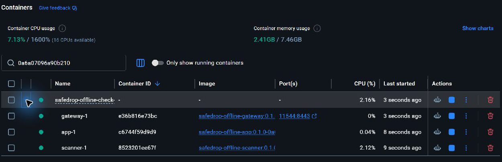

使用 Docker Desktop 的 Linux x64 引擎。在课程源码根目录运行下列命令。`ghcr.env` 固定三张公开镜像的摘要，可匿名拉取。

~~~powershell
# 8443 端口已占用时，取消下一行的注释。
# $env:SAFEDROP_OFFLINE_PORT = '18446'
$options = @('--env-file', 'deploy/offline/ghcr.env',
    '-f', 'deploy/offline/compose.yaml', '-p', 'safedrop-ghcr-review')
docker compose @options pull --policy always
if ($LASTEXITCODE -ne 0) { throw 'GHCR 镜像拉取失败' }
docker compose @options up -d --no-build --pull never --wait --wait-timeout 600
if ($LASTEXITCODE -ne 0) { throw 'SafeDrop 启动失败' }
$reviewDir = '.local/ghcr-review'
New-Item -ItemType Directory -Force $reviewDir | Out-Null
$gatewayCa = 'gateway:/data/caddy/pki/authorities/local/root.crt'
docker compose @options cp $gatewayCa "$reviewDir/ca.crt"
docker compose @options cp app:/data/accounts.json "$reviewDir/accounts.json"
~~~

扫描器可用内存需要约 4 GiB。信任本次网关的公开 CA 后访问 `https://localhost:8443`，启用备选端口时访问 `https://localhost:18446`。首次启动生成随机账号，`alice` 和 `bob` 可测试传输，`admin` 可查看维护和审计。FreshClam 启动时从官方服务更新签名。完全断网时，需要预先把仍有效的官方签名装入本次专用签名卷。

已有镜像包时，可校验归档 SHA-256，在解压目录运行 `docker load --input .\images.tar`，再运行 `docker compose -p safedrop-offline-prepared up -d --no-build --pull never --wait`。

### 11.4 建议验收步骤

1. 登录并上传两个无害文件，等文件列表显示「扫描通过」。
2. 新建文件夹，把两份文件移入。再从根目录开始上传一个稍大的文件，进入文件夹多选前两份，点击「批量下载」并选择空目录。观察三个任务推进。
3. 下载完成后，用 `Get-FileHash -Algorithm SHA256 -LiteralPath <路径>` 对照两份源文件与保存件。打开安全中心，查看「客户端确认已保存」事件。
4. 用普通账号和 VIP 账号分别下载同大小的大文件，按第 6 节的确认字节和计时口径比较速率。用普通账号开两个会话，检查两者的合计速率。
