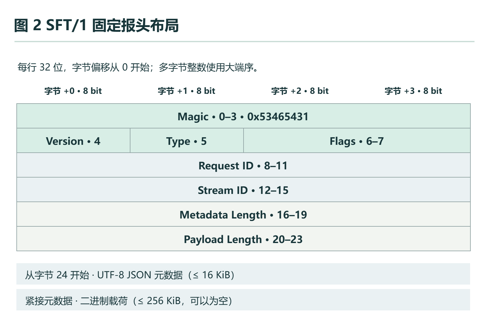
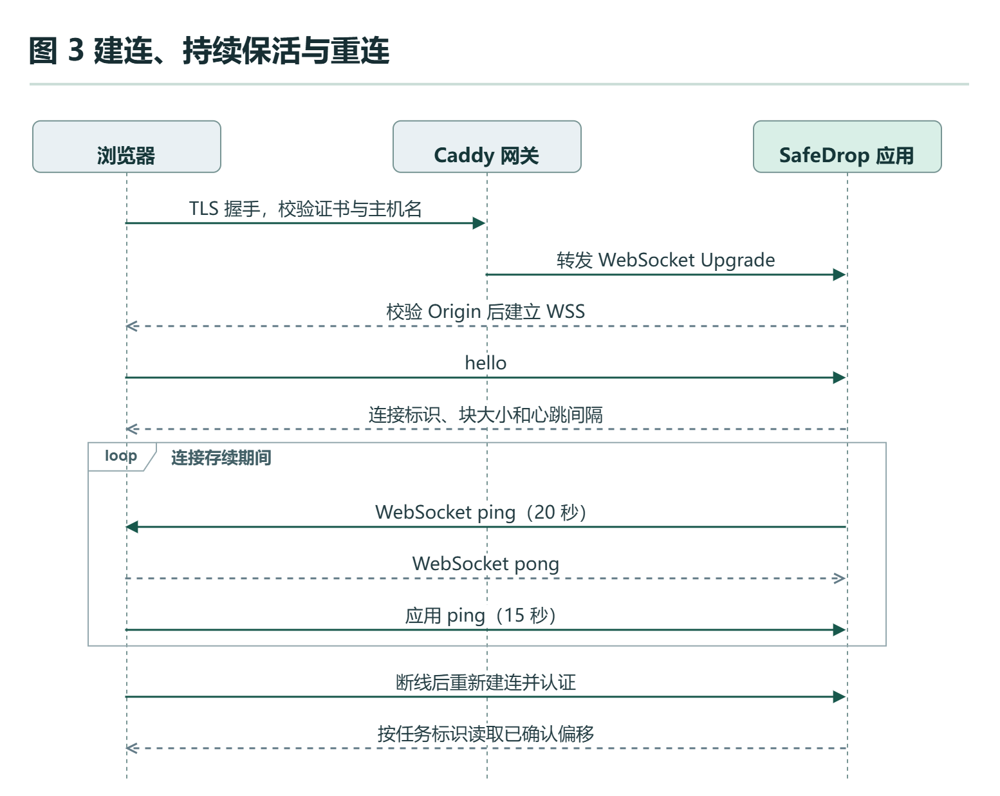
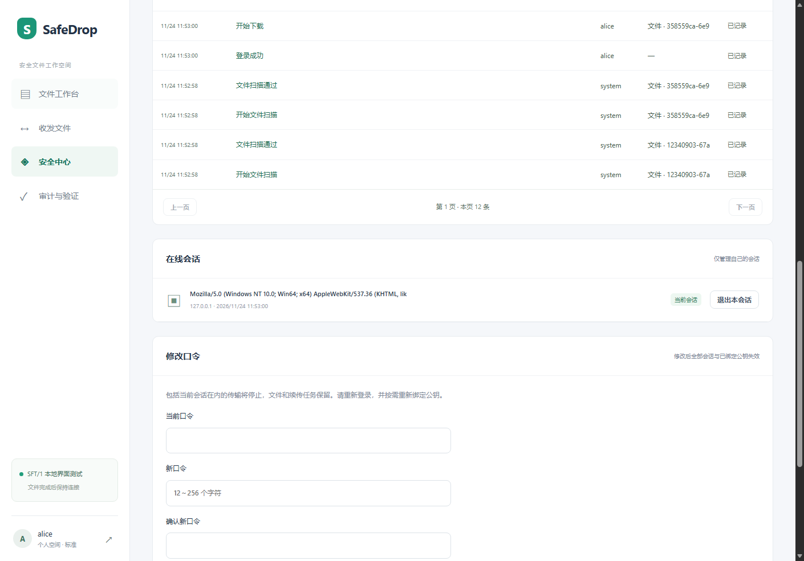
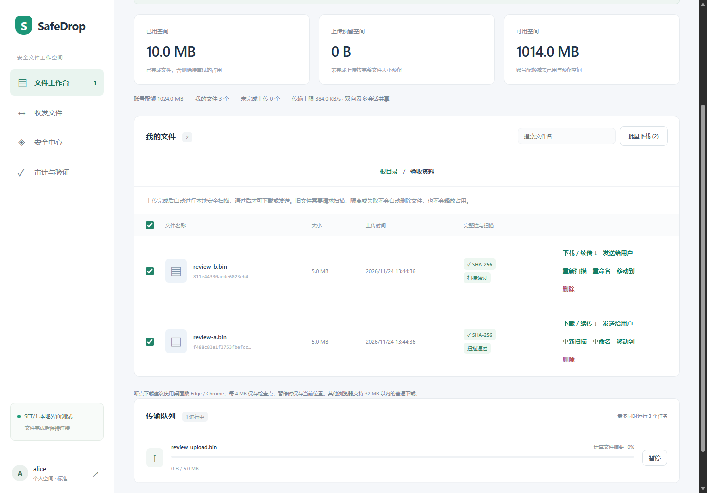
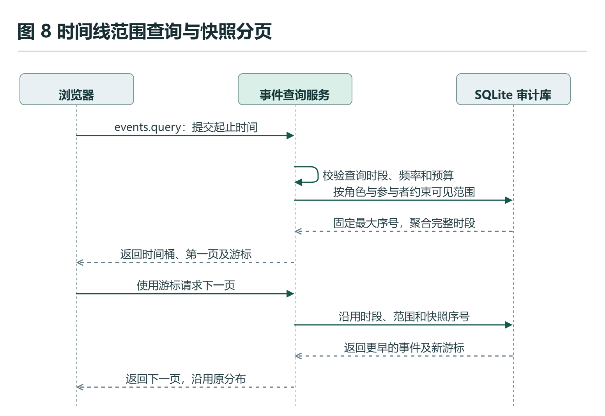
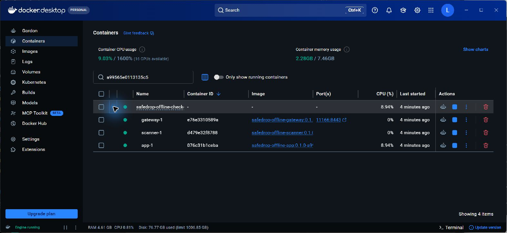

# SafeDrop 安全文件传输实验报告

《软件与系统安全》实验 1B · SafeDrop 0.1.0 · 应用协议 SFT/1

| 项目 | 内容 |
| --- | --- |
| 日期 | 2026 年 11 月 24 日 |
| 本轮功能提交 | 文件夹 `0fa5a33`，批量下载基线 `d67255f` |
| 历史容器与安全测试基线 | `28a3f4f` |
| 源码与 Git 历史 | [logic-xx/safedrop](https://github.com/logic-xx/safedrop) |

SafeDrop 通过同一条经过认证的 WSS 长连接完成个人文件夹管理、上传和下载。服务器保存已确认的传输偏移，客户端和服务器分别校验文件内容。应用还实现了设备公钥登录、文件扫描、指定接收方交付、账号级限速和可校验审计。

## 1 架构与访问边界

浏览器验证 Caddy 的 TLS 证书后，通过 WSS 与 Node.js 应用通信。SQLite 保存归属、上传偏移、扫描结果、授权和审计。文件对象按服务端随机标识存放，用户提交的文件名仅用于展示。ClamD 通过隔离网络接收待检文件字节。

| 组件 | 实际权限与网络配置 |
| --- | --- |
| Caddy 网关 | 本地部署只在宿主机回环发布 HTTPS。独立数据卷保存本次实例的证书和 CA。 |
| 业务进程 | UID/GID `10001:10001`，`read_only: true`，`cap_drop: [ALL]`，`no-new-privileges`。业务卷挂载到 `/data`，对象和暂存目录由应用管理。 |
| 扫描器 | UID/GID `65532:65532`，只读根文件系统，专用签名卷挂载到 `/data`。ClamD 只在内部网络提供服务，FreshClam 通过独立网络连接官方更新服务。 |

业务读取同时检查会话和文件归属或精确交付授权。管理员按角色管理账号及系统维护。Windows 直跑使用启动用户的文件权限；容器隔离由 Compose 配置实现。

## 2 SFT/1 报文与长连接

WebSocket 每条二进制消息承载一个 SFT/1 报文。固定头为 24 字节，多字节整数为大端序，随后是 UTF-8 JSON 元数据与原始文件字节。解码首先核对版本、类型、标志和长度，再解析元数据。请求编号用于匹配响应，传输标识用于跨会话定位持久任务。

| 偏移 | 字段 | 含义 |
| --- | --- | --- |
| 0–3 | Magic | 固定为 `0x53465431`（SFT1） |
| 4–7 | Version、Type、Flags | 版本 1，区分请求和响应，标志位为 0 |
| 8–15 | Request ID、Stream ID | 响应回显请求编号，Stream ID 当前保留 |
| 16–23 | Metadata Length、Payload Length | 分别最多 16 KiB 和 256 KiB，实际总长须等于 24 加两字段的值 |

服务端显式调用 `setKeepAlive(true, 30000)`，每 20 秒执行 WebSocket Ping/Pong 检查。浏览器在线时每 15 秒发送一条 SFT/1 `ping`。传输完成后连接继续服务后续请求，自动测试观察到事务前后的连接标识一致。断线后页面连接管理器退避重连，用户重新认证再恢复任务。页面关闭会结束浏览器连接管理。

**设计取舍**　文件下载后通常还要查列表或发起下一次操作。协议用显式长度和完成响应判断传输结束，让同一连接继续服务后续操作，也让掉线后的任务位置能独立查询。

## 3 身份认证与文件管理

口令经 scrypt 校验。设备可登记 P-256 公钥，浏览器私钥以不可导出的形式保存，登录时签署绑定本次连接的一次性短时挑战。服务器将认证结果绑定当前 WSS 会话，校验有效期和撤销状态。邀请令牌用于限时注册。管理员可启用 TOTP，恢复码只能进入受限恢复会话。

工作台按账号分页。用户从根目录上传，可新建一级文件夹、进入文件夹并移动已有文件。SQLite 8 新增两张目录表，旧文件默认归根目录。移动只改归属，文件标识、扫描、配额和交付沿用原记录。

## 4 批量传输、断点续传与校验

| 阶段 | 传输正确性 |
| --- | --- |
| 上传准备和写块 | `upload.init` 声明名称、全长和 SHA-256。每次 `upload.chunk` 同步落盘并更新 SQLite 偏移后才确认。字节相同且完全位于已确认区间的重发可幂等处理。 |
| 上传完成 | `upload.finish` 复核大小和整文件 SHA-256，再发布对象并登记扫描。确认丢失时，使用原任务标识可查询已完成结果。 |
| 下载和恢复 | `download.init` 校验读取权限和已保存前缀。客户端逐块检查偏移、长度、结束标志，完成前核对整文件 SHA-256。原生存盘每推进约 4 MiB 写入一个检查点。 |

桌面 Edge / Chrome 可多选已扫描通过的自有文件，再选一次本地目录。每个文件单独进入传输队列，同名保存目标会加编号。单页最多三个活跃任务，同一账号的多个任务和会话共享服务端带宽预算。普通档默认 1 MiB/s，VIP 默认 4 MiB/s。

**设计取舍**　掉线时，浏览器可能漏掉最后一次确认，所以续传以服务端确认位置和本地前缀为依据。按账号统一限速则防止同一用户名下通过增加标签页或任务数放大总速率。

## 5 扫描、交付与审计

上传发布后自动排队扫描。应用检查 ClamD 版本和签名发布时间，核对实际送检的字节摘要。默认签名库有效期为 72 小时，扫描通过结果有效期为 168 小时。签名过期、引擎异常或文件无法完整扫描时，上传者看到「扫描未完成」，服务端拒绝下载和交付。

交付授权绑定文件和指定接收人，可撤销并设置到期。服务端在读取初始化、限速等待结束及发出字节前复查状态。授权可能在排队等待时到期，因此只在下载开始时检查一次会遗漏窗口。

普通用户只看自己有权访问的操作记录。运维保留独立检查点，恢复时用它复核旧审计链的已知前缀。加密备份校验通过后恢复到新目录，避免覆盖当前实例。

## 6 验证结果

| 场景 | 结果与证据范围 |
| --- | --- |
| 本轮 Windows 自动检查 | 构建通过。默认测试 61 通过、3 跳过。专项 185/185，含 SQLite 7 到 8 迁移、跨账号移动拒绝、续传、交付及加密恢复。 |
| 本轮并发与续传 | 隔离 Windows 实例使用真实 ClamAV 1.5.5 / 28192。Edge 中两下载和一上传均推进，一条下载在 1 MiB 暂停后恢复，三项完成，上传扫描通过。两个下载与源文件 SHA-256 一致。目录选择使用浏览器隔离存储测试适配器。 |
| Edge 原生目录与批量下载 | Edge 信任独立 Compose 实例的 CA，通过 HTTPS/WSS 登录。勾选两份扫描通过的文件，一次选择本地目录并允许保存。两份下载均已落盘，大小和 SHA-256 与原件一致。 |
| 历史浏览器验收 | 已观察上传及下载从持久位置恢复、公钥登录和撤销、两上传一下载并发。普通档并发的合计持续样本约 1.001 MiB/s，VIP 单上传约 4 MiB/s。 |
| 历史 Linux 验收 | `28a3f4f` 的 CI 四个作业通过，安全场景 183/183。真实容器复验了扫描、期限、MFA 和恢复。镜像扫描结果对应当时的镜像。 |
| 本轮文件夹版 Compose | Docker Desktop 导入并核对三张镜像的 ID。两套独立项目用新卷和临时账号禁构建、禁拉取启动。联网完成扫描、移入、按摘要下载与移回。断网过期签名拒绝读取。 |

| Compose 验收条件 | 实测结果 |
| --- | --- |
| 扫描器断网，过期种子 `28185` | 严格 HTTPS/WSS 可以登录和上传 262,181 字节，扫描返回 `SCAN_DATABASE_STALE`，下载和交付均被拒绝。 |
| 扫描器联网，同一镜像和新卷 | FreshClam 更新至 `28192`。扫描通过的样本移入文件夹，262,181 字节下载一致，随后移回根目录。 |

联网样本 SHA-256 为 `fa9f6d4d0eb819b1c1a8dafbfce72e75ea736982972a472ad902cc88a497bdf7`。旧打包脚本误将 OCI 索引摘要与配置摘要比较。本轮沿索引、平台清单、配置和层的引用链校验归档，在导入和运行时分别核对镜像身份。原失败记录保留。

| 并发测试下载件 | 字节数 | SHA-256 |
| --- | ---: | --- |
| `review-a (2).bin` | 5,243,003 | `f488c83e1f3753fbefcc95cc84090597ba8b37bbdaf0eeaaf33a114e6a420621` |
| `review-b.bin` | 5,243,201 | `811e44330aede6023eb49d4e204feefcb680d223e122f7b0dce87be6af4668c1` |

新版 Edge 回环测试复验了文件夹内两下载和一上传并发、暂停恢复及同名保护。原生目录测试使用批量下载基线的严格 HTTPS/WSS 入口，落盘结果如下。

| 原生目录下载件 | 字节数 | SHA-256（原件与下载件相同） |
| --- | ---: | --- |
| `native-batch-wak85sri-a.bin` | 6,508,380 | `04b5fcbb9eda32b7f5486f825b839de8913a418de4b91d92f322c89a94adc542` |
| `native-batch-wak85sri-b.bin` | 6,508,380 | `f72f4cd29b4b23caaed1169a796ce9c0c8fde47ad03d18934db98640d8192666` |

资源滥用测试覆盖认证频率、连接、帧、存储和带宽上限，公网链路饱和与长期高负载仍待实测。历史作业见 [GitHub Actions 45008996789](https://github.com/logic-xx/safedrop/actions/runs/45008996789)。

## 7 助教复现步骤

### 7.1 从源码构建并运行

在 Windows PowerShell 进入源码根目录。安装 Node.js 24.x（项目最低 24.14）、npm、OpenSSL，并使用桌面 Edge 或 Chrome。若 OpenSSL 不在 PATH，把 `OPENSSL_PATH` 设为其可执行文件全路径。

~~~powershell
npm.cmd ci
npm.cmd run build
npm.cmd run setup
npm.cmd start
~~~

安装本次生成的 `.local/tls/ca.crt` 到 Windows 当前用户的受信任根证书存储，重启浏览器后访问 `https://localhost:8443`。用 `Get-Content -Raw -LiteralPath .local/accounts.json` 私下查看随机口令。录像中依赖由 npm 本地缓存提供，构建仍实际执行。完整传输需接入有效的 ClamAV 签名库。

若选 Windows 独立扫描器，使用官方 ClamAV 1.5.5 x64。复制样例配置并移除 `Example` 行，让 FreshClam 和 ClamD 共用可读写的 `DatabaseDirectory`。FreshClam 设 `DatabaseMirror database.clamav.net`。ClamD 设 `Foreground yes`、`TCPAddr 127.0.0.1`、`TCPSocket 3310` 和 `StreamMaxLength 512M`。先运行 `freshclam.exe --config-file=freshclam.conf`，再设置 `TZ=UTC` 并运行 `clamd.exe --config-file=clamd.conf`。应用终端设置 `CLAMD_HOST=127.0.0.1`、`CLAMD_PORT=3310` 后重启应用。

### 7.2 预构建镜像免构建启动

使用 Docker Desktop 的 Linux x64 引擎与 Docker Compose。验收目录需有分发的 `compose.yaml` 和 `Caddyfile`。镜像包先按分发清单校验 SHA-256，再导入 `images.tar`。如果采用公开镜像仓库，用发布者提供的三条固定摘要设置对应镜像引用，然后执行 `docker compose pull --policy always`。

~~~powershell
docker load --input .\images.tar
docker compose -p safedrop-review up -d --no-build --pull never --wait --wait-timeout 600
docker compose -p safedrop-review ps
New-Item -ItemType Directory -Force .local | Out-Null
$rootCa = 'gateway:/data/caddy/pki/authorities/local/root.crt'
docker compose -p safedrop-review cp $rootCa .local/ca.crt
docker compose -p safedrop-review cp app:/data/accounts.json .local/accounts.json
~~~

使用新项目名和独立卷。扫描器可用内存需要约 4 GiB。核对并信任本次网关的公开 CA 后访问 `https://localhost:8443`。首次启动生成随机账号，普通用户 `alice`、VIP 用户 `bob` 可用于传输。辅助角色 `admin` 可查看维护和审计。启动时 FreshClam 从官方服务更新签名。完全断网时，需从联网环境取得仍有效的官方签名，并装入本次专用签名卷。

也可在源码根目录使用 `docker compose -p safedrop-review up -d --build --wait --wait-timeout 600` 联网构建并启动。两种部署均使用同一 HTTPS 端口，依次运行。

### 7.3 最短验收操作

1. 登录并上传两个无害文件，等文件列表显示「扫描通过」。
2. 新建文件夹，把两份文件移入。再从根目录开始上传一个稍大的文件，进入文件夹多选前两份，点击「批量下载」并选择空目录。观察三个任务推进。
3. 下载完成后，在 PowerShell 用 `Get-FileHash -Algorithm SHA256 -LiteralPath <路径>` 分别对照两份源文件与保存件。刷新后可用同一应用继续操作。
4. 从源码目录可运行 `npm.cmd test` 和 `npm.cmd run security:report`，把环境相关的跳过项与实际通过项分别记录。

提交材料为课程命名的源码目录、MP4 和本报告 PDF，外层使用未加密 ZIP。源码 Git 历史见首页。
